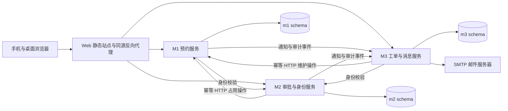

# 校园资源服务平台技术文档

## 1. 文档定位与实施基线

本文是课程项目的待实现技术基线，与[需求文档](需求文档.md)配套。业务规则以需求条目为依据；本文说明三个模块组如何把规则落实为可运行、可集成、可发布和可验证的系统。本文不是实现报告，所有组件、接口、迁移、测试和发布均为实施设计，当前实现与验证状态统一为**待实现／待执行**。

任务书明确要求的内容标为“原文要求”；栈、状态编码、协议、表结构、重试参数、组织分工等未由任务书指定的部分均为“项目补充设计”。每条需求的来源和业务验收标准见需求文档；不得把本文选型写成课程指定选型。所有日期使用服务端时钟，业务时区为 `Asia/Shanghai`；数据库使用可表达时区的时间戳保存绝对时刻，接口使用带时区的 ISO 8601 字符串。

| 基线项 | 采用方案与约束 |
|---|---|
| 前端 | Vue 3、TypeScript，单一 Web 应用；支持手机浏览器，无须另建移动端 |
| 后端 | Java 21、Spring Boot 4，三个独立构建、可单独启动的 HTTP 服务 |
| 数据库 | PostgreSQL 17，同一环境共享一个实例，以 schema 和数据库角色隔离所有权 |
| 工程 | 单仓库、Docker Compose、GitHub Actions，统一发布三个模块及前端 |
| 通知 | 真实 SMTP 邮件为验收推送渠道；站内通知保存投递状态，不代替邮件验收 |
| 版本锁定 | 实施初始化时锁定完整补丁版本、镜像摘要和依赖锁文件；不使用浮动 `latest` 发布 |
| 环境 | 本项目独占开发、测试、生产环境；环境间数据库、凭据、邮件配置和数据分别隔离 |

选型参考官方资料：[Vue TypeScript](https://vuejs.org/guide/typescript/overview)、[Spring Boot 系统要求](https://docs.spring.io/spring-boot/system-requirements.html)、[PostgreSQL 版本政策](https://www.postgresql.org/support/versioning/)。以上资料用于验证技术兼容性与维护窗口，不构成已经搭建系统的证据。

## 2. 系统边界、职责和仓库

| 模块组 | 服务和公共能力 | 所有权与交付责任 |
|---|---|---|
| 第一组 | `reservation-service`：M1、房间/座位、开放时间、统一可用性与追溯 | 对应页面、接口、m1 表、迁移、测试；牵头跨模块验收 |
| 第二组 | `approval-service`：M2、账户、会话、RBAC、权限配置 | 对应页面、接口、m2 表、迁移、测试；协调发布批次与审批 |
| 第三组 | `maintenance-service`：M3、通知、审计 | 对应页面、接口、m3 表、迁移、测试；检查部署、备份、恢复及运行状态 |

公共能力归入三个业务服务，不增加第四个公共服务。M1 是空间与可用性唯一裁决方；M2 是身份和权限唯一事实源；M3 是邮件投递与集中审计唯一写入方。公共能力的归属意味着该组承担契约版本、失败恢复和测试责任，不意味着允许其他组直接操作其表。

建议仓库目录为 `apps/web`、`services/reservation`、`services/approval`、`services/maintenance`、`contracts/openapi`、`contracts/events`、`db/m1`、`db/m2`、`db/m3`、`infra`、`tests/integration`、`docs/decisions` 和根目录 `AGENTS.md`。前端按模块目录划分维护范围，共享导航和组件经评审修改；公共枚举和 DTO 以契约生成或核验，禁止三组私自复制后分别修改。

ADR-001 记录三个候选方案：单体便于事务但不能清楚展示模块间网络协作；独立公共服务增加部署与协调负担；采用三个业务服务并按子域分摊公共能力，既保留网络集成，又控制课程规模。ADR-002 记录共享实例隔离 schema 与独立数据库的取舍。ADR-003 记录持久化 HTTP 重试与消息中间件的取舍，选前者满足有限链路。上述是拟采用的书面决策，不声称已获得全组一致；首次 Review 前由实际成员评审、记录异议与会签，姓名和会议日期由实际参与者填写。

## 3. 身份、权限与安全边界

采用本地校园账户种子数据和密码登录。密码仅保存成熟密码哈希组件生成的散列；测试账户和生产初始账户分离。登录返回服务端会话，浏览器通过 `Secure`、`HttpOnly`、`SameSite=Lax` 的同源 Cookie 访问，写请求必须附 CSRF token；登录错误不区分“用户不存在”和“密码错误”，失败按账户与来源限速。初始管理员首次登录修改密码。

初始管理员种子设置 `mustChangePassword=true`，初始密码由受控环境配置注入，种子重跑不得覆盖已修改散列或重置该标记。登录返回该标记并建立受限会话：只允许读取本人 `/auth/me`、退出及提交本人改密，其他业务和管理请求一律 `403 PASSWORD_CHANGE_REQUIRED`。M2自身路由执行该门禁；M1/M3每次内省读取该标记，同样在业务逻辑前拒绝，不能仅前端跳转。内省对受限账户返回空权限并显式标记，内部带用户会话的范围查询亦拒绝。

本人改密提交 `currentPassword/newPassword/expectedVersion`，验证当前会话、CSRF、当前密码和账户版本；新密码12–128个Unicode字符、不可等于旧密码，哈希组件必须支持完整UTF-8输入而不静默截断。事务更新散列、清除mustChangePassword、递增accountVersion、撤销该账户全部会话并写不含密码的审计事件，成功后清除Cookie、要求用新密码重新登录。普通已登录用户亦可用此接口改密。密码和请求正文不落日志、审计或幂等结果；如需正文一致性比较，仅保存受服务密钥保护的摘要。成功响应丢失后旧会话返回401，用户以新密码重新登录核实，不提供绕过已撤销会话的重放入口；失败校验不改密码或会话。

M1、M3 每次受保护请求均调用 M2 会话内省接口，取得 `userId/deptId/permissions/scopes/accountVersion/mustChangePassword`；本基线不缓存正向授权，避免权限撤销后继续生效。M2 不可达时，受保护业务返回 `503 AUTH_UNAVAILABLE`，前端提示重试。房间公开信息也须登录查看，任何跨院系授权都由服务端判定，不能仅靠页面隐藏。

权限使用“动作 + 资源范围”：如 `reservation:create`、`room:manage`、`approval:level1`、`approval:level2`、`workorder:assign`、`workorder:repair`、`workorder:accept`、`audit:read`。范围为全校或明确房间/院系集合；校级房间对全校学生开放，院系房间按申请者当前院系限制。新增角色只能组合已有动作与范围，不允许通过配置发明未实现的业务动作。系统管理员不自动拥有审批、维修、验收权限。

M2 两级审批人员须不同且不得为申请人；二级审批检查一级记录和当前角色。M3 维修人员只能处理被派给自己的工单；验收人必须具有该房间管理范围且不是实际维修人。历史事件保留当时身份与范围快照，后续权限变更不改写历史。

内部接口通过 Compose 私有网络访问，使用按调用服务独立配置的服务凭据和接收端允许清单；公网反向代理不暴露 `/internal/`。服务调用只能代表其拥有的来源类型，M2 不能创建 M3 限制。后台定时任务使用明确的系统执行者身份；内部记录同时保留 `actorUserId` 和 `callerService`，禁止把任意客户端传来的用户ID视为已认证身份。跨主机部署时内部流量也必须使用 TLS。

对房间元数据、座位报修元数据、维修候选和资格这四类**同步、带用户范围的只读调用**，调用服务除独立服务凭据外，必须在 `X-Actor-Session` 请求头转发本次用户请求的原会话令牌；`actorUserId`取自已验证会话，不从浏览器正文直接采信。M1接收端调用M2 `/internal/auth/introspect`，以头中令牌取得院系/权限/范围并校验返回userId等于actorUserId；M2接收维修候选/资格查询时直接验证自己拥有的会话，再核验派单人和目标维修人。缺失/失效会话返回401，身份不符、首登受限或范围不足403，内省依赖失败503。公网入口移除客户端自带的该内部头，由调用服务从真实会话重新构造；令牌不得放入URL、日志、operation/outbox或数据库。后台已受理操作的重试、截止裁决、通知等仍采用服务凭据及持久化授权操作记录，不依赖或保存用户会话。只保存userId、事实版本和授权结果摘要供审计。

后台通知的院系范围解析另走最小事实接口：仅M2持独立服务凭据、以 `purpose=NOTIFICATION_ROUTING` 和已登记通知eventType/eventId调用M1 `/internal/rooms/{id}/scope-facts`，仅返回roomId、schoolWide、deptId（校级为空）、enabled、roomVersion、asOf。M1直接以服务身份和用途白名单鉴权，不要求X-Actor-Session，也不嵌套用户内省；未注册用途/非M2调用403，无效服务凭据401，未知房间404，读取故障503。已停用/注销但保留历史的房间仍返回范围事实及enabled=false，供取消/升级通知路由，不因停用丢掉责任范围。该接口无个人资料，不对公网暴露；正常用户访问及派单资格判断仍走上段用户范围校验，不能用后台接口绕过。记录服务、用途、eventId和事实版本供追溯。

## 4. 数据所有权与一致性约束

### 4.1 核心实体

所有业务主键为 UUID；状态使用明确枚举；可变聚合含 `version`，时间含 `created_at/updated_at`；业务记录逻辑注销，不能删除历史被引用的房间、座位、用户或审批轨迹。跨 schema 保存外部ID但不建立跨所有者写操作或级联删除；展示用快照不得反向成为另一服务事实源。

| schema | 表或聚合 | 关键字段与约束 |
|---|---|---|
| m1 | `room` | code唯一、名称、位置、归属院系/全校、enabled、version |
| m1 | `seat` | roomId、全局唯一编号、插座类型NONE/FIXED/RAIL、enabled |
| m1 | `opening_rule` | roomId、日期或星期、开始/结束时间；具体日期覆盖周规则 |
| m1 | `reservation` | userId、deptSnapshot、roomId、seatId、start/end、status、cancelReason、version |
| m1 | `resource_claim` | sourceType=M1/M2/M3/ADMIN、sourceId、roomId、seatId可空、start/end可空上界、state、sourceVersion、effectiveAt |
| m1 | `claim_history` | claimId、动作、旧新状态、sourceVersion、operationId、操作者、原因、发生时间 |
| m1 | `room_code` | roomId+localDate唯一；同日编码散列跨房间唯一（冲突重生成）；编码散列、加密编码、有效期、版本；解密值只给授权显示端 |
| m1 | `violation_appeal` | violationId唯一、applicantId、text、status、decisionReason、reviewerId、version；一次申诉、留存原文与处理证据 |
| m1 | `violation` | reservationId唯一、原因、有效/已冲正、纠错理由、操作者、原始发生时间 |
| m1 | `reservation_user_lock` | userId唯一；串行同一用户跨房间的重叠预约校验 |
| m2 | `account/role/permission/role_binding/session` | 账户院系、状态、密码散列、mustChangePassword、accountVersion、角色动作范围、会话过期与撤销 |
| m2 | `room_application` | applicantId、roomId、start/end、用途、人数、联系人、deadline、status、sourceVersion、claimId |
| m2 | `approval_decision` | applicationId、level、decision、actor、reason、time；每级有效决定唯一 |
| m3 | `work_order` | reporterId、roomId、seatId可选、类别、描述、联系方式、assignee、status、processingPhase、repairStartedAt、escalation flags |
| m3 | `work_order_history/acceptance/evaluation` | 状态记录、验收结果/原因、评价分数评论；每工单一条本人评价 |
| m3 | `notification/delivery_attempt` | eventId+recipientId+channel唯一、模板参数、接收地址快照、重试次数、状态 |
| m3 | `audit_event` | eventId唯一、业务来源、对象ID、动作、操作者、时间、traceId、最小必要变更摘要 |
| 各自 | `operation/outbox/inbox` | 操作ID、来源版本、期望动作、请求摘要、状态、结果、重试时间、事件去重ID、roomId或SYSTEM范围标记、责任来源 |
| 各自 | `business_config` | 本服务拥有的参数、值、version、生效时间与变更审计 |

运行角色 `app_m1/app_m2/app_m3` 只授予本 schema 的必需 DML 权限；撤销对公共 schema 的建表权限，不授予其他业务 schema 的读写权。迁移使用独立 `migrate_m1/migrate_m2/migrate_m3` 凭据，只在发布阶段启用。备份恢复账号与应用账号分开。数据库管理员不作为正常应用连接用户。

### 4.2 可用性与锁顺序

可用性是计算结果，不能用一个可被覆盖的 `available=true/false` 表示。判断顺序为房间/座位有效、院系范围、开放时间、管理员限制、维修限制、整室占用、个人占用。区间统一为 `[start,end)`；相邻结束/开始不冲突。M3 限制无结束上界，直到明确释放；M2 为房间整段占用，不逐个复制成座位记录，因此中途增加座位仍受整室限制。

所有影响某房间可用性的写操作先锁定本地 `room` 行，检查并修改台账后同事务提交，包括 M1 创建/签到/取消/超时、M2 创建/撤销占用、M3 加入/释放限制、管理员停用/开放时间/座位变更。个人预约创建先锁 `reservation_user_lock`，再锁房间，校验该用户没有重叠的有效预约；其他操作不反向等待该用户锁。多房间批量管理按 roomId 排序锁定。调用远程HTTP发生在事务之外，不在持有数据库锁时等待其他服务。

房间归属变更只取消失去新院系资格的未结束记录，其他仍满足新规则的预约保留；座位有历史后禁止改编号或迁室，采用旧座位注销、新座位登记。房间类型保存普通教室/图书馆/其他。

本地事务原子写业务行、台账、历史和 outbox。唯一约束兜底防重复；房间锁保护“先查无冲突再插入”的竞争窗口。修改房间归属、开放时间、注销或停用前，管理员必须先预览影响；提交携带 `expectedVersion` 和预览摘要，变更期间出现新预约则 `409 IMPACT_CHANGED` 重新预览。影响未结束的预约按系统取消处理并通知，不可悄悄缩短预约或删除历史。

管理端从管理房间列表/详情和管理座位列表/详情发现对象；这些读接口不套用学生可预约筛选，默认可看到授权房间内有效、停用及当前被占用的座位。返回稳定ID、编号、enabled、插座、所属房间、对象version和按当前角色/状态计算的allowedActions；可选时间区间仅补充限制类别摘要，不暴露其他学生身份。座位详情同时返回roomVersion供影响预览。管理员可从新会话按房间和编号检索停用座位，取得最新版本后预览/维护，不依赖预知UUID或数据库访问。

## 5. M1 实现设计

状态编码：`RESERVED`已预约、`CHECKED_IN`已签到、`COMPLETED`已完成、`CANCELLED_USER`用户取消、`CANCELLED_NO_SHOW`未签到取消、`CANCELLED_SYSTEM`系统取消。仅有效的预约占用参与冲突判断；所有终态释放本预约的 M1 来源限制。

| 行为 | 服务端处理规则 | 对应需求 |
|---|---|---|
| 搜索 | 位置、院系可见性、日期时段、插座NONE/FIXED/RAIL筛选；查询是快照，提交必须重验 | REQ-M1-001/002 |
| 创建 | 起止整点，start严格晚于当前时刻，提前不超过7天，时长1至配置上限；默认4小时、参数允许1–8小时 | REQ-M1-003/004 |
| 本人取消 | 仅本人且尚未开始的RESERVED；终态重复取消返回同一结果，其他状态409 | REQ-M1-005 |
| 编码 | 每室每日0点生成当日随机短码；授权教室显示端展示，普通学生API不得读取；散列用于校验，加密值用于授权显示 | REQ-M1-006 |
| 签到 | 本人、本室、实际签到日期的当日编码，窗口[start−15分钟,start+15分钟)；检查有效限制后原子转CHECKED_IN | REQ-M1-007 |
| 提醒 | start−15分钟提前提醒、start+10分钟仍未签到再次提醒；太晚创建不补发已过去的提前提醒 | REQ-M1-008/009 |
| 未签到 | now≥start+15分钟仍RESERVED，原子转CANCELLED_NO_SHOW、释放、生成唯一违约和提醒事件 | REQ-M1-010 |
| 历史复用 | 返回旧seatId作表单初值；必须选择新时间，经同一创建接口重验，不复制旧状态 | REQ-M1-011 |
| 统计 | 分房间/日期的预约时长、已签到预约、取消原因与有效违约；口径见下文 | REQ-M1-012 |
| 到期 | CHECKED_IN且now≥end转COMPLETED并释放；未签到路径先按截止规则处理，不能被直接算完成 | REQ-M1-013 |
| 维护影响 | 先结算应生效时刻不晚于维护的未签到截止/到期；再将剩余受影响且未结束预约整条系统取消，含已签到；维护早于未签到截止才豁免 | REQ-M1-014 |
| 页面反馈 | 手机适配、表单校验、409说明当前限制原因、超时显示核验中；禁止前端本地直接改成成功 | REQ-M1-015 |

每日编码采用不含易混淆字符的8位随机串；每账户/房间5分钟最多5次错误尝试，失败后暂缓5分钟并审计。此编码验证使用场景，不能证明绝对物理在场，论文应如实说明局限。按实际签到当天的编码校验：00:00开始的预约在前一天23:45可用当时当日码，跨0点后旧码失效。定时生成失败时，授权读取/校验入口按roomId+localDate唯一键补建当日码，不能把昨日码延长使用。加密密钥保存在受控环境配置中，不与编码表一起明文导出。

定时扫描周期不超过60秒，使用数据库当前时刻；同一预约签到与截止判断使用同一行锁和条件更新，取得锁后重新读取数据库当前时刻（不复用事务开始时刻）。恰好 `start+15分钟` 已不允许签到，无论扫描任务是否运行；接口可在当前事务执行到期转换。提醒事件有唯一键 `reservationId:eventType`，发送前重新检查预约状态和有效性，避免取消后继续发迟到提醒。重复扫描、进程重启不能重复计违约。

历史占用率只统计截至查询时已发生的区间。分子为M1实际有效占用片与预约时段、统计窗口的交集分钟数；分母为按历史房间/座位/开放规则计算的开放座位分钟，扣除停用、维修、整室占用区间的并集。建立/释放时刻与开放规则历史不能被当前终态覆盖，跨日只计交集。固定口径：2座开放1小时、1座全程占用为60/120=50%；1座先占用30分钟后因维修取消并封锁后30分钟为30/30=100%；全程封锁分母0显示不适用。未来区间只展示预约数量和明细，不混算历史占用率。签到仅表示完成签到，不宣称实际在座时长；系统取消与冲正单列。实现须保留房间/座位有效期、开放规则版本、每个限制与占用实际建立/释放的时间片。

## 6. M2 实现设计

状态编码：`PENDING_L1`、`PENDING_L2`、`ACQUIRING`（占用处理中）、`APPROVED`、`REJECTED`、`CANCELLED_APPLICANT`、`EXPIRED`、`RESOURCE_CONFLICT`、`CANCELLED`、`ENDED`。释放中的操作通过 `processingPhase=RELEASING` 表示，直到确认释放才展示最终撤销/结束。审批意见独立保存，不能用一个状态覆盖两级意见。

1. 申请先校验 `room:apply` 权限、房间范围、人数不大于房间容量、用途非空；提前1小时至14天，整点1–8小时。计算 `deadline=min(submittedAt+24小时,start)`。待审批不锁座，重叠申请可同时存在。
2. 一级通过后进入待二级；两级审批权限、范围和回避规则均在服务端校验。一级通过不修改 deadline。驳回必须带理由，保留所有意见。
3. 二级通过仅写入二级意见、ACQUIRING及持久化占用操作，不能立即向用户返回“已批准”。M1 以房间锁检查整个时段，遇任何已有个人预约、整室占用、维护或关闭冲突，整体拒绝；不挤掉个人预约、不部分占用。
4. 批准的线性化时刻定义为M1取得房间/来源锁、完成所有冲突检查后，从数据库当前时钟取得并写入的 `decisionAt`。只有 `decisionAt<deadline` 且该本地事务最终成功提交，才存在有效批准事实，`effectiveApprovedAt=decisionAt`；提交和响应可晚于deadline，事务回滚则不存在该事实。M2收到或查询到持久化结果后才投影APPROVED，响应丢失保留ACQUIRING。
5. 到deadline时M2发出持久化 `EXPIRE_IF_NOT_APPROVED` 条件裁决操作，由M1在同一房间/来源锁下返回已有批准事实、既有终态或超时封存结果；M2只投影此结果，禁止用普通查询404决定EXPIRED。条件裁决会等待在途ACTIVE事务提交/回滚后再检查；已有截止前批准时保留占用，不发无条件释放。新的ACTIVE若取得锁后的decisionAt已到deadline则拒绝。主动撤销、驳回和到期释放使用RELEASED，超时只使用条件裁决，所有释放仅针对本申请来源。
6. 申请人可撤销待审批、占用处理中或已批准申请，但**所有新本人撤销**均在M2申请行锁内按服务端当前时刻检查 `withdrawAcceptedAt<start`；到达开始时刻一律409，不能因本地仍ACQUIRING放宽。M1实际已批准但响应丢失、开始后仍未决的记录交既定截止裁决核实，申请人不得借撤销释放；实际已开始的批准只能由有范围权限的运营管理员带理由终止。合法撤销在同事务保存withdrawAcceptedAt、身份、理由、期望释放状态并递增sourceVersion、写补偿操作；开始前已持久化受理的同一撤销操作允许跨过start继续幂等恢复，不能用新键制造开始后的新受理。旧占用响应不得把撤销中的申请改回批准，确认释放才显示撤销成功。到期释放后转ENDED，保留审批与占用历史。
7. M1 维护/停用生效时，同事务使冲突M2占用失效并发出失效事件；M2 收取后转CANCELLED并记录来源原因。最终审批时遇维护进入RESOURCE_CONFLICT；维护结束不会自动复活旧申请。

**有效批准的读取约束：**M2列表、详情和批准凭据使用M1批量查询核验关联占用，只有确认当前有效且未受限制才显示“已批准，可使用”。核验直接读取M1主库，不读取可能延迟的副本。若M1已失效但本地尚未投影，立即显示系统取消/同步中并排队收敛；M1不可达显示“占用核验中”，不得继续展示可使用的批准凭据。列表结果是读取时的状态快照，不承诺状态在后续维护变化后永久有效。

## 7. M3 实现设计

主状态为 `SUBMITTED`已提交、`ASSIGNED`已派单、`REPAIRING`维修中、`PENDING_ACCEPTANCE`待验收、`ACCEPTED`已验收、`CANCELLED`本人取消、`CLOSED`管理员关闭；独立 `processingPhase=NONE/STARTING/RELEASING/RECOVERING`，正常可操作阶段为NONE，不伪造成功主状态。所有转换必须匹配 `(status,processingPhase)`，不能只检查主状态或expectedVersion。除明确的原操作幂等恢复外，下表业务转换前提均为phase=NONE。

STARTING冻结开始决定，RELEASING冻结本轮验收通过决定；RECOVERING保存原operationId和原阶段并继承其冻结规则。这三类处理中只允许查询、原决定同键同正文的幂等重试和管理员恢复同一操作，不允许新派单/改派、开始、进度、完工、验收（包括相反或相同的新决定）、取消、关闭或评价；新版本+新幂等键仍返回 `409 OPERATION_IN_PROGRESS`。验收通过与RELEASING在同一本地事务写入，只有确认原来源已释放才能进入ACCEPTED/NONE；不能改判回REPAIRING，也不能把已终结来源重新ACTIVE。失败验收仅允许PENDING_ACCEPTANCE/NONE，写决定后返回REPAIRING/NONE并保留原限制。

该冻结只限制新的用户业务决定；后台原操作恢复、到期升级标志、审计与通知继续运行，不能借这些后台动作改变冻结决定或另建来源。

创建工单时M3先查询M1房间事实；传入seatId时再调用M1座位元数据验证接口，检查存在、有效且属于给定房间。该查询不以可预约性过滤，已占用或被整室预约的有效座位仍能报修。派单和改派前，M3调用M2专用维修资格接口，按目标assigneeId核验账户有效、具有维修动作权限且范围覆盖工单房间，同时验证发起管理员的派单范围；不能拿管理员自己的会话内省结果代表维修人资格。

派单工作台先调用M3按工单的候选查询入口，M3检查工单可见性及workorder:assign范围，再转发当前会话和roomId到M2候选接口。M2只列有效、具有维修动作权限且范围覆盖该室的账户，返回ID、姓名和资格摘要，支持姓名关键字与分页，不要求教室管理员具有system:manage，不暴露其他账户资料。候选是查询时快照，实际派单/改派仍调用目标资格接口重验；候选查询依赖失败显示503，不使用过期候选自动提交。

若M2判断派单/维修范围需要房间的院系归属，则使用已有M1房间元数据接口及同一转发会话获取，不能据roomId猜测归属；该依赖失败同样返回503。所有远程读取均在本地写事务之外，避免身份内省与房间查询相互等待数据库锁。

上述只读调用按第3节转发当前有效会话，在M3本地写事务之前完成，记录返回的事实版本与checkedAt，再以工单行锁和expectedVersion检查当前前态。查询401/403/404/业务不匹配时拒绝该动作，依赖超时/503时返回503并保持未创建/原派单不变，不写成功通知；重新提交必须重新核验。事实读取与M3提交不是跨库事务，资格结果是本次校验时的快照；开始维修等后续请求仍实时内省执行者权限，派单记录本身不能代替有效权限。

| 转换 | 前置与执行 | 失败/回退约束 |
|---|---|---|
| 提交→派单 | 本人报修绑定有效roomId；管理员指定维修人，记录派单时间 | 可带seatId定位问题，但开始维修仍封锁整室 |
| 提交→取消 | 本人且尚未派单 | 重复取消幂等；派单后本人不可取消 |
| 提交/派单→关闭 | 管理员带误报等原因，尚未建立维护限制 | 与开始维修用工单行锁互斥；STARTING时不允许关闭 |
| 派单→维修中 | 被派维修人发起；本地写STARTING操作；M1建立来源限制并原子取消受影响预约；收到确认后进入REPAIRING | 失败保留处理中，不允许宣称已开始维修；effectiveAt由M1生效事务确定 |
| 维修中→待验收 | 被派维修人提交进度、完工说明 | 不释放限制，待验收保持整室不可预约 |
| 待验收/NONE→维修中/NONE | 有权限且非维修本人验收失败，必须给出原因 | 原来源限制继续有效，记录返修轮次；维修计时按原开始时间，不重置升级期限 |
| 待验收/NONE→待验收/RELEASING→已验收/NONE | 验收通过决定原子冻结并写RELEASING；M1释放当前workOrderId限制；核实释放后写ACCEPTED | 释放响应丢失仍处理中，拒绝新版本相反验收；不提前展示恢复，不删除其他工单限制 |
| 已验收→评价 | 报修本人、验收后7天内、1–5分、评论可选且≤500字 | 一次评价；不可由维修人代评，不覆盖已提交评价 |

派单超时为报告时间+4小时仍未派单；维修超时为第一次实际开始维修+24小时尚未验收，包含待验收和返修。每类升级只产生一次升级标志、审计和通知；通知运营管理员、当前教室管理员及当前维修人（已派单时）。升级不是新的主状态，不能自动解除限制。调度同样每60秒内扫描。

同室多个工单分别保存限制：A验收只释放A；B仍维修或待验收时房间继续下架。一个工单已开始维修后，不允许通过取消、误报关闭或重新派单绕过验收；改派仅允许开始维修前且无STARTING操作时进行；需要中途更换人员属于基线变更，应经需求评审后另行实现，不能直接修改assignee绕过状态限制。

维修人停用/离组而工单未完结列入运行风险清单：通知教室和运营管理员，保留工单及维修限制，由实际负责人评估处置；不得直接释放限制或恢复已被安全停用的账户绕过控制。本基线不增加维修中交接功能，若实际需要则先提交需求变更、明确责任与验收规则后实现。

## 8. 跨服务操作、通知与审计

### 8.1 最小持久化协议

本方案不使用跨库事务，也不把一次同步HTTP成功当成两个服务同时提交。每条链路只有所属业务服务的一个操作记录和M1的一个来源台账；操作由本地定时任务推进，业务API可短暂等待结果，也可返回 `202`。

每条写操作携带 `operationId`（UUID）、`sourceType/sourceId`、单调递增 `sourceVersion`、`action`、目标房间/区间、`actorUserId/reason/traceId`。普通动作 `action=SET_STATE` 携带 `desiredState=ACTIVE/RELEASED`；M2截止专用 `action=EXPIRE_IF_NOT_APPROVED` 不传期望状态。M2还携带deadline及申请快照；M3的ACTIVE区间开始由M1确定。请求内容哈希随记录保存。同一operationId相同正文返回原结果，不同正文返回409；同一来源版本相同内容可安全重放，不同内容返回409。M1允许服务只能操作对应sourceType。

发送方业务更新与operation/outbox写入同一本地事务。工作线程取得可执行行并设短租期，提交后调用HTTP；完成后另开本地事务记录结果，必须再次比较来源当前期望版本与处理阶段；若用户撤销或维护失效已使旧操作过时，只记旧结果，不得把聚合状态倒退，再继续较新操作。进程宕机导致租期过期可重新取出。接收方在一个本地事务写 inbox去重、业务效果、返回结果和必要outbox，提交后响应；响应丢失由重复请求或查询返回已持久化的结果。

M1按来源保存最大sourceVersion：较小版本返回 `409 STALE_SOURCE_VERSION`及当前版本/状态；相等版本只返回既有结果；更高版本按允许的状态变化执行。RELEASED即使没有找到活动占用，也建立墓碑。终结的申请/工单来源不可再次ACTIVE，用户重试业务必须创建新申请/工单ID；这保证先收到释放、后收到旧创建时不会复活占用。M3或管理员造成M2失效时，M1对该来源设置永久失效原因，迟到的旧ACTIVE不能清除此原因。

`EXPIRE_IF_NOT_APPROVED` 仅允许M2发起。M1先锁room，获锁后重新查询并锁定来源行，不复用等锁前查询结果；来源尚不存在也由room锁串行保护。锁内核实源roomId、区间和deadline与已存快照一致，若不存在则随本次裁决保存快照；重新读取时钟，未到deadline返回 `409 DEADLINE_NOT_REACHED`。按以下优先级裁决：已有撤销/失效/冲突等终态先返回 `TERMINAL`、原原因及历史effectiveApprovedAt（若有），不覆盖为超时；仍有效且存在已提交的截止前批准事实，返回 `ALREADY_APPROVED`、原effectiveApprovedAt及当前来源状态并保留占用；否则原子写入超时RELEASED墓碑并返回 `EXPIRED`。三种成功裁决均持久化操作结果及最大sourceVersion，故旧ACTIVE不能越过裁决复活。已批准后又维护失效时，当前失效状态优先投影为系统取消，不能因历史批准事实返回而恢复批准。

在途ACTIVE持有同一room锁直到事务提交或回滚：如果09:59:59.900完成批准裁决、10:00:00到截止而尚未提交，截止操作必须等待；ACTIVE随后提交则保留原批准事实，回滚则截止操作封存超时。线性化时刻采用锁内decisionAt，而非HTTP返回或物理提交完成时间，且只对最终提交的事务成立。锁等待/数据库失败返回503或保持操作处理中，不能退化为一次无锁查询再无条件释放；客户端超时按同operationId查证/重试。

连接超时2秒、单次总超时5秒；重试间隔5、15、30、60秒，之后每60秒重试。5分钟未收敛显示“待恢复”并向管理员发告警，仍持续重试，不丢弃操作。管理员只能执行查证/重试/发出更高版本补偿操作，不手工改其他服务数据库。远端503/网络中断重试；400/403进入需处理状态；409按错误语义读取最新状态再决定，不无限盲重试。

### 8.2 必须可复现的故障语义

| 场景 | 持久化事实与恢复动作 | 用户可见结果 |
|---|---|---|
| M2已记二级通过但尚未发请求 | 本地ACQUIRING+operation存在；后台重发；M1再次检查deadline | 占用处理中，不算批准 |
| M1已占用，响应丢失 | 同operationId重放或GET查询命中已提交结果；不创建第二份占用 | 先核验中，确认后批准 |
| M2截止与在途/迟到ACTIVE交错 | EXPIRE_IF_NOT_APPROVED持同一room/来源锁裁决，保留已提交的截止前决定；否则超时墓碑拦截旧ACTIVE | 未提交时不误判；无“已撤销但被迟到请求重新占用” |
| M2取得占用后，M3立即封锁 | M1同事务撤销M2有效占用并记失效事件；M2读接口核验失效并收敛 | 不提供失效的批准凭据 |
| M3封锁成功但本地提交失败 | 仍由同一操作查询恢复主状态，不能另建第二条限制 | 开始维修处理中，座位按M1已封锁 |
| M3验收释放响应丢失 | 保留验收意见和RELEASING，查询本工单来源，确认释放再进入已验收；M1若已释放则按源事实计算可用性 | M3验收处理中，不承诺整室已恢复 |
| 先处理B工单，后处理A验收 | 独立sourceId分别限制/释放；可用性由有效限制集合计算 | B仍有效则继续下架 |
| 通知/审计接收服务宕机 | 发送服务保留本地outbox并重试，业务本地已提交事实不回滚 | 业务结果不依赖邮件立即送达 |

M1维护事务取得房间锁后读取服务端当前时刻为 `effectiveAt`。先按业务应生效时刻结算涉及预约：未签到且 `start+15分钟<=effectiveAt` 的记录先按截止转为未签到取消、释放并保留唯一违约；已签到且 `end<=effectiveAt` 的先转已完成。再建立维护限制，将剩余受影响且未结束的M1记录整条系统取消、释放冲突M2占用并记录影响结果，一并提交。截止时间等于维护时间也算截止已到；只有维护早于截止才豁免。扫描任务先后取得锁不能改变这个结论。

记录同时保存业务应生效时间和实际处理时间；补结算的违约时间、占用释放时间使用原截止，不能用扫描或维护处理时间延长统计占用。固定反例：10:00预约未签到，10:15:30维修先取锁而截止扫描尚未执行，仍须保留10:15的一次违约；先运行扫描再维修得到相同结果。若生效早于截止的维护因实现缺陷/恢复延迟导致后续误记，使用关联sourceId的冲正记录补救，保留原记录和纠错原因。不得通过删除违约掩盖错误。

### 8.3 通知和审计

事件通用信封为 `eventId/eventType/producer/aggregateId/aggregateVersion/occurredAt/actorUserId/traceId/payload`。各服务只写自己的outbox；M3的事件入口同事务落inbox并建立唯一eventId关联的本地通知路由operation，然后生成通知和集中审计。M3按固定recipientId或事件目的调用M2收件人解析接口，保存本次解析的地址、房间版本、权限版本和resolvedAt；解析失败保留本地待处理操作，不绕过权限读取账户表。M3自身业务也走本地相同事件处理规则；不存在所有服务共写一张通知表或审计表的捷径。

审批待办、工单升级等通知的**角色分支**由M2根据解析时当前有效角色/权限以及M1后台scope-facts返回的当前房间归属匹配，校级/房间/院系范围分别按既定授权求值；不用事件发生时旧范围冒充当前权限，也不借用发起人会话。每次准备发送或重试前重新解析完整组合：已SENT的同eventId+recipient不重发，仍合格的待发项使用本次地址快照，新增合格人按唯一键生成待发项；已不满足任何登记收件分支的待发项标记SKIPPED_SCOPE、记录原因且不再发送，不删除既往投递历史。仅失去角色资格但仍是合法业务参与人的人，不从并集中移除。解析是当次读取快照，记录各事实版本，不声称两服务全局原子快照。本人预约取消等**业务固定对象分支**按受验证事件中的合法本人ID解析当前有效账户及邮箱，不把管理员角色范围规则错误用于取消本人通知。

M2的收件人解析成功返回 `outcome=RESOLVED`、recipient列表及scopeFacts/resolvedAt；事实依赖401/403/404/503或超时均返回明确错误，禁止折叠为空列表200。M1读取/网络暂时失败映射503 `SCOPE_FACTS_UNAVAILABLE`，M3路由operation按既定间隔重试；不存在房间、未授权用途或配置错误记录明确原因并BLOCKED待管理员处理。事实均读取成功但确无合格收件人时显式返回 `outcome=NO_ELIGIBLE_RECIPIENTS`，M3标记needsAttention/BLOCKED，不能记为通知投递成功；范围管理员可通过operation清单发现并在权限配置修复后重试。用户已退出不影响任何上述后台路径。

每种已登记eventType采用服务端预先固定的收件组合，可同时包含业务参与人和范围管理员；不允许调用者指定任意角色或额外收件人。按房间找角色的事件必须携带roomId；已有固定本人事件按合法userIds解析。无房间的SYSTEM运维告警只匹配显式全局运维权限，不调用房间事实接口。M3工单事件使用下表participants字段，由产生事件的业务事务从工单及派改前后状态读取，与业务变更和outbox原子保存，不采信浏览器的收件人数组；M2仅接受已认证M3提交且符合该eventType schema的字段。

| M3事件 | 业务事务快照participants | 固定收件组合及触发点 |
|---|---|---|
| WorkOrderAssigned | newAssigneeId；oldAssigneeId首次派单为空、改派必填 | 新维修人∪旧维修人；派改提交后 |
| WorkOrderRepairStarted | reporterId | 上报人；M1限制确认、M3进入维修中后 |
| WorkOrderCompletionSubmitted | reporterId | 上报人∪该房间当前有验收职责的教室管理员；进入待验收后 |
| WorkOrderEscalated | assigneeId；未派单升级为空，维修超时为事件事务当前维修人 | 快照维修人（若有）∪该房间当前有对应管理职责的运营/教室管理员；每类升级唯一事件 |
| WorkOrderAccepted | reporterId | 上报人；来源释放已核实且M3进入已验收后，RELEASING不提前通知 |

参与人ID在原事件重试中不替换为后来改派的人；每次解析检查其账户当前有效性和邮箱。旧维修人可接收其被改派通知，但不因此恢复执行权限。收件集合按recipientId去重，保存每人匹配分支和不可投递原因；沿用eventId+recipientId+channel唯一键。必需范围事实分支失败时整个解析保持待处理，不创建或发送此次部分集合来冒充完整成功；账户停用等已知不可投递原因可记录后跳过，不以无关人员替补。所有分支成功求值但总集合为空时按NO_ELIGIBLE_RECIPIENTS处理。

`ReservationReminderDue`、`ReservationCancelled`、`ApprovalStatusChanged`、`WorkOrderAssigned`、`WorkOrderEscalated`、`MaintenanceImpactApplied`为主要通知事件；权限配置、主数据、审批、派工、验收、限制变更、纠错、发布操作形成审计。接收邮件前M3对预约提醒调用M1内部发送许可查询，核实仍未签到且未取消；不允许用过期outbox快照直接发送。查询失败先重试不发送，查询与SMTP发送之间仍可能出现并发取消，因此邮件注明状态以实时页面为准。事件payload只带模板所需信息；禁止放密码、完整会话、邮件凭据。M3根据受控模板输出，用户输入须转义。

邮件使用真实SMTP账户发送；测试环境使用本组真实受控邮箱，禁止向无关用户批量发送。投递失败按1、5、15、60、60分钟重试，最多5次重试（不含首次，共最多6次尝试）；之后FAILED可人工重试，保留全部尝试。每封使用稳定Message-ID，记录SENDING/SENT/FAILED/UNKNOWN；发送后未确认结果或进程崩溃标为UNKNOWN，不伪造已知失败。SMTP接受与实际收件分开记录，不能把SMTP返回成功当成人已阅读；期末验收需同时观察投递记录与受控收件箱。因发送成功后进程崩溃，SMTP无法保证严格一次投递，允许相同业务事件偶发重复邮件，但不得重复业务状态、违约或审计记录。

审计接口只允许按权限查询，不提供普通业务修改/删除接口。按来源与aggregateVersion解释顺序，不依据HTTP到达顺序覆盖业务状态；重复eventId无副作用。outbox积压数、最老事件年龄、失败投递数、待恢复操作数均在运维页可见。

管理员恢复入口由各服务查询本schema实现，不依赖收件人身份、告警邮件是否送达或管理员预先知道UUID。`operation:read`允许读取授权房间的操作列表/详情/指标，`operation:recover`另行允许恢复；M3对应使用`notification:read`和`notification:retry`。列表、详情、指标和恢复均检查相同资源范围，恢复还检查相应写权限；无roomId的身份/配置/发布类SYSTEM记录仅向显式全局运维范围开放，不因持有某房间权限放行。事件/操作在产生时记录归属roomId或SYSTEM，接收服务校验来源类型与范围字段，不能接受任意用户伪造范围。

操作状态统一为PENDING、RUNNING、RETRY_WAIT、SUCCEEDED、BLOCKED；持续5分钟未收敛或需人工处理时标记needsAttention，暂时网络故障按既定间隔重试，永久非法请求为BLOCKED待查证。列表支持status/needsAttention/createdFrom/createdTo/sourceType/sourceId/roomId和分页，返回operationId、来源、状态、phase、归属、脱敏错误、attemptCount、nextRetryAt、version、allowedActions。已完成操作allowedActions为空；恢复只重试原操作或按既定规则产生补偿，不能直接改业务终态。

所有allowedActions按当前调用人的读/恢复权限、资源范围和对象状态共同计算，不能只凭状态给只读管理员展示可恢复动作。列表默认仅授权范围，显式指定越界roomId返回403；按ID访问不可见记录返回404；SYSTEM记录同样遵守全局范围校验。

通知管理员列表支持QUEUED/SENDING/SENT/FAILED/UNKNOWN/SKIPPED_SCOPE状态、时间、业务来源、roomId和分页，返回notificationId/eventId、收件人ID及脱敏地址、来源、错误、重试时间、version、allowedActions；投递详情列各次attemptId/time/result/error，不返回SMTP凭据或邮件正文中的额外个人信息。达到上限的FAILED允许人工重试；UNKNOWN仍按既定自动重试策略处理，不能另行并发手动发送；SKIPPED_SCOPE不直接重发，只有后续路由重验确认资格恢复才可回到QUEUED。每个服务提供同范围metrics：pendingOperationCount、attentionOperationCount、unsentOutboxCount、oldestUnsentAgeSeconds；M3另提供failedNotificationCount/unknownNotificationCount。指标由列表相同状态和权限谓词聚合并标注asOf，未发送outbox指尚未取得接收确认的事件，最老年龄为空时返回null。前端分别读取三个服务指标并标注各自asOf，不伪称跨服务一致快照。

UNKNOWN达到自动尝试上限后将通知调度状态转为FAILED（表示自动投递流程已停止），保留 `lastDeliveryOutcome=UNKNOWN` 及原尝试结果，不把它说成已确定未送达；管理员清单与重试页明确显示“上次结果未知，重试可能重复邮件”。此时允许记录原因后手动重试，同一事件不产生新业务记录。计数分别统计通知调度状态，unknownNotificationCount仅计尚在UNKNOWN阶段的项，已停止但末次未知的项计入FAILED并可按lastDeliveryOutcome筛选。

## 9. HTTP契约与页面接线

### 9.1 通用约定

外部路径按 `/api/m1`、`/api/m2`、`/api/m3` 路由。JSON字段使用camelCase；成功响应包含 `data/traceId`，202额外包含 `operationId/statusUrl/processingPhase`；列表使用 `page/pageSize`（默认20、上限100）、`total/items`。错误为 `code/message/traceId/details`，details只含允许当前用户看到的冲突来源摘要，不能泄露他人的完整申请或身份。

除登录/登出外，所有POST/PATCH/DELETE写请求均要求 `Idempotency-Key`（UUID），作用域为“身份+方法+路径”。先验证当前有效身份及访问范围，再查询幂等结果：24小时内同键同正文返回原结果，异正文返回409；新操作再检查版本和业务阶段门禁。身份已失效时401优先于幂等重放，特别是改密成功撤销所有会话后，持旧会话重试不能读取缓存成功结果，须用新密码重新登录核实。跨模块operationId和来源墓碑至少与业务记录同寿命，不能随24小时外部键清理。更新类请求必带 `expectedVersion`，不匹配返回 `409 VERSION_CONFLICT`。业务对象的唯一约束和终态规则在幂等键过期后仍有效。

通用错误：400 `VALIDATION_ERROR`；401 `UNAUTHENTICATED`；403 `FORBIDDEN`；404 `NOT_FOUND`（无可见权限的对象也可返回404）；409 `VERSION_CONFLICT/IDEMPOTENCY_CONFLICT/STATE_CONFLICT/RESOURCE_CONFLICT`；422 `TIME_RULE_VIOLATION`；429 `RATE_LIMITED`；503 `DEPENDENCY_UNAVAILABLE/AUTH_UNAVAILABLE`。创建同步成功201，普通操作200，删除采用业务注销且返回200；跨模块未确认202。前端超时后用原幂等键重试或查操作状态，禁止换键自动重复创建。

下表“同上”均继承本节认证、幂等和错误约定。用户身份、院系及服务身份由认证得到，不接受正文伪造。字段中“可选”以外均必填；路径ID也是必填。每个接口在 `contracts/openapi` 中建立同名operationId、请求响应schema、枚举、错误样例和关联需求ID，CI校验契约与实现一致。

### 9.2 公开接口

| 方法与路径 | 调用方/权限 | 请求关键字段 → 返回 | 特有错误与需求映射 |
|---|---|---|---|
| POST `/api/m2/auth/login` | 登录页面，未登录 | account/password → 用户摘要、Cookie、csrfToken、mustChangePassword、accountVersion | 401统一错误、429；受限会话不得办业务；REQ-D-001 |
| POST `/api/m2/auth/logout` | 当前会话 | csrfToken → revoked | 重复退出成功；REQ-D-001 |
| GET `/api/m2/auth/me` | 当前用户，含首登受限会话 | 无 → userId/deptId/permissions/scopes/mustChangePassword/accountVersion | 401；受限时permissions为空；REQ-D-001/002 |
| POST `/api/m2/auth/change-password` | 本人有效会话，允许首登受限态；CSRF | currentPassword/newPassword/expectedVersion → passwordChanged/reloginRequired=true | 400密码不合规则、403当前密码错误、409账户版本冲突、429限速；成功撤销全部会话；REQ-D-001、ETH-006 |
| GET `/api/m2/admin/accounts` | system:manage | keyword/page → 账户摘要 | 403；REQ-D-001/002 |
| PATCH `/api/m2/admin/accounts/{id}` | system:manage | enabled/deptId/expectedVersion → 新版本 | 最后一个有效管理员不可停用；REQ-D-001/002 |
| GET/POST `/api/m2/admin/roles` | system:manage | GET分页；POST name/permissions/scopes → 角色 | 名称冲突、未知动作400；REQ-D-002 |
| PATCH `/api/m2/admin/roles/{id}` | system:manage | permissions/scopes/expectedVersion → 新版本 | 越权授予403，保护最后管理员；REQ-D-002 |
| PUT `/api/m2/admin/accounts/{id}/roles` | system:manage | roleIds/expectedVersion → 授权结果 | 同通用幂等，立即撤销旧会话；REQ-D-002 |
| GET `/api/m1/rooms` | 已登录/范围过滤 | date/start/end/area可选 → 可见房间列表 | 时间格式400；REQ-M1-001、D-003 |
| GET `/api/m1/seats` | 已登录/范围过滤 | start/end；roomId/socketTypes/seatCode/area均可选 → 座位及可用性 | 缺省筛选不限制，空值见下文；结果不预占；REQ-M1-002 |
| POST `/api/m1/reservations` | reservation:create | seatId/start/end → reservation/status/version | RESOURCE_CONFLICT/USER_TIME_CONFLICT；REQ-M1-003/004/011 |
| GET `/api/m1/reservations` | 本人；运营按范围 | status/date/roomId/page均可选 → 预约历史 | 默认只本人，roomId缺省不限制授权历史中的房间；REQ-M1-011/012 |
| GET `/api/m1/reservations/{id}` | 本人或范围管理员 | id → 完整状态/来源原因 | 404；REQ-M1-005/007/014 |
| POST `/api/m1/reservations/{id}/cancel` | 本人 | expectedVersion → 取消状态 | 已开始STATE_CONFLICT；REQ-M1-005 |
| POST `/api/m1/reservations/{id}/check-in` | 本人 | roomCode/expectedVersion → 已签到 | CODE_INVALID/CHECKIN_WINDOW_CLOSED；REQ-M1-006/007 |
| GET `/api/m1/rooms/{id}/display-code` | room:display且该室范围 | id → 当日编码/日期/有效期 | Cache-Control:no-store；REQ-M1-006 |
| GET `/api/m1/violations` | 本人；运营按范围 | date/status/page → 违约依据及申诉状态 | 不包含他人记录；REQ-ETH-003 |
| POST `/api/m1/violations/{id}/appeals` | 本人 | text（1–1000字） → 申诉ID/待处理 | 重复申诉409；REQ-ETH-003 |
| GET `/api/m1/admin/appeals` | violation:review且运营范围 | status/page → 申诉及证据关联 | 403；REQ-ETH-003 |
| POST `/api/m1/admin/appeals/{id}/decision` | violation:review且运营范围 | decision=KEEP/CORRECT/reason/evidenceRef/expectedVersion → 处理结果 | 重复处理返回原决定，不静默覆盖；REQ-ETH-003 |
| GET `/api/m1/statistics` | statistics:read且范围 | startDate/endDate/roomId可选 → 数值、分母、口径 | 最长31天400；REQ-M1-012 |
| GET/POST `/api/m1/admin/rooms` | room:manage且范围 | GET列表；POST code/name/type/deptId或全校/capacity/location → 房间 | code冲突409；REQ-D-003 |
| GET `/api/m1/admin/rooms/{id}` | room:manage且该房间范围 | id → 房间完整管理字段/enabled/version/allowedActions | 含停用对象，不可见404；REQ-D-003/005 |
| GET `/api/m1/admin/seats` | room:manage且范围 | roomId必填，enabled/seatCode/socketType可选、page/pageSize、start/end可选且成对 → 全状态座位列表/total/version/allowedActions | 默认不过滤停用或占用座位；越界roomId403，非法区间400；REQ-D-004/005 |
| GET `/api/m1/admin/seats/{id}` | room:manage且所属房间范围 | id，start/end可选且成对 → 座位字段/seatVersion/roomVersion/限制类别/allowedActions | 含停用/占用对象，不可见404；不含预约人身份；REQ-D-004/005 |
| POST `/api/m1/admin/rooms/{id}/impact-preview` | room:manage且范围 | proposedChange → impactToken/affectedIds/count/version | 不改变状态；REQ-D-003/005 |
| PATCH `/api/m1/admin/rooms/{id}` | room:manage且范围 | 属性/enabled/expectedVersion/impactToken → 新版本及影响 | IMPACT_CHANGED；REQ-D-003、M1-014、M2-010 |
| POST `/api/m1/admin/rooms/{id}/seats` | room:manage且范围 | code/socketType → 座位 | 编号冲突；REQ-D-004 |
| PATCH `/api/m1/admin/seats/{id}` | room:manage且范围 | socketType/enabled/expectedVersion/impactToken → 新版本 | 影响预览沿用所属房间接口；REQ-D-004 |
| PUT `/api/m1/admin/rooms/{id}/opening-rules` | room:manage且范围 | rules/expectedVersion/impactToken → 开放规则 | 规则重叠400，影响变化409；REQ-D-005 |
| POST `/api/m1/admin/rooms/{id}/restrictions` | room:manage且范围 | seatId可选/start/end/reason/impactToken/expectedVersion → ADMIN限制 | 取消受影响业务；REQ-D-005、M1-014、M2-010 |
| POST `/api/m1/admin/restrictions/{id}/release` | room:manage且范围 | reason/expectedVersion → 本来源释放结果 | 不得释放M2/M3来源403；REQ-D-005/009 |
| GET `/api/m1/admin/rooms/{id}/claims` | room:manage或audit:read且范围 | start/end/sourceType可选 → 活动及历史来源 | 非授权用户只得原因摘要；REQ-D-009 |
| POST `/api/m1/admin/violations/{id}/correct` | violation:correct且范围 | reason/evidenceRef/expectedVersion → 冲正结果 | 不删除原记录；REQ-ETH-003、M1-014 |
| GET/PATCH `/api/{module}/admin/config` | system:manage | GET参数；PATCH values/expectedVersion → 参数及生效时间 | module仅m1/m2/m3，按所有权校验；REQ-D-006 |
| POST `/api/m2/applications` | room:apply且范围 | roomId/start/end/purpose/attendeeCount/contact → 待一级申请 | 用途1–500字、人数1至容量；TIME_RULE_VIOLATION；REQ-M2-001/002 |
| GET `/api/m2/applications` | 本人/审批范围 | status/page → 申请列表及有效占用核验 | 远端失败显示核验中；REQ-M2-008 |
| GET `/api/m2/applications/{id}` | 本人/审批范围 | id → 状态/两级轨迹/claim/processingPhase | 同上；REQ-M2-008、INT-004 |
| POST `/api/m2/applications/{id}/decisions` | 对应level审批权限 | level/decision/reason/expectedVersion → 状态或操作号 | 回避403、到期409、资源冲突409；REQ-M2-003/004/005/009 |
| POST `/api/m2/applications/{id}/withdraw` | 申请本人 | reason/expectedVersion → 状态或操作号 | 所有新请求含ACQUIRING均在行锁内检查now<start，已开始409且不发释放；已受理原操作幂等恢复；REQ-M2-007 |
| POST `/api/m2/applications/{id}/terminate` | application:terminate且运营范围 | reason/expectedVersion → 释放操作号 | 未批准409；REQ-M2-007/010 |
| POST `/api/m3/work-orders` | 已登录且可见房间 | roomId/seatId可选/category/description/contact → 工单 | description为1–1000字，类别设施/电力/环境/其他；座位归属不符400、无权403、不存在404、校验依赖失败503且不创建；REQ-M3-001 |
| GET `/api/m3/work-orders` | 本人/被派人/管理范围 | status/page → 可见工单 | 403；REQ-M3-002 |
| GET `/api/m3/work-orders/{id}` | 同上 | id → 工单/历史/限制/处理阶段 | 404；REQ-M3-002/009 |
| POST `/api/m3/work-orders/{id}/cancel` | 报修本人 | reason/expectedVersion → 已取消 | 已派单409；REQ-M3-002 |
| GET `/api/m3/work-orders/{id}/assignee-candidates` | workorder:assign且工单房间范围，无须system:manage | keyword可选/page/pageSize → userId/displayName/qualificationSummary列表 | 401/403/404；M2依赖失败503；非可派改阶段409；REQ-M3-003 |
| POST `/api/m3/work-orders/{id}/assign` | workorder:assign且范围 | assigneeId/reason/expectedVersion → 派单/改派结果 | 无效/无维修权限/范围不符400 ASSIGNEE_INELIGIBLE，核验依赖失败503且原派单不变；REQ-M3-003/010 |
| POST `/api/m3/work-orders/{id}/start` | 被派维修人 | expectedVersion → 状态或操作号 | 已关闭409；REQ-M3-004 |
| POST `/api/m3/work-orders/{id}/progress` | 被派维修人 | note/expectedVersion → 进度记录 | note为1–1000字，非维修中409；REQ-M3-005 |
| POST `/api/m3/work-orders/{id}/complete` | 被派维修人 | completionNote/expectedVersion → 待验收 | completionNote为1–1000字，保留限制；REQ-M3-005 |
| POST `/api/m3/work-orders/{id}/acceptance` | workorder:accept且范围且回避 | passed/reason/expectedVersion → 返修或释放操作 | 仅PENDING_ACCEPTANCE/NONE接受新决定；其他处理中即使最新version也409 OPERATION_IN_PROGRESS，原决定同键重试返回原操作；说明1–1000字，维修本人403；REQ-M3-007/009 |
| POST `/api/m3/work-orders/{id}/evaluation` | 报修本人 | score/comment可选 → 评价 | 已评价409、超期422；REQ-M3-008 |
| POST `/api/m3/work-orders/{id}/close` | workorder:assign且范围 | reason/expectedVersion → 已关闭 | 已封锁或处理中409；REQ-M3-010 |
| GET `/api/m3/notifications` | 本人 | page/status → 通知及投递状态 | 不显示他人地址；REQ-D-007 |
| GET `/api/m3/admin/notifications` | notification:read且范围 | status/lastDeliveryOutcome/createdFrom/createdTo/sourceType/sourceId/roomId可选、page/pageSize → 管理通知列表及total | 跨范围403，无匹配为空；脱敏字段和allowedActions见第8.3节；REQ-D-007 |
| GET `/api/m3/admin/notifications/{id}/attempts` | notification:read且同通知范围 | page/pageSize → 通知摘要及投递尝试列表 | 不可见404；结果/错误脱敏，禁止凭据；REQ-D-007 |
| GET `/api/m3/audit-events` | audit:read且范围 | sourceId/traceId/action/time/page → 事件 | 只读；REQ-D-008 |
| GET `/api/{module}/operations/{id}` | 发起者或operation:read且同操作范围的管理员 | id → 阶段/错误/重试时间/结果/version/allowedActions | 不可见404；REQ-INT-004 |
| GET `/api/{module}/admin/operations` | operation:read且范围 | status/needsAttention/createdFrom/createdTo/sourceType/sourceId/roomId可选、page/pageSize → 操作列表/total | module仅m1/m2/m3；跨范围403；REQ-INT-004 |
| GET `/api/{module}/admin/metrics` | operation:read或M3的notification:read，逐字段组检查其各自范围 | roomId可选 → 有权读取的本域计数/最老事件年龄/asOf | 未授权指标不返回，无任一权限403；每类指标与其列表范围相同；不跨schema查询；REQ-INT-004、D-007 |
| POST `/api/{module}/admin/operations/{id}/retry` | operation:read+operation:recover且同操作范围 | reason/expectedVersion → 重试调度结果 | allowedActions不允许时409；不能跳过状态/冻结决定；REQ-INT-004 |
| POST `/api/m3/admin/notifications/{id}/retry` | notification:read+notification:retry且同通知范围 | reason/expectedVersion → 重试状态 | 仅FAILED且允许恢复项，已成功/发送中/UNKNOWN拒绝409；REQ-D-007 |

`PUT`也遵守写幂等约定。运行期注册新账号不在学生界面提供；账户建立由受审查的幂等种子/导入脚本经M2管理命令完成，账号停用与角色维护走上述接口。批量导入的校验、执行和审计属于第二组交付。M2用途1–500字且人数为正整数；M3所有进度/完工/验收说明均1–1000字；contact只允许校内邮箱或校内联系方式，不扩张采集范围。M1参数保存预约上限/搜索窗口；M2保存申请与审批时限；M3保存工单时限、通知参数。调整参数对新对象生效，既有对象保存的deadline和时长不追溯改变；安全性停用则按显式维护影响流程执行。

### 9.3 内部网络接口

| 方法与路径 | 调用方/接收服务与鉴权 | 必填请求 → 返回 | 错误、幂等与需求 |
|---|---|---|---|
| POST `/internal/auth/introspect` | M1/M3→M2，服务凭据 | sessionToken → principal/permissions/scopes/expiresAt/mustChangePassword/accountVersion | 401无效、503故障；受限账户返回空权限及标记，M1/M3业务门禁403；REQ-D-001/002 |
| GET `/internal/rooms/{id}` | M2/M3→M1，服务凭据+X-Actor-Session | id/actorUserId，start/end可选 → 房间/院系/容量/版本/对应开放范围 | 内省绑定操作者；401会话失效、403身份不符/不可见、404不存在、503不能核验；REQ-D-003、INT-005 |
| GET `/internal/rooms/{id}/scope-facts` | 仅M2→M1，独立服务凭据，无用户会话；purpose白名单 | purpose=NOTIFICATION_ROUTING/eventType/eventId/traceId → roomId/schoolWide/deptId/enabled/roomVersion/asOf | 401无效服务身份、403用途或调用方非法、404未知房间、503读取失败；含停用历史对象；不调用用户内省；REQ-D-007、M3-006、INT-005 |
| GET `/internal/seats/{id}/reporting-metadata` | 仅M3→M1，服务凭据+X-Actor-Session及报修用途 | actorUserId/expectedRoomId → seatId/roomId/enabled/seatVersion/roomVersion/checkedAt | 内省校验操作者身份及房间范围；401会话失效、400 SEAT_ROOM_MISMATCH（不泄露外室信息）、403身份不符/范围不足、404不存在、503依赖失败；不按占用过滤；REQ-M3-001、D-004、INT-005 |
| POST `/internal/maintenance/assignee-candidates` | 仅M3→M2，服务凭据+X-Actor-Session及派单用途 | actorUserId/roomId/keyword可选/page/pageSize → total/items(userId/displayName/qualificationSummary)/checkedAt | 本地会话绑定、workorder:assign及房间范围校验；401无会话、403受限/身份或范围不符、503不能查询；只返回合格账户；REQ-M3-003、D-002 |
| POST `/internal/maintenance/assignee-eligibility` | 仅M3→M2，服务凭据+X-Actor-Session及派单用途 | actorUserId/assigneeId/roomId → assigneeId/active/hasRepairPermission/scopeMatched/eligible/accountVersion/permissionVersion/checkedAt | 本地验证操作者会话；401会话失效、403身份不符/无派单范围、404目标账户不存在、503不能核验；目标无效或不合资格返回eligible=false，不含凭据或邮箱；只读；REQ-M3-003、D-002、INT-005 |
| PUT `/internal/claims/{sourceType}/{sourceId}` | M2或M3→M1，来源白名单 | operationId/sourceVersion/action=SET_STATE/desiredState/roomId/actorUserId/reason/traceId；M2另start/end/deadline | claimId/state/effectiveAt/impactSummary/resultVersion；409冲突/过期/旧版本；REQ-INT-001/002/003 |
| POST `/internal/claims/M2/{sourceId}/expire-if-not-approved` | 仅M2→M1，服务凭据 | operationId/sourceVersion/action=EXPIRE_IF_NOT_APPROVED/roomId/start/end/deadline/actorUserId/reason/traceId → outcome=ALREADY_APPROVED/TERMINAL/EXPIRED、effectiveApprovedAt可空/currentState/resultVersion | 同来源幂等及锁内条件裁决；409未到截止/旧版本/快照不符，503未能裁决；REQ-M2-006、INT-004 |
| GET `/internal/operations/{operationId}` | 原调用服务→M1 | operationId → 持久化处理结果或404未提交 | 只读，404不等于旧请求永不会到达；REQ-INT-004 |
| POST `/internal/claims/query` | M2/M3→M1 | sourceType/sourceIds（≤100） → 每来源当前状态/最大版本/失效原因 | 只读批量，须对应来源权限；REQ-M2-008、INT-004 |
| POST `/internal/integration-events` | M1→M2，服务凭据 | 事件信封及ClaimInvalidated的sourceId/reason/effectiveAt | inbox确认；eventId去重，不按到达顺序回退终态；REQ-M2-010、INT-004 |
| GET `/internal/reservations/{id}/notification-eligibility` | M3→M1，服务凭据 | id/eventType → allowed/currentStatus/asOf | 只读，无权限不发送；REQ-M1-008/009、D-007 |
| POST `/internal/notification-recipients/query` | M3→M2，服务凭据及通知用途白名单，无用户会话 | eventId/eventType/traceId；工单事件roomId及§8.3规定participants，其他事件按注册策略传roomId或userIds → outcome、去重收件人ID/邮箱/权限版本/匹配分支、不可投递原因、scopeFacts可空/resolvedAt | 角色分支读取后台scope-facts，组合必需分支失败不返回部分成功；SYSTEM无需roomId；401/403鉴权用途错误、404事实缺失、503依赖不可用；无合格人显式NO_ELIGIBLE_RECIPIENTS；REQ-D-007、M3-006、ETH-001 |
| POST `/internal/events` | M1/M2→M3，服务凭据 | 事件信封+受schema验证payload | inbox确认eventId；重复200；REQ-D-007/008、INT-005 |
| GET `/internal/health/ready` | 发布/运维检查→各服务 | 无 → 依赖可用性、迁移版本、构建commit/tag | 对公网隐藏；503未就绪；REQ-ENG-008/009 |

M2创建占用使用同一申请ID，M3创建限制使用同一工单ID；内部查询不能查询别的服务来源。M1失效事件payload包含 `sourceId/sourceVersion/claimId/terminalReason/effectiveAt`；接收端若收到早于当前已处理版本的事件，仅保留审计，不重新改变主状态。接口变更先更新契约、需求映射和调用方用例，再实现双方，禁止以调用成功的200替代业务状态断言。

座位搜索start/end必须同时提供且start<end。可选roomId/seatCode/area省略或trim后空串均表示不筛选；非空值按字段格式校验。socketTypes省略或空数组表示不筛选，非空数组去重后仅允许NONE/FIXED/RAIL，空元素或未知枚举返回400；GET数组使用重复查询键编码，空数组在线路上表现为省略该键。前端清空条件时省略查询键，不发送通配符或字符串“[]”；只选时段即可发现座位，所有组合始终执行权限和可用性过滤。历史roomId使用相同空串归一化规则，指定后只在既有授权范围内筛选，不扩大可见历史。OpenAPI与表单序列化共同遵循此约定。

前端页面最小集合：登录及本人改密（首登受限时仅改密/退出）；房间座位搜索与预约确认；本人预约/签到/历史；整室申请与审批工作台；报修、含维修候选选择的派单/维修工作台、验收评价；房间座位/开放时间/停用管理；账户角色/配置；运营统计；本人通知；管理员失败通知/投递尝试、各域待恢复操作与指标；审计。所有M3新业务写接口统一先检查第7节(status,phase)门禁，处理中显示冻结决定并禁用新动作，后端即使收到最新version仍拒绝。按钮按权限显示，后端重复校验；每个202页面显示操作号和可手动刷新状态，默认每3秒轮询，连续1分钟仍未完成改为每15秒并清楚提示待恢复。

## 10. 开发协作、迁移和统一交付

### 10.1 AI协作与版本管理

根目录 `AGENTS.md` 固化本项目范围、模块所有权、命名、契约、禁止跨schema访问、测试命令、敏感信息规则、人工验收与冲突处理；`spec`保存机器可读状态/权限/接口约束。每项AI任务写明关联REQ、允许修改路径、约束、预期行为、固定验收数据和不通过条件。先比较候选方案再实现，不能把AI首次建议直接当已评审方案。

AI产物由负责人阅读差异，核对需求和真实测试输出，完成必要手工体验后才提交；记录AI参与范围、人工发现的问题及修复。重点审查认证遗漏、边界时间、重复请求、跨服务丢响应、错误数据写入、依赖安全与泄密。提交历史是过程证据，聊天记录只作辅助。

采用短生命周期 `feat/REQ-…` / `fix/REQ-…` 分支，受保护主分支仅通过PR合并；提交说明注明需求和变更理由。普通PR至少一位非作者人工评审；跨模块、公共能力、schema变更需相关所有者评审。测试失败不能合并；代码冲突由人实际处理和确认，AI不得自行解决并合并。代码、规则、需求、ADR、迁移、种子、流水线和基础设施脚本从首次提交持续版本化，禁止期末一次性补齐历史。

### 10.2 持续集成与部署步骤

| 阶段 | 触发与执行 | 成功条件/阻断 |
|---|---|---|
| PR/提交构建 | TypeScript检查、前端构建、三个Java服务构建、单元与数据库测试、契约校验 | 任一失败停止后续；上传真实日志与测试报告 |
| 集成门禁 | 启动隔离PG和三个HTTP服务，迁移+种子，执行跨模块/权限/故障用例 | 不mock被测业务；满足第11节固定预期 |
| 合并后打包 | 同一commit构建四个应用镜像并记录摘要，生成release manifest | manifest包含commit、契约版本、迁移版本和各镜像摘要 |
| 测试部署 | GitHub Actions自动取得本项目部署锁；关闭业务写入、暂停调度并排空操作；备份；迁移；统一替换前端及三个服务 | 不需人工点击；全部就绪、冒烟和关键集成通过后释放部署锁 |
| 生产发布 | 选择已在测试验证的同一manifest/tag，人工审批后执行同一脚本 | 审批证据、备份位置、迁移兼容性、回退版本完整 |
| 发布后核验 | 查询四个组件版本、各schema版本、运行健康、待恢复积压；业务页展示统一版本 | 不允许四个组件混用未验证批次；失败进入回退或恢复流程 |

Compose提供前端/反向代理、三个Java服务和PG，SMTP使用外部受控账号，不增加服务发现、消息集群或分布式事务平台。每个项目和环境使用独立Compose项目名、卷、端口和凭据。`.env.example`只列变量名；实际secret用受控CI环境和服务器权限文件注入，不进Git或日志。测试、生产用不同部署凭据和批准权限。

GitHub Actions环境部署设置同环境互斥任务，服务器脚本再用部署锁防止人工和流水线并发。持锁期间发布维护标识，拒绝新写请求，暂停调度和集成测试；已领取操作必须完成或租期到期，未收敛操作保留供新版本恢复。若无法安全排空则中止部署，不能删除operation。发布就绪后恢复调度，再放行业务写与集成测试，避免把中间部署状态记成业务失败。

### 10.3 Schema和种子数据

每个schema使用版本化迁移，文件不可在已经发布后原地改写；采用迁移历史表与校验和记录已执行版本，重复运行迁移器只执行未应用脚本。任务书“可重复执行”落实为整套迁移命令可重跑并验证一致，不要求已执行DDL被无条件重复执行。禁止手工改库和自动按实体更新生产schema。

迁移顺序由统一manifest描述，默认先M2身份、再M1资源、再M3工单，具体依赖通过契约和种子引用约束，不创建跨schema外键。每步失败停止，保留故障日志；不能对可能部分成功的迁移盲目重跑，应先读迁移记录确定已提交状态。采用Flyway管理迁移并锁定工具及PG支持依赖版本，三个服务使用同一套命名、校验和与失败处理约定；不依赖框架自动猜测迁移顺序。

种子分为角色权限/系统参数等必要基准与仅开发测试的业务样例；稳定自然键与版本号保证幂等插入/更新，不覆盖用户已修改配置，不清空业务表。演示账号使用显式环境开关，生产默认不导入虚构业务预约。首次从空库一次运行所有迁移及种子，第二次执行应没有重复角色、房间或账户；在测试环境从上一发布版本带真实形状的样本升级到新版本，验证历史预约/审批/工单不丢失。

### 10.4 回退与恢复

优先采用扩展—迁移—收缩：先新增可空列/新表，使上一应用版本仍可运行；部署兼容读写，回填并校验；删除旧列放到后续版本。发布清单声明支持回退的上一应用版本和schema兼容区间。应用回退使用原manifest镜像摘要，保留已向前迁移的兼容schema，不执行未经验证的反向DDL。

如果变更无法兼容旧应用，本次发布必须在测试先演练完整备份恢复。生产维护窗口从备份开始到发布核验结束均禁止新业务写入；发布失败时恢复该备份与匹配镜像，再核对用户、预约、限制、operation/outbox等行数与关键关联，防止新旧数据库部分混搭。若开放写入后才发现不兼容故障，不允许直接恢复旧备份丢掉新数据；先停写，导出新增记录并制定经审批的数据修复/前向修复方案，明确期间不可用状态。

演示必须实际展示一次生产审批发布和回退、一次包含schema变更的部署以及当前tag回溯到commit；只展示脚本或截图不算完成。备份不能仅“任务成功”：在隔离环境恢复并查询关键业务记录才证明可恢复。回退演练记录实际耗时，不提前承诺未测得的RTO/RPO。

## 11. 验证计划与证据

以下均为待执行验收计划。需求文档每条AC定义业务预期；本节定义运行环境、数据和缺陷检测。单元测试可隔离时钟等边界，但数据库锁、网络丢响应、权限和迁移必须用真实实现。测试报告记录commit/tag、环境、固定数据、实际结果、失败日志和复核人。

统一夹具：校级房间R1两座（S1固定插座、S2无插座）；院系房间R2一座；学生A属院系X、B属Y；一级管理员L、二级运营O、维修人T，L/O/T彼此不同；日期选未来合法整点。各服务的业务时间（含锁内decisionAt、签到截止、维护effectiveAt和任务到期）统一经本schema的数据库函数 `business_now()` 读取；生产函数直接返回数据库当前墙钟，不用事务起始时间。仅隔离测试环境将同签名函数接到本schema的受控测试时钟表；普通串行用例由测试控制账号在无业务动作的步骤边界将三个schema时钟设为同一值，再运行真实HTTP、状态逻辑、数据库锁和定时扫描。显式并发用例允许采用下段屏障推进，不受“无在途事务”限制；不能只推进Java时钟而让数据库裁决点仍用真实时间。生产迁移不创建测试时钟表或修改入口，生产就绪检查验证函数是生产定义。测试报告记录各裁决点实际读取的时刻与锁屏障；演示使用真实时钟和经记录的允许配置，不修改代码绕过规则。

VT-06的固定次序：①三个测试时钟设为09:59:59.900；②真实ACTIVE事务取得room锁，读取并固定decisionAt后停在提交前屏障；③保持该事务和room锁，用独立测试控制连接更新并提交三个schema时钟为10:00:00，控制期间不放行其他未指定业务线程；④确认三个更新均已提交后才发截止请求，断言截止请求等待同一room锁，尚未给出EXPIRED；⑤分别放行ACTIVE提交或回滚，再核对既定两分支结果。测试时钟读取使用每次查询当前已提交值的语义，不缓存事务开始时刻；已捕获的decisionAt不重算，不用改测试时钟释放业务锁。屏障及提交/回滚注入只在测试构建启用，生产无对应入口。

| 验证编号/关联AC | 固定操作与环境 | 不依赖自述的预期及证据 | 故意破坏的检测点 |
|---|---|---|---|
| VT-01 / AC-M1-001~004 | A搜索R1固定插座；B访问仅X可用的R2；20个合法用户并发抢S1同小时；另用隔离夹具分别固定A胜/B胜，记胜者W、败者L，W再申请S2重叠时段后L申请S2；相邻区间另用隔离夹具 | 固定插座只返回S1，B访问R2被拒；并发只一条有效占用；两种交错均W重叠409、L可成功，相邻合法；查实际台账 | 故意允许同座/同人重叠写入或B跨院系访问，分别被固定断言检出；单独去掉冗余锁不保证本用例失败 |
| VT-01a / AC-M1-002 | 同一R1夹具依次只传时段、房间+时段、加FIXED、移除插座；省略编号再指定S1编号；空串字符串筛选、空数组、未知/空插座元素；再占用S1重查 | 未占用时无插座筛选含S1/S2，加FIXED仅S1，清空重新含S2；省略编号可发现、指定编号才过滤；空串/空数组不筛选，非法枚举400；占用后各组合始终排除S1；核对浏览器查询参数 | 把可选字段设必填、把清空当空结果或漏可用性校验，应失败 |
| VT-02 / AC-M1-003/005/011 | 提交非整点、5小时默认限制、重复键异正文；取消后历史复用新时间；本人在两个授权房间有历史，按roomId筛选再清空 | 分别422/422/409；历史保留且新ID重验；roomId只返回对应历史，清空返回全部本人授权历史、不泄露他人 | 移除时长/键哈希校验、忽略历史房间筛选或遗漏本人范围，应失败 |
| VT-03 / AC-M1-006~010 | 预约10:00，测试9:45、10:10、10:15；错室/错日编码；重复调度与重启 | 对应3类通知事件；10:15未签到仅1违约且已释放，错码不签到 | 在精确10:15测试把截止比较改为>应失败；禁止违约生成应因缺违约失败；禁止截止转换应因未取消/未释放失败 |
| VT-03a / AC-M1-010、AC-ENG-014 | 在真实隔离PG用合法夹具插入一条违约，再绕开业务服务直接插同reservationId第二条；清理后在仅供此用例的副本移除该唯一约束再重复 | 有约束时第二次写入被数据库拒绝、事务回滚且仍一条；移除后第二次成功，因此原“必须拒绝”断言失败；随后恢复迁移并重验 | 只验证数据库唯一约束，不声称移除冗余约束必然使VT-03业务扫描测试失败 |
| VT-04 / AC-M1-007/013/014 | 10:14:59签到与截止并发；签到后到期；10:15:30维修先取锁、截止扫描延后；再交换两任务顺序；另测维护10:14:59及10:15:00 | 签到按锁内时刻判窗口；到期完成；截止后两种顺序均仅一条10:15违约；10:14:59维护豁免，10:15维护不豁免 | 按扫描顺序豁免、把业务截止改为处理时刻或放宽终态条件均应失败 |
| VT-05 / AC-M2-001~009 | 同人两级审批、本人审批；已有个人预约时终批；两个并发整室申请 | 回避拒绝；不取消已有个人预约；两申请最多一个获占用 | 去掉回避或冲突检查应失败 |
| VT-06 / AC-M2-004/006、AC-INT-001/004 | 丢弃成功响应；09:59:59.900的ACTIVE锁内裁决后暂停在提交前，10:00:00触发截止操作，再分别提交/回滚；另测截止裁决先取锁、旧ACTIVE后到和开始前已受理撤销 | 前一分支保留原批准，回滚分支超时封存，截止先裁决则迟到创建拒绝；占用最多一份，合法已受理撤销仍可释放，UI无虚假批准 | 改回GET404后无条件释放，或故意允许终结来源被迟到ACTIVE重新激活，应被固定交错用例检出；仅移除某层冗余保护不保证失败 |
| VT-06a / AC-M2-007 | 10:00开始申请在09:59:59获M1批准并提交，丢弃响应使M2仍ACQUIRING；10:01本人以新键撤销；另测09:59前已受理撤销的延迟恢复 | 10:01新撤销409且不发RELEASED、原占用保留，随后按源事实恢复批准；开始前已持久化受理的原撤销可在开始后继续完成 | 只给APPROVED状态做start检查、让ACQUIRING开始后发释放，应失败 |
| VT-07 / AC-M3-001~010、AC-INT-002/003 | 同室A/B工单先后维修；A完工待验收、验收失败、通过；B仍有效 | 待验收与返修一直封锁；只释放A后仍不可用；维修人不能自验 | 把验收实现为room.available=true应失败 |
| VT-07b / AC-M3-007/010、AC-INT-002 | 待验收工单通过后M1已释放但响应丢失；读取最新version，再用新键提交不通过及进度/完工/关闭/改派；另对STARTING执行同类新动作 | RELEASING/STARTING均409 OPERATION_IN_PROGRESS，冻结决定不变，原操作重试可收敛；不会出现无封锁REPAIRING；升级与审计仍可执行 | 只检查主状态/旧version而放过新版本相反验收，应失败 |
| VT-07a / AC-M3-001/003、AC-INT-005 | 报修R1却传R2座位；报修已占用的R1有效座位；派给停用/无维修权限/范围不符用户；内部读取缺会话头或伪造actorUserId；分别中断M1元数据及M2资格/内省接口后创建/派改 | 错室拒绝、同室已占用可报修；三类不合资格均拒绝；缺会话401、身份不符403且不泄露元数据；依赖失败503且无新工单、原派单不变、无成功事件；恢复重试重新校验 | 删除会话与actor绑定、删除真实资格调用、用管理员内省代替目标核验或用可预约搜索验证座位应失败 |
| VT-07c / AC-M3-003 | 仅有R1派单权限、无system:manage的L查询候选，选择T派单再合法改派；列表后撤销候选维修权限，再提交；查询R2及模拟M2不可用 | 仅R1合格最少字段可见，能完成派改；资格变更后提交拒绝；越界403、依赖503，无过期列表自动派单 | 要求system:manage、返回越界候选或跳过提交重验，应失败 |
| VT-08 / AC-M1-014、AC-M2-010 | 一项未来M1、一项已签到M1及一项不重叠已批准M2，建立无限期M3限制 | 未结束受影响记录整条系统取消，M2占用失效，通知和原因可查 | 仅阻止新预约而不处理旧预约应失败 |
| VT-09 / AC-D-007/008、AC-INT-004 | 停止M3；M1完成取消；恢复M3；事件重复与乱序；SMTP失败后恢复 | outbox最终清空，审计单条，邮件状态可查；实际收件箱验收 | 删除本地事务outbox写入或eventId去重应失败 |
| VT-09a / AC-D-007、AC-INT-004 | A邮件失败到上限、各域有待恢复操作；非收件管理员O无预知ID，从范围列表发现、看尝试/详情/计数、恢复；另查跨范围ID和SYSTEM项 | 授权清单、详情、指标同范围且可发现故障，合法恢复留审计；越界不可见、计数不泄露他室，纯只读角色不能重试；告警邮件失败也能发现 | 仅按收件人列举、指标未过滤范围或详情/重试漏范围校验，应失败 |
| VT-09b / AC-M3-006、AC-D-007、AC-INT-005 | 单独夹具R1属X、L/O仅X范围，另有Y管理员；报修人退出后分别触发未派单4小时及维修24小时升级；两分支均中断范围事实读取再恢复；维修分支另让T兼任合法管理员；发送前撤销仅角色收件人的资格，另测总集合为空 | 无会话仍路由；依赖中断503待处理，维修分支不得只发T就记完整成功；恢复后范围管理员及事件快照T（若有）收件、Y不收，T兼任时仅一份；失去全部匹配分支的待发项跳过，总集合空显式需关注；无跨schema读 | 强求会话、部分集合冒充成功、漏范围过滤、兼任重复或复用过期角色快照发送，应失败 |
| VT-09c / AC-M3-003~007、AC-D-007 | 派单T后改派T2，故障延迟原事件重试；再改派T3；另测T2账户停用，完工进入待验收及验收释放响应丢失后恢复 | 原改派事件仅通知快照T/T2、不替换为T3，旧人不恢复执行权；停用参与人不发且原因可查；待验收通知上报人及合格教室管理员；RELEASING不发验收成功，已验收确认后通知上报人；实际邮箱与事件投递记录一致 | 用最新assignee替换快照、漏参与人或提前发送验收成功，应失败 |
| VT-10 / AC-D-002~006/009、AC-ETH-001/003 | 越权改角色/房间；带旧预览提交停用；冲正错误违约；尝试跨schema写 | 403/409；冲正保留原记录；数据库权限实际拒绝越界写 | 放开应用数据库权限或预览版本校验应失败 |
| VT-10a / AC-D-001、AC-ETH-006 | 空库管理员首登；直接请求M1/M2/M3业务；错误旧密码/非法新密码；合法改密；用全部旧会话和新密码重新登录；重跑种子 | 首登标记为true且业务403，只允许me/logout/change-password；非法不改；合法后全部旧会话401，新登录标记false，种子不覆盖；审计无密码 | 只在页面跳转、M1/M3漏首登标记、未撤销旧会话或种子覆盖新散列，应失败 |
| VT-10b / AC-D-003/004/005 | room:manage范围管理员从新会话打开管理房间列表，分页找到停用/被占用座位，读详情/version/allowedActions后预览并修改插座或合法恢复；另读越界对象 | 无预知UUID可发现完整授权清单，学生搜索仍排除不可用座位；详情版本可用于维护，越界列表403/详情404，不泄露预约人身份 | 复用学生可预约过滤导致停用对象不可发现、遗漏version或漏管理范围，应失败 |
| VT-11 / AC-ENG-007~012 | 空库安装、重复种子、旧版升级；构建故意失败；用屏障让两次部署同时请求临界段许可；生产回退 | 空库成功可操作；数据不重复不丢；失败不部署；同一时刻最多一个部署获许可；tag与恢复记录一致 | 故意让失败构建仍部署或同时给两个部署执行许可，应被对应断言识别 |
| VT-12 / AC-ENG-014/015、AC-ETH-004 | 选上述明确会改变固定预期的权限、冲突、截止、来源释放缺陷逐项注入，执行原测试，撤销再执行；现场新环境演示 | 每项有具体被破坏行为、失败断言和恢复后报告；冗余保护用独立约束测试；演示网络请求及数据库效果 | 若约定的行为缺陷仍未检出，该用例不得作为对应证据；不要求业务测试必然杀死所有冗余保护变异 |
| VT-13 / AC-ETH-006 | 隔离环境含到期身份、未发送事件、操作及墓碑；保留到期前一天的备份及其受控恢复副本；到90天执行§12清理，尝试迟到请求/重放并检查全部副本，再恢复清理后新备份 | 停写/调度/重放在清理前生效；迟到操作不重新创建业务或身份；旧含身份备份和恢复副本已删除/不可逆匿名化且不可恢复身份，新备份恢复仅含去身份数据；清理清单无个人信息 | 仅清在线库、给滚动备份额外7天、恢复副本漏清或删除墓碑后仍重放，应失败 |

所有单条AC仍须逐项执行，上表覆盖风险集成场景，不能代替其余验收。页面检查包含手机宽度下搜索/提交/签到/错误提示可用、键盘可达、表单标签、空状态与处理中；性能验收在固定测试环境用20并发用户验证搜索和普通查询95%请求2秒内完成、无5xx，跨服务处理中独立统计，不把202算已完成业务。结果不达标则记录瓶颈和未完成项，不改口径掩盖。

任务拆分与依赖：先共同冻结角色/时间/状态契约和最小环境；第二组交付身份内省、第一组交付主数据和台账、第三组交付事件接收；随后分别实现M1闭环、M2两级审批和M3工单；再联调占用/维护/通知故障恢复，最后发布迁移与演示。每步都可先用契约桩并行开发，但合并验收必须替换为真实HTTP服务。

首次Review检查需求基线、ADR、规则、第一轮可运行闭环和风险清单；第二次Review检查主功能、真实集成、自动迁移和提交至部署全流程；期末演示全新环境部署、变更触发构建、schema演进、生产回退和模块间网络写回。实际日期由项目组排定，日期计划不替代完成证据。

## 12. 工程伦理的技术落实

最少保存校内账户标识、院系、角色、邮件与必要业务记录；不采集定位轨迹，不保存密码明文，不在日志输出编码/会话。页面按本人或管理范围展示，运营统计默认聚合；个人导出和审计访问本身也须审计。测试用合成数据，生产排障导出先去标识并限制接收者。

规则公开展示：预约时长、院系范围、审批回避、deadline、签到边界、取消与维修影响理由。抢占冲突由数据库串行裁决，不能让管理员通过审批挤掉已确认学生预约。维护取消不惩罚学生，违约支持提交证据后人工冲正；申诉入口允许本人针对一条违约提交一次1–1000字说明，运营管理员按房间范围读取原截止、维护及请求日志，给出保留或冲正决定并通知本人；本期不设自动封禁或信用惩罚。管理员纠错必须保留理由、证据引用与原记录，不允许悄悄改分。

默认业务历史、来源墓碑、操作结果和审计在课程结束后保留90天供复核，届时经授权删除或不可逆匿名化并保留不含身份的汇总；通知正文保留30天，投递元数据按业务记录同期限保留；会话过期24小时后清理，登录安全日志保留30天。备份每日一次、最长7天滚动保留，但90天界限同时适用于全部含到期身份的备份和受控恢复副本，包括前一天新建且尚未滚出7天窗口的备份，不另加保留宽限。在项目实际运行前向使用者说明并经项目组确认；本课程部署按该期限结束含身份业务的运行。

到期清理按一次受控停机执行：先关闭外部业务写入和内部命令接收，停止定时任务、outbox/inbox消费、操作恢复及邮件重试，确认无在途事务/投递；然后清理在线身份及关联历史、事件payload、操作/墓碑/投递元数据与到期日志，删除或不可逆匿名化所有含这些身份的备份及受控恢复副本。墓碑不能先于关联记录清理，清理后该部署不再接受旧操作或重放；不以清空墓碑后恢复旧队列的方式重新开放业务。清理清单仅保留无身份的副本位置、执行时间和检查结果。此后如需备份，只从已去身份的数据生成新备份。按VT-13检查前一天备份及恢复副本已不可用于恢复到期身份，并验证新备份恢复结果；未完成副本检查不能宣称清理完成。

每个迭代记录真实伦理问题、受影响人、处理依据、残余风险和责任人，例如编码可能转发、邮件可能延迟、管理员权力滥用、误记违约及纠错。个人课程论文引用本人参与的提交、评审、测试和处理记录，区分预防设计与实际发生事件，禁止把演练写成真实事故或把待执行测试写成通过。

## 13. 逐条需求追踪

本表实现状态均为**待实现**，验证状态均为**待执行**。实施时在同一行补充真实源码路径、PR、测试用例路径与报告链接；失败/未完成需求必须留在表中。需求文档中的 `AC-模块-序号` 与同序号REQ一一对应，细化场景见各AC正文。

| 需求及验收 | 技术落点 | 计划实现/验证重点 |
|---|---|---|
| [REQ-M1-001 可用空间查询](需求文档.md#req-m1-001) / AC-M1-001 | [tech-m1](#tech-m1) | 房间可见范围与实时可用数；校级/院系/维修夹具 |
| [REQ-M1-002 条件搜索与插座标记](需求文档.md#req-m1-002) / AC-M1-002 | [tech-m1](#tech-m1) | 插座组合、编号和区域筛选；含占用排除 |
| [REQ-M1-003 整点时段与可调时长](需求文档.md#req-m1-003) / AC-M1-003 | [tech-m1](#tech-m1) | 预约参数快照与整点校验；非法边界 |
| [REQ-M1-004 预约确认与冲突保护](需求文档.md#req-m1-004) / AC-M1-004 | [tech-m1](#tech-m1) | room锁+用户锁+claim；同座/同人并发 |
| [REQ-M1-005 本人取消预约](需求文档.md#req-m1-005) / AC-M1-005 | [tech-m1](#tech-m1) | 取消接口与来源释放；前态和本人限制 |
| [REQ-M1-006 每日教室签到编码](需求文档.md#req-m1-006) / AC-M1-006 | [tech-m1](#tech-m1) | room_code当日生成/加密显示；午夜与权限 |
| [REQ-M1-007 预约签到与边界](需求文档.md#req-m1-007) / AC-M1-007 | [tech-m1](#tech-m1) | check-in事务；错码/窗口/重复请求 |
| [REQ-M1-008 开始前提醒](需求文档.md#req-m1-008) / AC-M1-008 | [tech-m1](#tech-m1) | 提前事件及发送前资格查询；迟创建跳过 |
| [REQ-M1-009 开始后未签到提醒](需求文档.md#req-m1-009) / AC-M1-009 | [tech-m1](#tech-m1) | 迟到事件及发送前资格查询；已签到排除 |
| [REQ-M1-010 未签到取消、释放与违约](需求文档.md#req-m1-010) / AC-M1-010 | [tech-m1](#tech-m1) | 截止事务/唯一违约/outbox；调度重放 |
| [REQ-M1-011 历史查询与再次预约](需求文档.md#req-m1-011) / AC-M1-011 | [tech-m1](#tech-m1) | 历史列表与新建复用；停用重新校验 |
| [REQ-M1-012 运营预约与利用情况](需求文档.md#req-m1-012) / AC-M1-012 | [tech-m1](#tech-m1) | 统计API/区间并集口径；50%与零分母 |
| [REQ-M1-013 已签到预约到期完成](需求文档.md#req-m1-013) / AC-M1-013 | [tech-m1](#tech-m1) | 到期任务；签到完成与未签到分流 |
| [REQ-M1-014 维护取消与违约豁免](需求文档.md#req-m1-014) / AC-M1-014 | [tech-m1](#tech-m1) | 维护事务/冲正；未来和进行中影响 |
| [REQ-M1-015 Web交互与明确反馈](需求文档.md#req-m1-015) / AC-M1-015 | [tech-m1](#tech-m1) | 手机页面/202/错误反馈；390像素与断网 |
| [REQ-M2-001 申请权限门槛](需求文档.md#req-m2-001) / AC-M2-001 | [tech-m2](#tech-m2) | 身份内省及room:apply；撤权直调拒绝 |
| [REQ-M2-002 提交整室申请](需求文档.md#req-m2-002) / AC-M2-002 | [tech-m2](#tech-m2) | application字段/时限快照；联系人和人数 |
| [REQ-M2-003 一级审批](需求文档.md#req-m2-003) / AC-M2-003 | [tech-m2](#tech-m2) | 一级decision及回避；越权和重复 |
| [REQ-M2-004 二级审批与最终批准](需求文档.md#req-m2-004) / AC-M2-004 | [tech-m2](#tech-m2) | ACQUIRING与M1占用；丢响应核验 |
| [REQ-M2-005 驳回与来源回滚](需求文档.md#req-m2-005) / AC-M2-005 | [tech-m2](#tech-m2) | 驳回decision及释放墓碑；保留意见 |
| [REQ-M2-006 超时自动撤销](需求文档.md#req-m2-006) / AC-M2-006 | [tech-m2](#tech-m2) | deadline锁内条件裁决；在途提交/回滚及迟到请求 |
| [REQ-M2-007 主动撤销、终止与结束](需求文档.md#req-m2-007) / AC-M2-007 | [tech-m2](#tech-m2) | withdraw/terminate与高版本释放；到期收敛 |
| [REQ-M2-008 申请查询与审批轨迹](需求文档.md#req-m2-008) / AC-M2-008 | [tech-m2](#tech-m2) | 列表详情核验claim；审批轨迹与邮件 |
| [REQ-M2-009 并发申请与既有预约保护](需求文档.md#req-m2-009) / AC-M2-009 | [tech-m2](#tech-m2) | room锁统一争用；个人优先保护既有占用 |
| [REQ-M2-010 维护对整室申请的影响](需求文档.md#req-m2-010) / AC-M2-010 | [tech-m2](#tech-m2) | ClaimInvalidated收件；系统取消不复活 |
| [REQ-M3-001 故障上报](需求文档.md#req-m3-001) / AC-M3-001 | [tech-m3](#tech-m3) | 工单创建及房间座位校验；文字字段 |
| [REQ-M3-002 工单查询与本人取消](需求文档.md#req-m3-002) / AC-M3-002 | [tech-m3](#tech-m3) | 归属查询/cancel；派单后拒绝 |
| [REQ-M3-003 派单与改派](需求文档.md#req-m3-003) / AC-M3-003 | [tech-m3](#tech-m3) | 候选列表→资格重验→派改；旧执行人权限失效 |
| [REQ-M3-004 开始维修与整室封锁](需求文档.md#req-m3-004) / AC-M3-004 | [tech-m3](#tech-m3) | STARTING操作及无上界限制；旧预约取消 |
| [REQ-M3-005 维修进度与完工提交](需求文档.md#req-m3-005) / AC-M3-005 | [tech-m3](#tech-m3) | progress/complete；待验收保持封锁 |
| [REQ-M3-006 超时升级](需求文档.md#req-m3-006) / AC-M3-006 | [tech-m3](#tech-m3) | 超时标志与唯一事件；重启不重复升级 |
| [REQ-M3-007 人工验收与返修](需求文档.md#req-m3-007) / AC-M3-007 | [tech-m3](#tech-m3) | acceptance/RELEASING；自验回避与返修 |
| [REQ-M3-008 完工评价](需求文档.md#req-m3-008) / AC-M3-008 | [tech-m3](#tech-m3) | 评价唯一约束；本人/整数/7天边界 |
| [REQ-M3-009 多工单独立限制](需求文档.md#req-m3-009) / AC-M3-009 | [tech-m3](#tech-m3) | sourceId独立限制；多工单叠加 |
| [REQ-M3-010 状态权限与误报关闭](需求文档.md#req-m3-010) / AC-M3-010 | [tech-m3](#tech-m3) | 状态机/close；禁止任意状态改写 |
| [REQ-D-001 账户登录与身份](需求文档.md#req-d-001) / AC-D-001 | [tech-auth](#tech-auth) | account/session与内省；首登受限改密/全部会话撤销 |
| [REQ-D-002 可配置RBAC与资源范围](需求文档.md#req-d-002) / AC-D-002 | [tech-auth](#tech-auth) | 权限动作+范围；角色新增撤权 |
| [REQ-D-003 自习室主数据与院系归属](需求文档.md#req-d-003) / AC-D-003 | [tech-data](#tech-data) | room字段/预览/范围变更；历史快照 |
| [REQ-D-004 座位主数据与插座](需求文档.md#req-d-004) / AC-D-004 | [tech-data](#tech-data) | seat编号/插座/注销；有历史不可迁室 |
| [REQ-D-005 开放时间与管理员停用](需求文档.md#req-d-005) / AC-D-005 | [tech-data](#tech-data) | opening_rule和ADMIN来源；并集与影响预览 |
| [REQ-D-006 系统参数管理](需求文档.md#req-d-006) / AC-D-006 | [tech-data](#tech-data) | 各域config/版本；非法范围与旧快照 |
| [REQ-D-007 真实邮件通知与失败可查](需求文档.md#req-d-007) / AC-D-007 | [tech-integration](#tech-integration) | SMTP真实收件；管理员范围清单/尝试/指标/恢复 |
| [REQ-D-008 操作审计](需求文档.md#req-d-008) / AC-D-008 | [tech-integration](#tech-integration) | 各域outbox至M3 audit；事件关联及只读 |
| [REQ-D-009 座位状态来源追溯](需求文档.md#req-d-009) / AC-D-009 | [tech-data](#tech-data) | claim_history查询；来源及角色分级展示 |
| [REQ-INT-001 M2占用写回M1](需求文档.md#req-int-001) / AC-INT-001 | [tech-integration](#tech-integration) | M2 PUT claim；整室原子冲突判定 |
| [REQ-INT-002 M3下架与验收恢复M1](需求文档.md#req-int-002) / AC-INT-002 | [tech-integration](#tech-integration) | M3 PUT claim；维修建立/验收释放 |
| [REQ-INT-003 多来源并发与重复请求](需求文档.md#req-int-003) / AC-INT-003 | [tech-integration](#tech-integration) | 最大来源版本与墓碑；重复乱序 |
| [REQ-INT-004 依赖失败与状态收敛](需求文档.md#req-int-004) / AC-INT-004 | [tech-integration](#tech-integration) | operation持久化/补偿；范围清单/指标与宕机恢复 |
| [REQ-INT-005 公共契约与数据所有权](需求文档.md#req-int-005) / AC-INT-005 | [tech-integration](#tech-integration) | OpenAPI/事件契约/DB角色；真实HTTP |
| [REQ-INT-006 端到端集成验收](需求文档.md#req-int-006) / AC-INT-006 | [tech-integration](#tech-integration) | VT-01至VT-10真实三服务；固定证据 |
| [REQ-ENG-001 组织、环境与公共层决策](需求文档.md#req-eng-001) / AC-ENG-001 | [tech-architecture](#tech-architecture) | 三组职责与ADR；真实会签/独占环境 |
| [REQ-ENG-002 机器规则与AI任务委派](需求文档.md#req-eng-002) / AC-ENG-002 | [tech-delivery](#tech-delivery) | AGENTS/spec/任务模板；范围与验收 |
| [REQ-ENG-003 候选架构与决策评估](需求文档.md#req-eng-003) / AC-ENG-003 | [tech-architecture](#tech-architecture) | ADR候选与人工决策；选型有依据 |
| [REQ-ENG-004 AI代码风险与人工验收](需求文档.md#req-eng-004) / AC-ENG-004 | [tech-verification](#tech-verification) | 人工diff和行为验收；AI风险记录 |
| [REQ-ENG-005 全生命周期版本管理](需求文档.md#req-eng-005) / AC-ENG-005 | [tech-delivery](#tech-delivery) | 单仓库持续提交全部资产；无凭据 |
| [REQ-ENG-006 分支、合并评审与人工冲突处理](需求文档.md#req-eng-006) / AC-ENG-006 | [tech-delivery](#tech-delivery) | 受保护主干/PR；人工解冲突 |
| [REQ-ENG-007 自动构建与测试质量门禁](需求文档.md#req-eng-007) / AC-ENG-007 | [tech-delivery](#tech-delivery) | 构建+契约+真实测试门禁；失败阻断 |
| [REQ-ENG-008 测试环境自动全组部署](需求文档.md#req-eng-008) / AC-ENG-008 | [tech-delivery](#tech-delivery) | 测试自动统一manifest部署；全模块 |
| [REQ-ENG-009 生产审批、版本与回滚](需求文档.md#req-eng-009) / AC-ENG-009 | [tech-delivery](#tech-delivery) | 生产环境审批/tag/备份/回退；实演 |
| [REQ-ENG-010 版本化Schema迁移](需求文档.md#req-eng-010) / AC-ENG-010 | [tech-delivery](#tech-delivery) | 版本化迁移历史；空库/旧版/重跑 |
| [REQ-ENG-011 幂等种子与业务数据分离](需求文档.md#req-eng-011) / AC-ENG-011 | [tech-delivery](#tech-delivery) | 基准与测试种子分离；幂等不覆盖 |
| [REQ-ENG-012 脚本化环境与部署互斥](需求文档.md#req-eng-012) / AC-ENG-012 | [tech-delivery](#tech-delivery) | CI+服务器部署锁；与集成测试互斥 |
| [REQ-ENG-013 需求实现验证追踪与缺口](需求文档.md#req-eng-013) / AC-ENG-013 | [tech-traceability](#tech-traceability) | 本表保留全部ID；补实际路径证据 |
| [REQ-ENG-014 测试行为与故障注入验证](需求文档.md#req-eng-014) / AC-ENG-014 | [tech-verification](#tech-verification) | 固定oracle及故意破坏；失败再恢复 |
| [REQ-ENG-015 评审节点与实际展示](需求文档.md#req-eng-015) / AC-ENG-015 | [tech-verification](#tech-verification) | 节点与五项现场演示；真实版本记录 |
| [REQ-ETH-001 最少数据与访问控制](需求文档.md#req-eth-001) / AC-ETH-001 | [tech-ethics](#tech-ethics) | 分域权限/脱敏/最少字段；越权测试 |
| [REQ-ETH-002 公平规则与限制解释](需求文档.md#req-eth-002) / AC-ETH-002 | [tech-ethics](#tech-ethics) | 规则说明/不挤占/统计口径；公平夹具 |
| [REQ-ETH-003 违约查询、申诉与纠错](需求文档.md#req-eth-003) / AC-ETH-003 | [tech-ethics](#tech-ethics) | violation_appeal/decision/冲正；保留原证据 |
| [REQ-ETH-004 证据真实性与人的责任](需求文档.md#req-eth-004) / AC-ETH-004 | [tech-ethics](#tech-ethics) | 真实测试和人工责任；失败明确记录 |
| [REQ-ETH-005 过程伦理记录与个人论文](需求文档.md#req-eth-005) / AC-ETH-005 | [tech-ethics](#tech-ethics) | 迭代伦理记录及个人论文；真实工作关联 |
| [REQ-ETH-006 安全运维、保留与删除](需求文档.md#req-eth-006) / AC-ETH-006 | [tech-ethics](#tech-ethics) | 每日备份/7天/90天清理；恢复与授权删除 |
