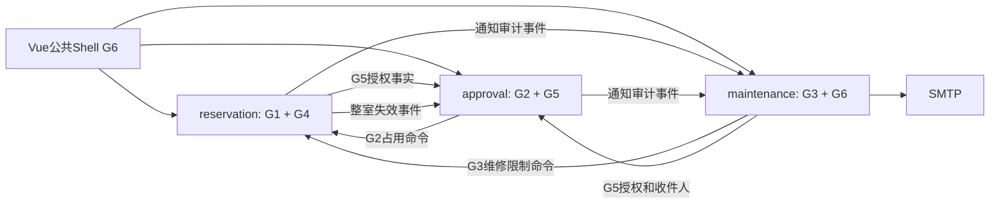

# 校园资源服务平台技术文档

技术设计基线 v2.0，2026-10-24。配套业务基线为[需求文档 v1.4](需求文档.md)。本文所有组件、接口、脚本、测试、迁移及部署均为**待实现／待验证**，不是实现报告。技术选型、协议与职责是项目补充设计；课程任务书规定的工程过程要求在第10—12章以ENG编号单列。人员姓名、实际排期、执行结果须由实施时的真实记录补充。

2026-11-02 认证规则修订：用户要求新密码/初始创建密码为 8—24 个 Unicode 码点，取消首次登录强制改密；已有凭据按原值登录。详情见 [调整记录](../docs/decisions/G5-006-password-policy.md)，不改变其他模块的业务授权和会话撤销规则。

阅读顺序：各组先读第2—4章，再读第5章自己的提供接口与调用接口；实现状态变化前读第6—8章；页面、协作、验收、发布分别见第9—12章。接口ID是契约operationId，不能随页面名称变化；业务需求引用“需求§x.y”，第11章给出双向索引和测试编号。

## 1. 定位、范围与需求对应

本期实现个人座位预约、固定两级整室审批、文字报修及维修，配套资源、身份、通知、审计和工程交付。共享标识统一为UUID。时间区间一律[start,end)，业务日和整点按Asia/Shanghai解释，服务端数据库时钟决定期限。编码签到不证明物理在场，不建立信用惩罚或自动封禁。

需求文件现有54个旧HTML锚点只作为导航兼容；业务覆盖按新版小节核对，不再声称存在71条业务需求或旧AC。旧文档中17项过程内容在本文编号ENG-01—ENG-17，不链接已删除锚点。需求§1—8的每个三级小节均在第11章列出设计、接口或工程实施位置及验收证据。

技术栈沿用Vue 3/TypeScript、Java 21/Spring Boot 4、PostgreSQL 17、单仓库、Docker Compose、GitHub Actions；不新增后端部署单元。初始化时锁补丁版本和镜像摘要，不用latest；锁文件尚未产生。兼容性依据：[Vue官方TS说明](https://vuejs.org/guide/typescript/overview)、[Spring Boot系统要求](https://docs.spring.io/spring-boot/system-requirements.html)、[PostgreSQL版本政策](https://www.postgresql.org/support/versioning/)。

## 2. 总体架构与六组职责

### 2.1 三部署单元、六个模块所有者

| 部署单元 | 模块组 | 独占职责 |
|---|---|---|
| reservation-service | G1个人预约 | 搜索/预约页面、预约记录、签到编码与签到、历史、违约申诉、统计 |
| reservation-service | G4空间资源 | 房间座位开放停用、唯一资源可用性与占用台账、来源历史、资源事务集成协调器 |
| approval-service | G2整室审批 | 申请、两级审批、撤销终止、截止裁决请求、审批工作台 |
| approval-service | G5身份权限 | 账户会话、角色动作范围、院系字典、资格事实与候选、全局业务参数版本 |
| maintenance-service | G3报修维修 | 报修、派改、维修开始、进度、完工验收、评价、升级 |
| maintenance-service | G6通知审计工程集成 | 事件收件/邮件、集中审计、投递异常、运行聚合、前端公共框架、构建部署协调 |

每组承担所属页面、API、数据、迁移、契约测试和行为测试。G6维护集成框架及发布流水线，各组提供并修复自己的测试与部署探针；G6不代替其余五组完成测试。



### 2.2 仓库归属与依赖

`apps/web/src/features/g1`至`g6`、`services/reservation/modules/g1`和`g4`、`services/approval/modules/g2`和`g5`、`services/maintenance/modules/g3`和`g6`分别由对应组维护。每个后端模块分`api`（公开应用端口/DTO）、`application`、`domain`、`persistence`。其他模块只能引用api，不得引用repository/entity或执行其表SQL。G4维护reservation的`integration/ResourceTransactionCoordinator`，G6维护每个服务的启动装配文件，装配不承载领域规则。

`contracts/openapi/gN.yaml`、`contracts/events/gN/*.schema.json`与`contracts/local/gN.md`归提供组；`contracts/common`由G5维护身份类型、G4维护资源类型、G6维护信封与错误，修改需所有消费者评审。`apps/web/src/app/{router.ts,route-registry.ts,navigation.ts,session.ts,http.ts,polling.ts}`、`shared/ui`和`infra`归G6；各组只导出自己的`routes.ts`与`navigation.ts`，由G6在唯一注册文件导入，禁止各自另建Router或全局拦截器。第9章定义接线清单。

`db/m1/g1`和`g4`、`db/m2/g2`和`g5`、`db/m3/g3`和`g6`各组独占。迁移名`V20261024_120000_4_001__G4_description.sql`，版本键为UTC时间到秒+纯数字组号1—6+该组序号；组名仅放在双下划线后的描述区；同schema按完整键排序，一旦合入不可改名或改校验和。每组序号仅由本组迁移清单分配；CI拒绝重复版本和跨组表写入。合并前检查主干最大迁移版本；未发布分支的旧时间迁移必须重新编号为主干之后，禁止启用outOfOrder掩盖顺序。三服务各有独立Flyway历史表及完整schema迁移目录，不让两组分别启动两个迁移器争用同schema。

### 2.3 架构决策与本地事务边界

采用三服务内六模块而非六服务，理由是保留任务书要求的真实网络协作，同时让个人预约和资源裁决保持本地原子性。与单体、独立公共服务的比较及成员意见记录于ADR-001—003，当前为设计决定，实际会签不得虚构。

G4的`ResourceTransactionCoordinator`是reservation服务唯一资源写事务入口。它在事务外取得所需G5身份/参数事实，在事务内按第7章锁序调用G1 `ReservationMutationPort`与G4 `ResourceLedgerPort`。每个端口只写自己表；二者不互调、不重新开启事务、不访问网络、不自行再取得用户或房间锁。协调器负责业务操作分派，不把G1状态字段移交G4所有。G1入口也必须调用协调器，不能先锁预约行再进协调器。G4领域模块不持有G1依赖；集成协调器单向依赖两组api，因此没有“G4锁内调用G1、G1再反向请求G4”的循环。

## 3. 数据模型与唯一所有权

### 3.1 表、聚合和约束

所有可变聚合含UUID主键、正整数version、createdAt/updatedAt；追加历史仅追加，时间为timestamptz。业务及操作标识保留至课程结束后90天清理。下表列出全部逻辑表族；后续拆分物理表不得改变所有权。

| owner/schema | 表族 | 保存事实及强制约束 |
|---|---|---|
| G1/m1 | reservation, reservation_history | 预约人/院系快照、房座快照、原时段、规则版本、状态、签到/取消时刻与来源；ID唯一 |
| G1/m1 | room_code | roomId+localDate唯一；当日codeHash跨房间唯一；加密编码、散列、有效日期；不归G4 |
| G1/m1 | violation, violation_correction, violation_appeal | reservationId唯一违约；原发生时间不可改；violationId唯一申诉；纠错追加关联证据 |
| G4/m1 | room, seat, department_reference, opening_rule, resource_version_history | 房/座编号全局唯一；归属引用G5院系ID；房/座有效期、归属和开放版本历史；历史座位不迁室不改编号 |
| G4/m1 | resource_claim, claim_history, source_cursor | sourceType+sourceId唯一；PERSONAL/WHOLE/REPAIR/ADMIN来源；roomId、seatId可空、区间、实际生效/释放、最大sourceVersion、永久终态墓碑 |
| G4/m1 | reservation_user_lock, resource_impact_preview | 用户锁行唯一；预览快照/摘要、过期时间、操作者、roomVersion和影响来源集合 |
| G2/m2 | room_application, approval_decision, application_history | 申请人、房间/时段/用途/人数/联系人/规则快照、deadline、sourceVersion；每级有效决定唯一，审批意见不可覆盖 |
| G5/m2 | account, department, role, permission, role_binding, session, business_config | 账号编号/院系编号/角色名唯一；密码仅散列；角色动作范围、会话撤销、配置版本；内置角色不可删 |
| G3/m3 | work_order, work_order_history, assignment, acceptance, evaluation, escalation | 房/座/上报人快照、当前维修人、历次实际维修人、首次维修时间、固定通过决定；每工单一次评价、每种升级唯一 |
| G6/m3 | notification_route, notification, delivery_attempt, audit_event | eventId路由唯一；eventId+recipientId+EMAIL唯一；尝试序号唯一；audit eventId唯一 |
| 每组/其schema | gN_operation, gN_outbox, gN_inbox, gN_idempotency, gN_creation_intent | 只由该组写；不共享一张可随意写的outbox；操作请求摘要、原actor、范围、来源版本、重试租约和持久结果；creation_intent的actorId+method+canonicalPath+Idempotency-Key唯一，存请求HMAC摘要及原objectId，与业务记录同寿命 |

跨服务只保存外部ID及必要历史展示快照，不跨schema建外键/级联删除，不复制另一组业务状态作为裁决事实。G1统计通过G4只读历史端口读取台账时间片，不自行维护第二份资源规则。G2/G3界面中的claim确认信息是G4事实投影，必须标注checkedAt，失败时显示核验中。

运行数据库角色`app_m1/app_m2/app_m3`仅能DML本schema；迁移凭据`migrate_m1/m2/m3`与备份凭据单独保管，公共schema禁止应用建表。一个服务单连接事务无法靠数据库角色区分Java模块，**组级所有权靠包可见性、端口、SQL目录检查和架构测试**，不能宣称数据库已做到六组隔离。

### 3.2 历史、统计与保留

G4保存房座有效期、历史归属、开放规则生效段、各来源计划区间与实际作用段；释放不物理删除。个人占用有效片=[max(预约start,建立时刻),min(预约end,有效释放时刻))，未来建立的预约不计提前占用；未签到释放的业务时刻为start+15分钟，已签到到期为end，手动/维护取消为实际生效时刻。处理时刻另存，不能用扫描延迟拉长占用。

G1统计分子为上述个人有效片与已发生查询窗口交集的座位分钟；分母为按当时房座/开放规则可开放的座位分钟，减ADMIN/REPAIR/WHOLE区间并集，不能减PERSONAL。按秒求并集与交集再除60，返回小数至6位；比率分母0返回null，显示“不适用”。查询未来部分仅计预约记录，不能计占用率。统计明细含systemCancelledCount、有效违约与冲正分别计数，不用最终状态抹掉过去。T-G1-STAT固定120/60与30/30反例见第11章。

## 4. 统一接口、类型与安全约定

### 4.1 契约语法与传输

第5章是规范性接口目录。每项由“稳定ID、owner/调用方、方法路径或本地签名、权限、完整入出类型、特有结果、需求位置”构成；各项**显式继承本章C协议**：C-R为只读、C-W为写、C-I为内部HTTP、C-L为本地、C-E为事件。共有错误、超时和幂等不在每项重复，但属于每项完整契约。路径中的`{id}`及其他ID均为Id；query只接受列出字段，未知参数400；body未知字段400，防止无声忽略客户端拼写错误。

类型记法：`Id`=UUID小写标准36字符；`V`=1..9223372036854775807整数（JSON以十进制字符串传输，禁止浮点精度丢失）；`Int[a,b]`=JSON整数；`S[a,b]`=去首尾空白后的Unicode码点数a..b字符串，拒绝控制字符（描述允许换行）；`Bool`=true/false；`Time`=RFC3339含偏移的时间戳，输出统一+08:00且毫秒精度；`Date`=YYYY-MM-DD；`Minute`=HH:mm，00:00..24:00（24:00仅区间结束）；`Email`=1..254字符合法邮箱；`T?`=可省略且默认见具体定义，**不等于可为null**；`T|null`=字段必有、可明确null；数组`T[0..N]`，无界列表一律分页，不用无限数组。字段未标?则必填；响应不省略，缺事实使用明确null；所有未指定默认的可选筛选默认“不筛选”。`{...A,x:T}`完整复用A的所有字段，不是自由扩展对象。`A|B`为带枚举判别字段的互斥联合。

`P={page?:Int[1,1000000]=1,pageSize?:Int[1,100]=20}`；`Page<T>={items:T[0..100],page:Int[1,1000000],pageSize:Int[1,100],total:Int[0,2147483647],asOf:Time}`。排序默认为createdAt降序、id升序，搜索资源按code升序/id升序；页越界items=[]保留total；合法无记录200，绝不404。查询字符串空值与重复标量400；数组用逗号分隔，无项或空项400，重复项去重；省略数组表示全部。显式越界roomId筛选403；按ID详情不可见或不存在均404；可见对象但无动作权限403。列表先权限过滤再count和分页。历史本人资格按record.ownerId，不因之后跨院系或房间停用丢失本人历史；当前管理范围按当前G4房间归属求值。

`Ok<T>={data:T,traceId:Id}`；201用于创建，200用于同步读写；异步202为`Ok<Pending<T>>`，`Pending<T>={record:T,operation:Operation}`。operation.statusUrl是持久化的本域公开查询路径，不能只返回进度动画。无正文输入用`Empty={}`，GET没有body。C-W写请求必须有`Idempotency-Key:Id`，更新body必须有`expectedVersion:V`；登录、登出、改密例外见G5端点，预览虽POST但按C-R不产生业务写效果。

`Error={code:ErrorCode,message:S[1,500],traceId:Id,details:{fields:FieldError[0..30],conflicts:Conflict[0..100],currentVersion:V|null,operationId:Id|null,retryAfterSeconds:Int[0,3600]|null}}`；`FieldError={field:S[1,100],reason:S[1,200]}`；`Conflict={category:UnavailableReason,roomId:Id,seatId:Id|null,start:Time,end:Time|null}`。普通冲突不含他人姓名、用途、sourceId；管理员来源查询另经授权。ErrorCode全集及HTTP：400 VALIDATION_ERROR/SEAT_ROOM_MISMATCH/ASSIGNEE_INELIGIBLE；401 UNAUTHENTICATED；403 FORBIDDEN/PASSWORD_CHANGE_REQUIRED/CURRENT_PASSWORD_INVALID/SELF_REVIEW_FORBIDDEN；404 NOT_FOUND；409 VERSION_CONFLICT/IDEMPOTENCY_CONFLICT/STATE_CONFLICT/RESOURCE_CONFLICT/USER_TIME_CONFLICT/IMPACT_CHANGED/OPERATION_IN_PROGRESS/STALE_SOURCE_VERSION/SOURCE_TERMINAL/DEADLINE_NOT_REACHED/SNAPSHOT_MISMATCH/DUPLICATE_CODE/DUPLICATE_APPEAL/ALREADY_EVALUATED/LAST_ADMIN_PROTECTED/ROLE_PROTECTED；422 TIME_RULE_VIOLATION/CHECKIN_WINDOW_CLOSED/CODE_INVALID/EVALUATION_WINDOW_CLOSED/DEADLINE_PASSED/QUALIFICATION_REVOKED；429 RATE_LIMITED；503 AUTH_UNAVAILABLE/DEPENDENCY_UNAVAILABLE/SCOPE_FACTS_UNAVAILABLE。不存在未登记自由code；内部持久错误复用此枚举。

C-R默认无业务状态变化，可产访问失败审计；读详情允许触发已到期状态结算，但由明确后台同一应用命令完成，不能在只读repository隐式改状态。C-W同键作用域为用户ID+method+规范路径，当前鉴权优先；完整HTTP响应缓存24小时内同正文返回已持久结果、异正文409；无已接受结果才检查expectedVersion。所有创建新业务对象的接口同时在owner事务保存creation_intent唯一索引（用户ID+method+规范路径+原键→请求HMAC摘要、对象ID），保留至关联业务记录清理；完整响应缓存到期后仍先查该索引，同摘要返回原对象ID的当前可见记录、HTTP 200及头`Idempotency-Replayed:true`，不重新执行创建，异摘要409。首次创建201及头`Idempotency-Replayed:false`；当前对象已取消也返回该取消记录。对象唯一约束、原operation及来源墓碑同样按业务保留期保存。适用G1-P03/P10、G2-P01、G3-P01、G4-P02/P09/P12、G5-P07/P11/P16；登录/改密不保存凭据，其他含密码创建只保存服务密钥HMAC及无密码结果。24小时缓存内重放原创建响应只证明原操作已成立，不作为当前有效凭据，前端始终再读原ID当前详情；缓存过期按长期索引返回当前记录并标Replayed。外部缓存过期不允许第二次签到、申诉、验收或复活终态。写事务同时写owner历史/outbox/幂等结果；失败不留半业务写，但安全失败审计另事务记录。允许原请求重放，不代表可以发起新的状态相同请求。

HTTP内网连接超时2秒、总超时5秒，浏览器总超时8秒；未知结果使用原键重试或operation查询，不能自动换键。跨服务必须先落operation再调用，网络调用不持DB锁。C-I读可重试，C-I写以operationId与sourceVersion持久去重；C-L是同事务内调用，无网络重试；技术异常/无法裁决抛异常回滚；明确业务裁决通过返回联合区分VALUE/BUSINESS_REFUSAL，不把所有业务拒绝都抛异常。G4远程WHOLE批准的确定拒绝按第7.2同锁提交墓碑后再映射HTTP错误，个人新建尚未受理失败则无业务副作用回滚。C-E收件确认只表示事件已持久化，不表示邮件已送达。

### 4.2 身份事实、动作与范围

登录采用服务端会话，Cookie为Secure/HttpOnly/SameSite=Lax，同源POST/PATCH/PUT必须`X-CSRF-Token`。会话绝对8小时，无刷新延长；退出或停用撤销；正向授权不跨请求缓存。G1/G3/G4/G6每次用户请求调用G5内省，G2直接G5本地端口。权限撤销提交后新请求看到新版本；已通过授权且正在提交的请求按其授权快照留痕，不声称跨服务强事务撤权。最终整室批准和实际派改分别重新取得G5资格事实。G5不可达则503，不回退到旧登录缓存。

`Scope={kind:SCHOOL}|{kind:DEPARTMENT,departmentId:Id}|{kind:ROOM,roomId:Id}|{kind:SYSTEM}`。`Grant={action:Action,scope:Scope}`。对房间动作，SCHOOL覆盖所有已登记房间；ROOM精确匹配ID；DEPARTMENT仅匹配当前schoolWide=false且deptId相同的房间，不能匹配校级或其他院系；SYSTEM仅供账户配置、部署、全局运维对象，不自动覆盖房间业务。一个动作至少一个scope匹配即有授权，多角色并集，不存在隐含超级业务权限。普通访问`canAccessRoom`为房间全校开放或account.deptId=room.deptId；学生/整室申请/报修还须动作授权匹配该房间。管理动作可按明确ROOM授权跨院系。role binding的grants是角色grants在绑定生效时的引用，角色改变即时生效，不复制陈旧权限。

Action封闭目录与内置角色默认授予（范围在建账号时明确配置，不靠角色名猜测）：

| 角色 | 默认Action |
|---|---|
| 学生STUDENT | room:read、reservation:create/read-own/cancel/checkin、violation:read-own/appeal、workorder:report/read-own/cancel/evaluate |
| 整室申请人APPLICANT | room:read、room:apply、application:read-own/withdraw |
| 教室管理员ROOM_ADMIN | room:read/manage/display、approval:level1、application:read、workorder:read/assign/accept、resource:trace |
| 运营管理员OPERATIONS_ADMIN | room:read、approval:level2、application:read/terminate、statistics:read、violation:read/review/correct、workorder:read/escalation-receive、resource:trace |
| 维修人员REPAIRER | workorder:read-assigned/repair |
| 系统管理员SYSTEM_ADMIN | system:manage（SYSTEM）；不自动拥有前五行 |

本基线另外定义的动作`audit:read`、`operation:read/recover`、`notification:read/retry`、`runtime:read`可由system:manage配置进任意角色，默认仅初始系统管理员获SYSTEM范围；房间运维人员须另授房间范围。表内斜杠缩写展开为完整冒号动作，例如reservation:read-own、reservation:cancel；Action接口返回展开字符串全集。所有六角色均可auth/me、logout、change-password及本人通知（认证能力不另注册动作）。`system:manage`只能授予已登记Action；防止删除/停用/撤权最后一个有效SYSTEM范围system:manage管理员，事务锁全局admin_guard；内置六角色不可删除/改内置key，但可配置grants，需保留ROOM_ADMIN/OPERATIONS_ADMIN角色存在。自定义角色仅组合目录动作，不产生新代码能力。

`workorder:escalation-receive`是G3定义的工单升级接收动作，支持SCHOOL/DEPARTMENT/ROOM范围；不授予整室终止或普通工单写权限。升级的运营分支必须对同一当前房间同时匹配该动作与workorder:read，教室管理分支同理匹配workorder:assign与workorder:read；不检查角色名字，不借application:terminate。G5-I05/I06使用同一组合，撤掉工单查看即从对应管理分支移除，参与人分支仍独立。

G5只回答账户/权限/范围事实，不裁决“是否本人申请”“一级二级同人”“验收人是否曾实际维修”之类业务回避；G2/G3在本聚合锁内检查，角色叠加不能绕过。仅有system:manage者不能批自己的申请。维修验收回避集合为该工单所有实际开始/填写进度/完工的维修人员，保留历史，不因改派抹除。

内网服务凭据每调用服务独立，网关不公开/internal并剥离外部伪造X-Actor-Session。同步代用户查询转发当前会话（仅内存），接收方绑定actorUserId=内省结果；operation/outbox永不保存会话、密码或完整编码。后台调用仅服务凭据+原授权操作记录，通知后台范围事实不调用内省，以免G5↔G4循环。C-I会核对调用方、用途、sourceType、房间和事件schema，不把客户端提供userId当认证。

#### 普通动作的当前范围判定（第4.2节续）

受保护入口先G5内省取得当前Principal，再区分本人记录分支与管理分支；本人归属由业务owner读取自己的记录，仍检查相应own动作，历史访问不强制当前院系可访问该房。管理分支统一调用G5-I10（approval-service内的G2/G6适配器用G5-L06），不能借APPLICATION/REPORT元数据接口鉴权。G4本地入口直接用自身当前房间事实与G5 Principal执行相同scope算法。G5-I10只返回动作/资源授权，不替G2检查审批回避，也不替G3检查实际维修人与验收人关系。

详情/写操作先只读取不可变roomId，再在事务外G5-I10检查本动作；对象不可见仍404，已可见但动作不足403；授权依赖故障503，不用历史房间归属或旧正向缓存兜底。写操作加业务锁后确认roomId仍同一、授权validUntil未过期，否则回滚并事务外重验。权限撤销对其提交后的新请求生效；在途请求依第4.2已有授权快照留痕，不宣称跨服务全局事务。

管理列表从owner数据按非权限条件扫描候选、每批最多100项(action,target)检查、涉及最多100个不同roomId调用G5-I10；没有用户请求能跳过范围直接拿未过滤页。SYSTEM条目独立判定SYSTEM范围；本人与管理分支按记录ID去重。对本次已经检查的候选集合先过滤后count/排序/page，列表与指标复用同一谓词。全量候选通过有界游标流式扫描，不能只过滤一页后把原total给用户；显式roomId先单独检查，越界403。扫描批次使用同一Principal.accountVersion/permissionVersion，若G5返回版本变化则从新授权快照重新开始一次，仍变化返回503；G4房间事实逐批按当前版本求值并记checkedAt区间，不伪称跨服务全局原子快照。列表/指标同一次请求只使用同一已求值集合，后续刷新会看到归属改变。

### 4.3 公共枚举与DTO

以下为完整字段定义；未在枚举列出的值均400。`Meta={id:Id,version:V,createdAt:Time,updatedAt:Time}`；`Ref={type:SourceType,id:Id}`；`SourceType=PERSONAL|WHOLE|REPAIR|ADMIN|ACCOUNT|CONFIG|SYSTEM`。内部路径兼容M2映射WHOLE、M3映射REPAIR，不把路径枚举直接存为来源类型。

`UnavailableReason=ROOM_DISABLED|SEAT_DISABLED|DEPARTMENT_RESTRICTED|CLOSED_HOURS|ADMIN_RESTRICTION|REPAIR_RESTRICTION|WHOLE_OCCUPIED|PERSONAL_OCCUPIED`；`Socket=NONE|FIXED|RAIL`；`RoomType=CLASSROOM|LIBRARY|OTHER`。

```text
Room = { ...Meta, code:S[1,40], name:S[1,100], location:S[1,200], area:S[1,100],
 type:RoomType, capacity:Int[1,10000], schoolWide:Bool, deptId:Id|null, enabled:Bool,
 opening:Opening, allowedActions:Action[0..64] }
Opening = { weekly:Weekly[0..56], exceptions:ExceptionDay[0..366], version:V }
Weekly = { weekday:Int[1,7], start:Minute, end:Minute }
ExceptionDay = { date:Date, intervals:DayInterval[0..8] }
DayInterval = { start:Minute, end:Minute }
Seat = { ...Meta, code:S[1,40], roomId:Id, roomVersion:V, socketType:Socket,
 enabled:Bool, reasons:UnavailableReason[0..8], allowedActions:Action[0..64] }
RoomAvailability = { room:Room, start:Time, end:Time, availableSeatCount:Int[0,2147483647], reasons:UnavailableReason[0..8] }
SeatAvailability = { seat:Seat, roomName:S[1,100], start:Time, end:Time, available:Bool }
ScopeFacts = { roomId:Id, schoolWide:Bool, deptId:Id|null, enabled:Bool, roomVersion:V, asOf:Time }
ReservationStatus = RESERVED|CHECKED_IN|COMPLETED|CANCELLED_USER|CANCELLED_NO_SHOW|CANCELLED_SYSTEM
Reservation = { ...Meta, ownerId:Id, roomId:Id, roomCode:S[1,40], roomName:S[1,100], seatId:Id,
 seatCode:S[1,40], start:Time, end:Time, status:ReservationStatus, checkinDeadline:Time,
 checkedInAt:Time|null, cancelledAt:Time|null, cancelReason:S[1,1000]|null, source:Ref|null,
 configVersion:V, ruleSnapshot:ReservationRules, violationId:Id|null, allowedActions:Action[0..64] }
ReservationRules = { maxHours:Int[1,8], advanceDays:Int[1,7], earlyMinutes:15, lateMinutes:15 }
ReservationRulesView = { configVersion:V, effectiveAt:Time, asOf:Time, rules:ReservationRules }
ApplicationRules = { minHours:1, maxHours:8, minAdvanceMinutes:60, advanceDays:Int[1,14], approvalHours:24, approvalLevels:2 }
ApplicationRulesView = { configVersion:V, effectiveAt:Time, asOf:Time, rules:ApplicationRules }
StatisticsWindow = { startDate:Date, endDate:Date }
StatisticRoom = { roomId:Id, code:S[1,40], name:S[1,100], registeredAt:Time, enabled:Bool }
Violation = { ...Meta, reservationId:Id, ownerId:Id, roomId:Id, occurredAt:Time, processedAt:Time,
 status:ACTIVE|CORRECTED, reason:S[1,1000], correction:Correction|null, appealId:Id|null }
Correction = { actorId:Id|null, correctedAt:Time, reason:S[1,1000], evidence:Evidence[1..20], source:Ref|null }
Evidence = { kind:RESERVATION|CLAIM|AUDIT|WORK_ORDER, id:Id }
Appeal = { ...Meta, violation:Violation, reservation:Reservation, text:S[1,1000],
 status:PENDING|KEPT|CORRECTED, decisionReason:S[1,1000]|null, reviewerId:Id|null,
 decidedAt:Time|null, evidence:Evidence[0..20], allowedActions:Action[0..64] }
History = { id:Id, actorId:Id|null, actorKind:USER|SYSTEM, action:S[1,80],
 fromStatus:S[1,40]|null, toStatus:S[1,40], effectiveAt:Time, processedAt:Time,
 reason:S[1,1000]|null, operationId:Id|null, source:Ref|null }
ApplicationStatus = PENDING_L1|PENDING_L2|ACQUIRING|APPROVED|REJECTED|RESOURCE_CONFLICT|WITHDRAWING|WITHDRAWN|TERMINATING|TERMINATED|EXPIRED|CANCELLED_SYSTEM|FINISHING|FINISHED
Phase = NONE|ACQUIRING|VERIFYING|RELEASING|STARTING|ACCEPTING
Contact = { name:S[1,100], value:S[1,254] }
Application = { ...Meta, applicantId:Id, roomId:Id, roomCode:S[1,40], roomName:S[1,100],
 start:Time, end:Time, purpose:S[1,500], attendeeCount:Int[1,10000], contact:Contact,
 deadline:Time, configVersion:V, status:ApplicationStatus, processingPhase:Phase,
 sourceVersion:V, decisions:Decision[0..2], claim:ClaimCheck, reason:S[1,1000]|null,
 currentOperationId:Id|null, allowedActions:Action[0..64] }
Decision = { level:Int[1,2], decision:APPROVE|REJECT, actorId:Id, reason:S[1,500], decidedAt:Time }
ClaimState = ACTIVE|RELEASED|INVALIDATED|REJECTED|EXPIRED|ABSENT
ClaimCheck = { state:ClaimState, claimId:Id|null, effectiveApprovedAt:Time|null,
 effectiveAt:Time|null, checkedAt:Time|null, verified:Bool, reason:S[1,1000]|null, sourceVersion:V|null }
WorkStatus = SUBMITTED|ASSIGNED|STARTING|REPAIRING|PENDING_ACCEPTANCE|ACCEPTING|ACCEPTED|CANCELLED|CLOSED
WorkOrder = { ...Meta, reporterId:Id, roomId:Id, roomCode:S[1,40], roomName:S[1,100],
 seatId:Id|null, seatCode:S[1,40]|null, category:FACILITY|ELECTRICITY|ENVIRONMENT|OTHER,
 description:S[1,1000], contact:Contact, status:WorkStatus, processingPhase:Phase,
 assigneeId:Id|null, firstRepairStartedAt:Time|null, acceptedAt:Time|null, sourceVersion:V,
 claim:ClaimCheck, currentOperationId:Id|null, escalations:Escalation[0..2],
 evaluation:Evaluation|null, allowedActions:Action[0..64] }
Escalation = { type:UNASSIGNED|REPAIR_OVERDUE, dueAt:Time, recordedAt:Time, eventId:Id }
Evaluation = { score:Int[1,5], comment:S[0,500], evaluatedAt:Time, reporterId:Id }
Candidate = { userId:Id, displayName:S[1,100], qualificationSummary:S[1,200] }
Claim = { ...Meta, source:Ref, roomId:Id, seatId:Id|null, start:Time, end:Time|null,
 state:ClaimState, effectiveAt:Time, releasedAt:Time|null, reason:S[1,1000],
 releaseReason:S[1,1000]|null, sourceVersion:V, operationId:Id, history:ClaimHistory[1..100] }
ClaimHistory = { eventId:Id, state:ClaimState, effectiveAt:Time, processedAt:Time,
 reason:S[1,1000], operationId:Id, auditEventId:Id, sourceVersion:V }
Impact = { source:Ref, roomId:Id, seatId:Id|null, effect:CANCEL_SYSTEM|KEEP_NO_SHOW|KEEP_COMPLETED,
 reason:S[1,1000], effectiveAt:Time|null }
ImpactPreview = { token:Id, roomVersion:V, affectedCount:Int[0,2147483647],
 digest:S[64,64], expiresAt:Time, impacts:Page<Impact> }
OperationState = PENDING|RUNNING|RETRY_WAIT|SUCCEEDED|BLOCKED
Operation = { ...Meta, ownerGroup:G1|G2|G3|G4|G5|G6, source:Ref, roomId:Id|null,
 scopeKind:ROOM|SYSTEM, category:RESOURCE|NOTIFICATION_ROUTE|OTHER, eventId:Id|null, actorId:Id|null, operationId:Id, status:OperationState, phase:Phase,
 acceptedAt:Time, attemptCount:Int[0,2147483647], nextRetryAt:Time|null,
 error:Error|null, needsAttention:Bool, result:OperationResult|null, statusUrl:S[1,300],
 allowedActions:Action[0..64] }
OperationResult = { outcome:APPLIED|ALREADY_APPLIED|TERMINAL|EXPIRED|REJECTED,
 record:Ref, resultVersion:V, effectiveAt:Time|null }
Account = { ...Meta, userCode:S[1,40], displayName:S[1,100], departmentId:Id,
 email:Email, enabled:Bool, mustChangePassword:Bool, roleIds:Id[0..50], permissionVersion:V }
Principal = { userId:Id, displayName:S[1,100], deptId:Id, accountVersion:V,
 permissionVersion:V, grants:Grant[0..1000], mustChangePassword:Bool, expiresAt:Time }
Role = { ...Meta, key:S[1,60], name:S[1,100], builtIn:Bool, grants:Grant[0..1000] }
Department = { ...Meta, code:S[1,40], name:S[1,100], enabled:Bool }
Config = { version:V, effectiveAt:Time, values:ConfigValues }
ConfigValues = { reservationMaxHours:Int[1,8], reservationAdvanceDays:Int[1,7],
 applicationAdvanceDays:Int[1,14], scanIntervalSeconds:Int[1,30], notificationRetryLimit:Int[0,5] }
NotificationState = QUEUED|SENDING|SENT|FAILED|UNKNOWN|SKIPPED_SCOPE
DeliveryOutcome = ACCEPTED|FAILED|UNKNOWN
Notification = { ...Meta, eventId:Id, eventType:EventType, source:Ref, roomId:Id|null,
 recipientId:Id, maskedEmail:S[1,254], status:NotificationState, lastDeliveryOutcome:DeliveryOutcome|null,
 retryCount:Int[0,2147483647], nextRetryAt:Time|null, error:Error|null, subject:S[1,200],
 needsAttention:Bool, allowedActions:Action[0..64] }
Attempt = { id:Id, attemptedAt:Time, finishedAt:Time|null, sequence:Int[1,2147483647],
 outcome:DeliveryOutcome|null, error:Error|null, possibleDuplicate:Bool }
Audit = { id:Id, producer:G1|G2|G3|G4|G5|G6, source:Ref, roomId:Id|null, scopeKind:ROOM|SYSTEM,
 actorId:Id|null, actorKind:USER|SYSTEM, action:S[1,80], before:AuditField[0..40], after:AuditField[0..40],
 reason:S[1,1000]|null, result:SUCCESS|FAILURE, errorCode:ErrorCode|null,
 effectiveAt:Time, processedAt:Time, traceId:Id, operationId:Id|null }
AuditField = { name:S[1,80], value:S[0,500]|null }
Metrics = { asOf:Time, operations:{pendingCount:Int[0,2147483647], attentionCount:Int[0,2147483647],
 outboxCount:Int[0,2147483647], oldestOutboxAgeSeconds:Int[0,2147483647]|null,
 oldestPendingAgeSeconds:Int[0,2147483647]|null, oldestPendingRef:PendingRef|null}|null,
 notifications:{failedCount:Int[0,2147483647], unknownCount:Int[0,2147483647], routingBlockedCount:Int[0,2147483647], oldestPendingAgeSeconds:Int[0,2147483647]|null, oldestPendingRef:PendingRef|null}|null }
PendingRef = { kind:OPERATION|OUTBOX|NOTIFICATION_ROUTE|NOTIFICATION, id:Id, since:Time, detailUrl:S[1,300] }
Runtime = { asOf:Time, components:ComponentVersion[4..4] }
ComponentVersion = { name:web|reservation|approval|maintenance, available:Bool,
 commit:S[7,40]|null, tag:S[1,100]|null, imageDigest:S[1,100]|null,
 startedAt:Time|null, migrationVersions:S[1,100][0..500], error:Error|null }
```

Opening每日期最多8个不重叠区间，start<end，跨午夜拆两日；exceptions中date唯一，空intervals表示整日关闭；当日例外整体覆盖周规则。Room的schoolWide=true要求deptId=null，否则deptId必为有效院系；历史停用院系仍可显示但不能新绑定。Contact是必要联系人姓名与联系方式文本，value允许可读手机号、电话或邮箱，只有长度与控制字符约束，不额外施加校内域名白名单；页面提示勿填无关敏感信息。claim.history最多100条，更多走第5章历史分页端点，响应先返回最近100条并以专用分页查询取全；不能截断不可发现。History、Audit的action属于第5章操作ID或第8章登记任务ID，不允许任意日志字符串充当安全动作。

## 5. 六组接口详细契约

每个接口的owner为ID前缀；除另注，公网调用方为该组页面，内部调用方逐项指定。下文“读”=C-R，“写”=C-W，“内”=C-I，“本地”=C-L；接口均继承第4章全套返回信封、错误、鉴权顺序、分页、幂等、超时恢复和版本规则。写入范围仅owner表；资源效果通过G4协调器/接口完成。所有成功写产生AuditRecorded，业务通知在注明的状态成立后产生第8章事件；无通知的写仍审计。GET无业务通知。`VersionBody={expectedVersion:V}`；`ReasonBody={expectedVersion:V,reason:S[1,1000]}`。以下请求为完整body或query，路径ID不重复列入body。

### 5.1 G1个人预约（reservation-service）

**G1-P01 读 `GET /api/m1/rooms`**。动作room:read并canAccessRoom。query=`{...P,start:Time,end:Time,area?:S[1,100],roomId?:Id}`；返回`Page<RoomAvailability>`。时间必须同一个北京时间日期或连续跨日合法区间、start<end、最长8小时；date由start推导，旧date参数移除在契约版本升级时明确公告。只返回可访问房间，停用房间可显示disabled原因，可用数由G4-L01计算。非法时间422，不预占。需求§3.1、7.5。

**G1-P02 读 `GET /api/m1/seats`**。room:read及canAccessRoom。query=`{...P,start:Time,end:Time,roomId?:Id,seatCode?:S[1,40],area?:S[1,100],socketTypes?:Socket[1..3]}`；返回`Page<SeatAvailability>`，items中available固定true。仅完整区间可用座位；NONE/FIXED/RAIL按精确集合过滤，省略不限制插座；seatCode为包含匹配。422时间不合法；搜索不保证稍后创建成功。需求§3.1。

**G1-P03 写 `POST /api/m1/reservations`**。reservation:create及canAccessRoom；body=`{seatId:Id,start:Time,end:Time}`；首次201 `Reservation`，长期同键重放200同原ID当前Reservation及Idempotency-Replayed:true。G1入口按G4-L02最终RESERVATION.disposition确定上述状态码和头；NEEDS_CONFIG只触发事务外读取配置及原键重入，不能回成功。G1创建意图索引与预约行、G4 claim同事务；G4协调器事务内先验证G1规则、用户重叠、G4完整可用性，再G1插入RESERVED、G4写PERSONAL claim；任何失败整体回滚。422 TIME_RULE_VIOLATION、409 RESOURCE_CONFLICT/USER_TIME_CONFLICT。历史复用仅调用此接口，无复制接口。需求§3.2、3.6、7.1。

**G1-P04 读 `GET /api/m1/reservations`**。query=`{...P,view?:OWN|MANAGED=OWN,date?:Date,roomId?:Id,status?:ReservationStatus}`；OWN要求reservation:read-own且ownerId为本人；MANAGED要求statistics:read且房间范围。返回`Page<Reservation>`；date按预约时段与该日有交集筛选。需求§3.6、6.5。

**G1-P05 读 `GET /api/m1/reservations/{id}`**。本人reservation:read-own或statistics:read房间范围；query=Empty；返回`Reservation`。不返回完整签到编码。需求§3.3—3.7。

**G1-P06 写 `POST /api/m1/reservations/{id}/cancel`**。本人reservation:cancel；body=ReasonBody；200 Reservation。仅now<start且RESERVED转CANCELLED_USER、G4释放本PERSONAL claim、ReservationCancelled事件；新操作在开始后409 STATE_CONFLICT；已成功同键重放不改取消时间。需求§3.3。

**G1-P07 写 `POST /api/m1/reservations/{id}/check-in`**。本人reservation:checkin；body=`{...VersionBody,roomCode:S[8,8]}`；200 Reservation。锁后检查实际当天码及[start−15min,start+15min)，RESERVED转CHECKED_IN；不释放占用。422 CODE_INVALID/CHECKIN_WINDOW_CLOSED，429限速；不同键对已签到同本人返回原签到结果且首次时间不变，取消记录409。需求§3.4、3.5。

**G1-P08 读 `GET /api/m1/rooms/{id}/display-code`**。room:display且房间管理范围；query=Empty；返回`{roomId:Id,date:Date,code:S[8,8],validFrom:Time,validUntil:Time,version:V}`，Cache-Control:no-store。只在授权页面解密；缺当日码按唯一键补建，算审计任务CODE_ROTATE；普通学生404。需求§3.4。

**G1-P09 读 `GET /api/m1/violations`**。query=`{...P,view?:OWN|MANAGED=OWN,date?:Date,roomId?:Id,status?:ACTIVE|CORRECTED}`；OWN为violation:read-own，MANAGED为violation:read范围；返回Page<Violation>，date按occurredAt。需求§3.7。

**G1-P10 写 `POST /api/m1/violations/{id}/appeals`**。本人violation:appeal；body=`{text:S[1,1000]}`；201 Appeal。创建PENDING，violationId唯一；已冲正违约409 STATE_CONFLICT，已有申诉新键409 DUPLICATE_APPEAL；不改违约。需求§3.7。

**G1-P11 读 `GET /api/m1/admin/appeals`**。violation:review范围；query=`{...P,status?:PENDING|KEPT|CORRECTED,roomId?:Id}`；返回Page<Appeal>。**G1-P12 读 `GET /api/m1/appeals/{id}`**，query=Empty；本人violation:read-own或violation:review范围；返回Appeal。两项需求§3.7。

**G1-P13 写 `POST /api/m1/admin/appeals/{id}/decision`**。violation:review范围；body=`{...VersionBody,decision:KEEP|CORRECT,reason:S[1,1000],evidence:Evidence[1..20]}`；200 Appeal。仅PENDING；KEEP→KEPT，CORRECT→CORRECTED且同事务追加violation_correction；证据须可见且关联该预约/房间，否则400或403；相反/二次新决定409 STATE_CONFLICT，同键返回原结果；AppealDecided通知本人。需求§3.7。

**G1-P14 写 `POST /api/m1/admin/violations/{id}/correct`**。violation:correct范围；body=`{...ReasonBody,evidence:Evidence[1..20]}`；200 Violation。仅ACTIVE→CORRECTED，追加纠错不删除原发生时间；若已有PENDING申诉，同事务标CORRECTED并记录同一理由；已冲正不同键409 STATE_CONFLICT。ViolationCorrected通知本人。需求§3.7、7.4。

**G1-P15 读 `GET /api/m1/statistics`**。statistics:read范围；query=`{...P,startDate:Date,endDate:Date,roomId?:Id}`，首尾日期均含、最多31天；返回`Statistics={asOf:Time,startDate:Date,endDate:Date,rows:Page<StatisticRow>,definitionVersion:1}`，`StatisticRow={date:Date,roomId:Id,reservationCount:Int[0,2147483647],checkedInCount:Int[0,2147483647],activeViolationCount:Int[0,2147483647],correctedViolationCount:Int[0,2147483647],systemCancelledCount:Int[0,2147483647],numeratorSeatMinutes:number,denominatorSeatMinutes:number,occupancyRate:number|null,futureReservationCount:Int[0,2147483647]}`。number为非负有限JSON小数，rate 0..1；每行对应一日一房间，按date升序/roomId升序分页，total为同授权范围全部行数，可跨页完整获取，不限制拥有多房间权限者查询。历史计算第3.2章；未来行分子分母0、rate=null。房间集合必须由G4-L14按本次日期窗口枚举，不从已有预约反推；roomId省略时遍历授权目录全部页，指定时使用同目录的roomId筛选。按房间registeredAt与查询日期相交生成日/房间行，即该日结束时刻严格晚于registeredAt才有行，登记前日期不生成；有效房间即使零预约也有行。每个房间再以G4-L03完整游标读取历史切片，与G1本域记录合成；停用日仍保留行，分母按当时历史计算，非零分母且零分子rate=0。枚举、G1计数和G4切片在同服务只读REPEATABLE READ事务共享数据库快照及asOf，不持业务写锁；G4目录按第4.2当前鉴权，任一依赖失败整次503，不返回不完整total或把失败当零。先构造全部授权日/房间集合确定total，再按date/roomId排序截取所请求页；允许流式合成，禁止把目录第N页当统计第N页。前端通过G1-P17选房间，日期变化重新加载目录；沿用同一statistics:read房间范围提供P04 MANAGED预约明细列表及P05详情链接，不增加其他动作门槛。需求§6.5。

**G1-P16 读 `GET /api/m1/reservation-rules`**。G1提供、个人搜索/申请页调用；任一有效会话可读，沿用C-R/当前会话校验，不需要system:manage或额外业务动作。query=Empty，200 ReservationRulesView。G1每次调用G5-I07取得当前Config，rules.maxHours/advanceDays分别映射reservationMaxHours/reservationAdvanceDays，earlyMinutes/lateMinutes固定15；configVersion/effectiveAt直接取该Config，asOf为本次读取完成时刻。响应Cache-Control:no-store，服务端不使用过期配置或历史预约快照兜底；依赖故障503 DEPENDENCY_UNAVAILABLE，无业务写。该读取仅说明规则，不预占资源、不承诺后续提交采用此版本；G1-P03对新意图仍按原流程取得当时Config重验，原键重放仍遵守L08。需求§3.2、6.4、8.6。

**G1-P17 读 `GET /api/m1/statistics/rooms`**。G1提供、统计页面调用；statistics:read当前空间范围，不要求room:read/manage/apply或workorder:report。query=`{...P,...StatisticsWindow,roomId?:Id}`，日期首尾均含且最多31天；200 Page<StatisticRoom>，完整继承G4-L14的房间集合、排序、total、空态、错误与当前范围过滤。G1把省略roomId转本地null，调用G4-L14，不自行读G4表。用于房间筛选，不返回预约个人明细。需求§2.3、6.5。

### 5.2 G2整室审批（approval-service）

**G2-P01 写 `POST /api/m2/applications`**。room:apply、canAccessRoom；body=`{roomId:Id,start:Time,end:Time,purpose:S[1,500],attendeeCount:Int[1,10000],contact:Contact}`；201 Application。同步G4-I01元数据核验及G5资格，人数≤capacity、整点1—8h、提前≥1h且≤配置14天上限、开放覆盖；创建PENDING_L1、deadline=min(createdAt+24h,start)，不创建claim，ApprovalTaskOpened(level1)。422时间/资格、本契约不因占用预检拒绝申请；维修/占用允许提交待审批，但房/座有效、访问和开放必须满足。元数据失败503且不建申请。需求§4.1。

**G2-P02 读 `GET /api/m2/applications`**。query=`{...P,view?:OWN|TASKS|MANAGED=OWN,status?:ApplicationStatus,roomId?:Id,date?:Date,level?:Int[1,2]}`；OWN application:read-own，TASKS对应approval:level1/level2，MANAGED application:read；返回Page<Application>。TASKS默认当前可审批阶段并排除自审/同人；level仅TASKS允许。每项claim经批量G4-I07核验；未确认verified=false、phase=VERIFYING，不提供使用凭据。需求§4.2、4.3。

**G2-P03 读 `GET /api/m2/applications/{id}`**。query=Empty；本人application:read-own或application:read/对应审批范围；返回Application，批准态必须核验G4，网络失败返回200但claim.verified=false及VERIFYING，禁止有效批准展示。**G2-P04 读 `GET /api/m2/applications/{id}/history`**，同权限，query=P，返回Page<History>；两个接口需求§4.3—4.5。

**G2-P05 写 `POST /api/m2/applications/{id}/decisions`**。body=`{...VersionBody,level:Int[1,2],decision:APPROVE|REJECT,reason:S[1,500]}`；权限对应approval:level1/level2房间范围、禁止本人及二级与一级同人。一级通过200 Application转PENDING_L2及ApprovalTaskOpened(level2)；驳回持久RELEASING操作，202 Pending<Application>，只释放自身来源后终态REJECTED（无claim也写墓碑），ApprovalStatusChanged。二级通过202 Pending<Application>转ACQUIRING，operation调用G4-I04；批准事实有效才APPROVED及结果事件；接收G4 DECLINED必须读取rejection.code，RESOURCE_CONFLICT投影RESOURCE_CONFLICT、QUALIFICATION_REVOKED投影REJECTED并保留明确原因、DEADLINE_PASSED投影EXPIRED；三者均不再重试ACTIVE。冲突投影RESOURCE_CONFLICT，不把已接受异步操作回滚成未审批。新审批deadline≤now为422 DEADLINE_PASSED；错级409 STATE_CONFLICT；自审403 SELF_REVIEW_FORBIDDEN；远端冲突保存在operation及Application.reason并作为最终结果。需求§4.2、4.4、7.1。

**G2-P06 写 `POST /api/m2/applications/{id}/withdraw`**。本人application:withdraw；body=ReasonBody；202 Pending<Application>。新受理必须锁内now<start且PENDING_L1/PENDING_L2/ACQUIRING/APPROVED，转WITHDRAWING、递增sourceVersion并持久化接受时刻；已受理原操作可开始后恢复；新键/新请求开始后409 STATE_CONFLICT且不发释放。G4释放确认后WITHDRAWN，ApprovalStatusChanged。需求§4.4。

**G2-P07 写 `POST /api/m2/applications/{id}/terminate`**。application:terminate范围；body=ReasonBody；仅APPROVED，202 Pending<Application>转TERMINATING，G4释放后TERMINATED及ApprovalStatusChanged；新操作处于其他处理中409 OPERATION_IN_PROGRESS。需求§4.4、7.4。

**G2-P09 读 `GET /api/m2/application-rules`**。G2提供、整室申请页调用；任一有效会话可读，C-R，不需要system:manage或新增业务动作。query=Empty，200 ApplicationRulesView；G2调用G5-L03取当前Config，rules.advanceDays映射applicationAdvanceDays，其余字段固定为DTO字面量；configVersion/effectiveAt取该Config，asOf为本次读取完成时刻。Cache-Control:no-store，禁止旧值兜底；依赖故障503 DEPENDENCY_UNAVAILABLE，无业务写。G2-P01新提交仍通过G5-L03取当前配置重验提前窗口、保存configVersion并冻结本次deadline；规则查询不延长既有申请期限。需求§4.1、6.4、8.6。

### 5.3 G3报修维修（maintenance-service）

**G3-P01 写 `POST /api/m3/work-orders`**。workorder:report及canAccessRoom；body=`{roomId:Id,seatId?:Id,category:FACILITY|ELECTRICITY|ENVIRONMENT|OTHER,description:S[1,1000],contact:Contact}`；201 WorkOrder，SUBMITTED，不建限制。G4核验有效房/座且相属，已被占用/维修不妨碍报修；seatId省略存null；400 SEAT_ROOM_MISMATCH、503核验失败不创建。需求§5.1。

**G3-P02 读 `GET /api/m3/work-orders`**。query=`{...P,view?:OWN|ASSIGNED|MANAGED=OWN,status?:WorkStatus,roomId?:Id,escalationType?:UNASSIGNED|REPAIR_OVERDUE,date?:Date}`；OWN workorder:read-own且上报人，ASSIGNED workorder:read-assigned且当前被派人，MANAGED workorder:read范围；返回Page<WorkOrder>。date按createdAt；此列表ASSIGNED包含“当前或曾实际维修”，历史人员allowedActions为空；派单后未实际维修即改派者不因此保留详情权限。需求§5.2、5.5、5.7。

**G3-P03 读 `GET /api/m3/work-orders/{id}`**。query=Empty；上述三种记录权限并集；返回WorkOrder。维修人员仅显示执行所必需Contact，权限外其他身份信息不扩展；G4核验失败claim.verified=false，处理中保持。**G3-P04 读 `GET /api/m3/work-orders/{id}/history`**。同权限，query=P，返回Page<History>，派改、进度、完工、返修、验收、升级、关闭均追加。需求§5.2、5.7。

**G3-P05 写 `POST /api/m3/work-orders/{id}/cancel`**。本人workorder:cancel；body=ReasonBody；200 WorkOrder，SUBMITTED→CANCELLED，WorkOrderClosed事件；派单后409 STATE_CONFLICT。**G3-P06 写 `POST /api/m3/work-orders/{id}/close`**。workorder:assign范围；body=ReasonBody；仅SUBMITTED/ASSIGNED→CLOSED，200 WorkOrder及WorkOrderClosed；任何处理中409 OPERATION_IN_PROGRESS，维修/待验收409 STATE_CONFLICT，不释放维修限制。需求§5.2。

**G3-P07 读 `GET /api/m3/work-orders/{id}/assignee-candidates`**。workorder:assign范围，无须system:manage；query=`{...P,keyword?:S[1,100]}`；Page<Candidate>。仅SUBMITTED/ASSIGNED，否则409；调用G5-I03并过滤有效维修资格，故障503。keyword匹配userCode或displayName；不返回邮箱。需求§5.3。

**G3-P08 写 `POST /api/m3/work-orders/{id}/assign`**。workorder:assign范围；body=`{...ReasonBody,assigneeId:Id}`；200 WorkOrder，SUBMITTED→ASSIGNED或ASSIGNED改派，原新维修人快照入事件WorkOrderAssigned；提交重新调用G5-I04，eligible=false为400 ASSIGNEE_INELIGIBLE，无法核验503且原指派不变；同一维修人新键409 STATE_CONFLICT。不改变限制；STARTING/ACCEPTING冻结。需求§5.3。

**G3-P09 写 `POST /api/m3/work-orders/{id}/start`**。当前被派人workorder:repair且该房间资格；body=VersionBody；202 Pending<WorkOrder>，ASSIGNED→STARTING，调用G4-I04 REPAIR ACTIVE；确认后REPAIRING、firstRepairStartedAt=G4实际生效时刻、WorkOrderRepairStarted。未知结果不允许实际开始。409阶段/状态错误。需求§5.4、7.2。

**G3-P10 写 `POST /api/m3/work-orders/{id}/progress`**。当前被派人workorder:repair；body=`{...VersionBody,note:S[1,1000]}`；200 WorkOrder，REPAIRING保持、version递增、追加历史；不重置首次开始。**G3-P11 写 `POST /api/m3/work-orders/{id}/complete`**。同权限；body=`{...VersionBody,completionNote:S[1,1000]}`；200 WorkOrder，REPAIRING→PENDING_ACCEPTANCE、WorkOrderCompletionSubmitted，保留限制。两接口任何处理中409 OPERATION_IN_PROGRESS。需求§5.4。

**G3-P12 写 `POST /api/m3/work-orders/{id}/acceptance`**。workorder:accept范围，非所有实际维修人；body=`{...VersionBody,passed:Bool,reason:S[1,1000]}`。仅PENDING_ACCEPTANCE/phase=NONE：passed=false返回200 WorkOrder转REPAIRING、WorkOrderReturned，不改claim；true返回202 Pending<WorkOrder>转ACCEPTING，固定本轮决定，调用G4只释放本REPAIR来源，确认后ACCEPTED、acceptedAt确认时刻、WorkOrderAccepted。任何STARTING/ACCEPTING新操作即使最新version也409 OPERATION_IN_PROGRESS；原键重放原通过结果；自验403 SELF_REVIEW_FORBIDDEN。需求§5.6、7.3。

**G3-P13 写 `POST /api/m3/work-orders/{id}/evaluation`**。本人workorder:evaluate；body=`{score:Int[1,5],comment?:S[0,500]=""}`；200 WorkOrder。仅ACCEPTED且now<acceptedAt+7天，唯一评价，不改主状态/claim；422 EVALUATION_WINDOW_CLOSED、409 ALREADY_EVALUATED/STATE_CONFLICT。需求§5.7。

### 5.4 G4资源管理（reservation-service）

管理读返回停用、被占用对象，不套学生可用筛选；所有变更递增room.version使影响预览失效。新建房间权限按拟建归属匹配room:manage的SCHOOL或DEPARTMENT范围，尚不存在ID不能利用任意ROOM授权新建；变更归属需同时覆盖旧范围和新范围。管理详情不含他人预约身份。

**G4-P01 读 `GET /api/m1/admin/rooms`**。room:manage范围；query=`{...P,keyword?:S[1,100],enabled?:Bool,departmentId?:Id,type?:RoomType}`；Page<Room>，keyword匹配编号/名称/地点，enabled省略全部。**G4-P02 写 `POST /api/m1/admin/rooms`**。body=`{code:S[1,40],name:S[1,100],location:S[1,200],area:S[1,100],type:RoomType,capacity:Int[1,10000],schoolWide:Bool,deptId:Id|null}`；201 Room，enabled=true、opening为空，默认不开放，G5验证院系；409 DUPLICATE_CODE。需求§6.1。

**G4-P03 读 `GET /api/m1/admin/rooms/{id}`**。room:manage范围；query=Empty；Room含完整opening。**G4-P04 读 `GET /api/m1/admin/seats`**。同范围；query=`{...P,roomId:Id,enabled?:Bool,seatCode?:S[1,40],socketType?:Socket,start?:Time,end?:Time}`，start/end必须成对；Page<Seat>，未传区间reasons=[]表示未评估，绝不表示可用。**G4-P05 读 `GET /api/m1/admin/seats/{id}`**。同范围；query=`{start?:Time,end?:Time}`成对；Seat。均含roomVersion、allowedActions，需求§6.1、6.2。

**G4-P06 读 `POST /api/m1/admin/rooms/{id}/impact-preview`**。room:manage范围；body=`{expectedVersion:V,change:ResourceChange}`；200 ImpactPreview，token五分钟有效、绑定操作者+完整change散列+受影响source版本集合，不占用资源。`ResourceChange={kind:ROOM_UPDATE,values:RoomPatch}|{kind:SEAT_UPDATE,seatId:Id,values:SeatPatch}|{kind:OPENING_REPLACE,opening:OpeningInput}|{kind:RESTRICT,seatId:Id|null,start:Time,end:Time|null,reason:S[1,1000]}`；`RoomPatch={name?:S[1,100],location?:S[1,200],area?:S[1,100],type?:RoomType,capacity?:Int[1,10000],schoolWide?:Bool,deptId?:Id|null,enabled?:Bool}`；`SeatPatch={socketType?:Socket,enabled?:Bool}`，patch至少一个属性；切换schoolWide须同时给deptId，code/roomId不允许patch。`OpeningInput={weekly:Weekly[0..56],exceptions:ExceptionDay[0..366]}`。影响包含PERSONAL及WHOLE已批准台账、变更原因及计数；超100条通过G4-P07分页，不泄露身份。需求§6.3。

**G4-P07 读 `GET /api/m1/admin/impact-previews/{id}/items`**。同操作者room:manage范围；query=P；Page<Impact>。过期或不可见404；供全部影响确认，详情链接仍需原业务权限。需求§6.3。

**G4-P08 写 `PATCH /api/m1/admin/rooms/{id}`**。room:manage新旧范围；body=`{...VersionBody,values:RoomPatch,impactToken:Id}`；200 `{room:Room,impactOperationIds:Id[0..100],affectedCount:Int[0,2147483647]}`，影响大于100不枚举全部operation，使用G4-P16清单source关联查询；必须与预览同正文；任何属性变化统一预览，减少隐含例外。事务协调器G1结算和系统取消、G4变更及失效WHOLE、outbox；409 IMPACT_CHANGED、503依赖未核验。停用为注销，历史保留；恢复不复活旧记录。需求§6.1—6.3、7.4。

**G4-P09 写 `POST /api/m1/admin/rooms/{id}/seats`**。room:manage范围；body=`{code:S[1,40],socketType:Socket,expectedVersion:V}`，expectedVersion为room.version；201 Seat。enabled=true；登记座位总数或有效座位数不以capacity额外限制，capacity仅用于整室申请人数；继承房间WHOLE/REPAIR限制不复制claim；409 DUPLICATE_CODE。**G4-P10 写 `PATCH /api/m1/admin/seats/{id}`**。同权限；body=`{...VersionBody,roomVersion:V,values:SeatPatch,impactToken:Id}`，expectedVersion为seat.version；200 Seat；按相同预览/取消协议，不能改编号/迁室；409 IMPACT_CHANGED。需求§6.1、6.3、7.1。

**G4-P11 写 `PUT /api/m1/admin/rooms/{id}/opening-rules`**。room:manage范围；body=`{...VersionBody,opening:OpeningInput,impactToken:Id}`；200 Room。先预览，替换完整规则，重叠/日期重复400；缩短使记录任一部分不合法则整条取消，不截短。需求§6.2—6.3。

**G4-P12 写 `POST /api/m1/admin/rooms/{id}/restrictions`**。room:manage范围；body=`{...VersionBody,seatId:Id|null,start:Time,end:Time|null,reason:S[1,1000],impactToken:Id}`；201 Claim（ADMIN）。start>=当前受理时刻，若预览已过去start允许提升为提交锁内now且重算影响、变化则409 IMPACT_CHANGED；不能倒填过去生效。end=null为无限；若有end须>start。整条取消相交未结束记录；只有其实际生效时点才比较违约截止，未来停用记录的受影响预约立即取消、维护影响生效使用当前确认时刻而非未来限制起点（第6.1章）。需求§6.2、6.3、7.4。

**G4-P13 写 `POST /api/m1/admin/restrictions/{id}/release`**。room:manage范围；body=ReasonBody；200 Claim。仅ADMIN本来源，G4写释放时间，重复原键原结果；其他来源403，不删其他维修/占用。需求§6.2、7.3。

**G4-P14 读 `GET /api/m1/admin/rooms/{id}/claims`**。resource:trace或audit:read且房间范围；query=`{...P,start:Time,end:Time,seatId?:Id,sourceType?:PERSONAL|WHOLE|REPAIR|ADMIN,state?:ClaimState}`；Page<Claim>，按区间交集、含历史，sourceId可进入业务详情但需该详情权限。**G4-P15 读 `GET /api/m1/admin/claims/{id}/history`**。同权限；query=P；Page<ClaimHistory>，不得截断来源历史。需求§6.6、7.3。

**G4-P17 读 `GET /api/m1/rooms/{id}/reportable-seats`**。调用G3报修页面；workorder:report+canAccessRoom，query=`{...P,seatCode?:S[1,40]}`；Page<Seat>，只有效登记座位，包含被占用/维修中，reasons=[]不代表可预约；allowedActions=[]。房间无效409 STATE_CONFLICT；越界房间403，合法无座位空页。需求§5.1、6.1。

**G4-P18 读 `GET /api/m1/rooms/catalog`**。调用G2申请页面及G3报修页面；query=`{...P,purpose:APPLICATION|REPORT,keyword?:S[1,100],area?:S[1,100]}`，无start/end；APPLICATION按room:apply、REPORT按workorder:report，均叠加canAccessRoom，不额外要求room:read。返回`Page<RoomSummary>`；`RoomSummary={id:Id,version:V,code:S[1,40],name:S[1,100],location:S[1,200],area:S[1,100],type:RoomType,capacity:Int[1,10000],schoolWide:Bool,deptId:Id|null,enabled:true}`。仅有效登记房间，keyword匹配code/name/location，不按开放时段/占用/维修过滤；排序code升序/id升序，合法无记录空页，未知purpose400。当前具体动作范围通过G4本地事实与G5 Principal求值，提交仍G4-I01核验，不保证最终预约可用。需求§4.1、5.1、2.3。

### 5.5 G5身份权限与参数（approval-service）

**G5-P01 写 `POST /api/m2/auth/login`**。未登录；body=`{account:S[1,40],password:S[1,128]}`；200 `{principal:Principal,csrfToken:S[32,128]}`并设置Cookie；mustChangePassword恒为false，grants为当前实际角色授权。不使用Idempotency-Key/expectedVersion，不记录密码摘要或正文；密码错误和停用统一401 UNAUTHENTICATED；每账号及IP五分钟10次失败后429、冷却5分钟，成功不暴露账号存在性。需求§8.1。

**G5-P02 写 `POST /api/m2/auth/logout`**。当前会话或已失效会话；body=Empty，有效会话要求CSRF；200 `{revoked:true}`并清Cookie，重复成功；无幂等键，不产生业务事件。**G5-P03 读 `GET /api/m2/auth/me`**。有效会话；query=Empty；Principal；仅无效会话401。需求§8.1、2.1。

**G5-P04 写 `POST /api/m2/auth/change-password`**。本人有效会话；body=`{currentPassword:S[1,128],newPassword:S[8,24],expectedVersion:V}`，不使用持久幂等键；200 `{passwordChanged:true,reloginRequired:true}`并清Cookie。新旧不得相同，成熟哈希保留完整UTF8不截断；事务更新散列/版本、清mustChangePassword并撤销全部会话；403 CURRENT_PASSWORD_INVALID，400不合法，409版本，429限速。成功丢响应后原会话401，用户新密码重新登录核实，无绕过撤销的缓存重放。不得在日志/审计保存正文。需求§8.1。

以下管理接口均system:manage且SYSTEM范围，不自动获得业务数据访问权。账户/角色变更后递增permissionVersion并撤销相关账户全部会话；停用本人也成功后退出。密码散列永不出接口。

**G5-P05 读 `GET /api/m2/admin/accounts`**。query=`{...P,keyword?:S[1,100],enabled?:Bool,departmentId?:Id,roleId?:Id}`；Page<Account>。**G5-P06 读 `GET /api/m2/admin/accounts/{id}`**，query=Empty；Account。需求§6.4。

**G5-P07 写 `POST /api/m2/admin/accounts`**。body=`{userCode:S[1,40],displayName:S[1,100],departmentId:Id,email:Email,initialPassword:S[8,24],roleIds:Id[0..50]}`；201 Account，enabled=true、mustChangePassword=false；院系/角色有效检查、409 DUPLICATE_CODE。密码不记录，幂等仅用服务密钥HMAC正文摘要且缓存响应不含密码；初始密码由管理员受控交付，不发含密码邮件。批量导入工具逐条调用此API并输出行号/成功ID/错误，重跑用稳定行操作键，不引入另一条直写表导入途径。需求§6.4、8.1。

**G5-P08 写 `PATCH /api/m2/admin/accounts/{id}`**。body=`{...VersionBody,displayName?:S[1,100],departmentId?:Id,email?:Email,enabled?:Bool}`，至少一项；200 Account。不能改userCode/密码；409 LAST_ADMIN_PROTECTED；院系改变仅影响后续请求资格，不追溯取消已合法个人预约（资源归属变更由G4独立处理）。需求§6.4。

**G5-P09 读 `GET /api/m2/admin/roles`**。query=`{...P,keyword?:S[1,100],builtIn?:Bool}`；Page<Role>。**G5-P10 读 `GET /api/m2/admin/roles/{id}`**。Empty→Role。**G5-P11 写 `POST /api/m2/admin/roles`**。body=`{key:S[1,60],name:S[1,100],grants:Grant[0..1000]}`；201 Role，builtIn=false，重复key/name409 DUPLICATE_CODE，未知动作或范围对象400。ROOM范围ID由G5调用G4-I02验证存在，DEPARTMENT由G5本地验证；依赖不可达503，不先保存未经核验的范围。需求§2.3、6.4。

**G5-P12 写 `PATCH /api/m2/admin/roles/{id}`**。body=`{...VersionBody,name:S[1,100],grants:Grant[0..1000]}`；200 Role；替换角色grants，不改key/builtIn；最后系统管理员保护409。**G5-P13 写 `PUT /api/m2/admin/accounts/{id}/roles`**。body=`{...VersionBody,roleIds:Id[0..50]}`；200 Account；完整替换绑定，去重，角色不存在400；保护最后管理员。需求§2.3、6.4。

**G5-P14 读 `GET /api/m2/admin/permissions`**。query=Empty；返回`{items:PermissionDescriptor[1..64]}`，`PermissionDescriptor={action:Action,description:S[1,200],scopeKinds:(SCHOOL|DEPARTMENT|ROOM|SYSTEM)[1..4],ownerGroup:G1|G2|G3|G4|G5|G6}`。房间业务动作前三scope，system:manage仅SYSTEM，运维读恢复及runtime:read可房间或SYSTEM；角色维护页面按该目录生成选项。需求§2.3、6.4。

**G5-P15 读 `GET /api/m2/departments`**。任何完整登录会话；query=`{...P,keyword?:S[1,100],enabled?:Bool=true}`；Page<Department>，不含账户。**G5-P16 写 `POST /api/m2/admin/departments`**。system:manage；body=`{code:S[1,40],name:S[1,100]}`；201 Department，enabled=true；409 DUPLICATE_CODE。**G5-P17 写 `PATCH /api/m2/admin/departments/{id}`**。body=`{...VersionBody,name?:S[1,100],enabled?:Bool}`至少一项；200 Department；停用院系仅禁止新的绑定，已有房间/账户历史和管理匹配保留，不自动删除或改变授权；code不可改。需求§6.1、6.4。

**G5-P18 读 `GET /api/m2/admin/config`**。system:manage；Empty→Config。**G5-P19 写 `PATCH /api/m2/admin/config`**。body=`{...VersionBody,values:ConfigValues}`（完整替换）；200 Config。默认values={reservationMaxHours:4,reservationAdvanceDays:7,applicationAdvanceDays:14,scanIntervalSeconds:10,notificationRetryLimit:5}；事务生成新版本和生效时刻、ConfigChanged审计；不改已有预约规则、申请deadline或已受理通知重试上限快照。配置数据唯一写入G5，但键定义/范围验证契约及生效语义由业务owner维护：G1负责前两键，G2负责applicationAdvanceDays，G6负责scanIntervalSeconds和notificationRetryLimit。各owner提交封闭JSON Schema到contracts/config/gN，G5构建时组合为唯一ConfigValues验证器；CI拒绝未获owner评审的键或范围变化。G5不自行修改业务规则，各组在新操作入口调用G5-I07取得完整版本并保存自身规则快照；后台仅下次扫描采用新间隔。禁止可配置签到15/10分钟、两级审批、24h总截止、维修4h/24h和评价7天，未列参数400；各组读取G5-I07快照后才接受新对象。旧`/api/m1/admin/config`与`/api/m3/admin/config`由网关兼容转发这两个读写接口，权限/DTO/owner均G5，不在其他schema复制配置。需求§6.4、3.2、8.2。

### 5.6 G6通知、审计、运行及各域异常

**G6-P01 读 `GET /api/m3/notifications`**。本人认证；query=`{...P,status?:NotificationState}`；Page<Notification>，只recipientId=本人；脱敏地址也不扩展他人信息。需求§8.2。

**G6-P02 读 `GET /api/m3/admin/notifications`**。notification:read范围；query=`{...P,status?:NotificationState,lastDeliveryOutcome?:DeliveryOutcome,createdFrom?:Time,createdTo?:Time,sourceType?:SourceType,sourceId?:Id,roomId?:Id}`；Page<Notification>，时间成对且from<to、最长31天，未指定时间默认最近7天；no roomId为当前授权范围而非全校。需求§6.7、8.2。

**G6-P03 读 `GET /api/m3/admin/notifications/{id}/attempts`**。notification:read同范围；query=P；`{notification:Notification,attempts:Page<Attempt>}`。**G6-P04 写 `POST /api/m3/admin/notifications/{id}/retry`**。notification:read+notification:retry同范围；body=ReasonBody；200 Notification。仅FAILED，可lastDeliveryOutcome=UNKNOWN；重排原eventId收件项并保留全部尝试，告知可能重复。SENT/SENDING/UNKNOWN/QUEUED新手工重试409，资格不合不发送，不能再执行业务动作。需求§6.7、8.2。

**G6-P05 读 `GET /api/m3/audit-events`**。audit:read范围；query=`{...P,sourceType?:SourceType,sourceId?:Id,traceId?:Id,action?:S[1,80],from:Time,to:Time,roomId?:Id,result?:SUCCESS|FAILURE}`；Page<Audit>，最长31天；无业务编辑/删除API。**G6-P06 读 `GET /api/m3/audit-events/{id}`**。同权限，Empty→Audit；需求§6.6、8.6。

以下是**独立端点展开表**，并非任意module路由。每行均提供四个接口，尾号a/b/c/d分别为详情/列表/恢复/指标，维护组对其schema操作负责。所有接口需求§6.7、8.4。G4的m1清单聚合G1、G4，通过各自OperationReadPort，G4不直接读写G1表；G2的m2同理调用G5端口，G3的m3同理调用G6端口。恢复dispatch到原owner端口，不越界写。

| 稳定ID前缀/owner | a GET详情 | b GET清单 | c POST重试 | d GET指标 |
|---|---|---|---|---|
| G4-P16 / G4 | /api/m1/operations/{id} | /api/m1/admin/operations | /api/m1/admin/operations/{id}/retry | /api/m1/admin/metrics |
| G2-P08 / G2 | /api/m2/operations/{id} | /api/m2/admin/operations | /api/m2/admin/operations/{id}/retry | /api/m2/admin/metrics |
| G3-P14 / G3 | /api/m3/operations/{id} | /api/m3/admin/operations | /api/m3/admin/operations/{id}/retry | /api/m3/admin/metrics |

a为C-R，query Empty，返回Operation；发起本人可读自己的业务操作或operation:read同范围。b为C-R，需operation:read范围，query=`{...P,status?:OperationState,needsAttention?:Bool,createdFrom?:Time,createdTo?:Time,sourceType?:SourceType,sourceId?:Id,roomId?:Id,ownerGroup?:G1|G2|G3|G4|G5|G6,category?:RESOURCE|NOTIFICATION_ROUTE|OTHER}`，createdFrom/To同P02，ownerGroup不在服务内400；返回Page<Operation>。c为C-W，需operation:read+operation:recover同范围，body=ReasonBody；返回200 Operation，将BLOCKED/RETRY_WAIT原操作排队，保持原sourceVersion/期望状态/已受理决定，SUCCEEDED或RUNNING返回409 STATE_CONFLICT；权限变化不把原操作的恢复变成新业务批准。d为C-R，query=`{roomId?:Id}`，返回Metrics；operations字段要求operation:read，notifications字段仅m3且notification:read；未获对应权限字段为null，二者均无403。各数值沿用b或G6-P02/路由操作的同一权限谓词和状态，无未授权房间泄露。

G6路由operation必须category=NOTIFICATION_ROUTE、source为原事件来源、roomId为原事件范围，Operation.eventId该类别必须非null，其他类别null。三域异常接口对该类别额外允许notification:read同范围读清单/详情；恢复额外允许notification:read+notification:retry同范围，且仍由G6原操作端口只重排解析。此权限替代只适用于G6/NOTIFICATION_ROUTE，不能借通知权限恢复G3业务或读取其他操作。原operation:read/recover仍可按同范围处理。如此仅具通知管理权限的人也能从原m3异常清单发现收件解析失败，不依赖已生成投递项。

Metrics严格采用以下集合与起算点：operations.pendingCount为本服务可见的PENDING/RUNNING/RETRY_WAIT/BLOCKED操作数，attentionCount在其中needsAttention=true；outboxCount为同可见范围尚未确认目的地收件的事件目的地记录数，oldestOutboxAgeSeconds从原事件occurredAt起计。operations.oldestPendingAgeSeconds对上述未终结操作（since=acceptedAt）和未交付outbox（since=occurredAt）取最早since；notifications.oldestPendingAgeSeconds对G6未完成路由操作（since=原事件occurredAt）与QUEUED/SENDING/UNKNOWN/FAILED投递项（since=原事件occurredAt）取最早since，包含待重试与需人工项，排除SENT/SKIPPED_SCOPE；原事件时间须保存到route/notification，不用重试或inbox受理时间重置等待。空集合age/ref均null，否则age=floor(max(0,asOf−since)秒)，同since按kind/id排序选唯一ref。routingBlockedCount只计BLOCKED路由，因此不能代替所有路由等待年龄。

PendingRef.detailUrl对应operation详情或通知attempts；OUTBOX采用下面G6-P11对应域owner端口查看，不暴露数据库。路由ref指向m3 operation详情并依上段通知读取权限可见。各域字段组依原operation:read/notification:read分组授权；某个未授权集合不参加该字段求最小值，overview只展示已授权集合及每域asOf，不把未知当0。列表与指标使用相同状态/时间范围/房间权限谓词，测试固定“发送方outbox已清空，G6 route RETRY_WAIT两小时”应返回notifications.oldestPendingAgeSeconds≥7200及可访问路由ref。

**G6-P11 读 `GET /api/m3/admin/outbox-references/{id}`**，G6运行页调用；operation:read且该事件范围。query=`{module:m1|m2|m3,ownerGroup:G1|G2|G3|G4|G5|G6}`，组合必须属于该服务，否则400；返回`OutboxReference={id:Id,eventId:Id,source:Ref,roomId:Id|null,ownerGroup:G1|G2|G3|G4|G5|G6,destination:G2|G6,occurredAt:Time,acceptedAt:Time|null,attemptCount:Int[0,2147483647],nextRetryAt:Time|null,error:Error|null}`。G6通过服务内部只读G6-I03聚合，不跨schema；未知/越界404，依赖503。它只支撑PendingRef回查，不增加写/重发业务入口。需求§6.7。

**G6-I03a/b/c `GET /internal/outbox-references/{id}`**，分别m1/m2/m3，G6运行聚合→对应服务装配适配器，服务凭据+X-Actor-Session；query=`{ownerGroup:G1|G2|G3|G4|G5|G6,actorUserId:Id}`；OutboxReference。适配器调用下述各owner只读端口，m1/m3通过G5-I10、m2通过G5-L06对当前operation:read范围鉴权后返回；合法owner组合与前项相同，错误语义相同，不接受后台无用户会话借此读私人事件。

**G1-L09/G2-L03/G3-L03/G4-L13/G5-L07/G6-L04**分别为各owner `OutboxReadPort.get(principal:Principal,id:Id):OutboxReference`，仅同服务装配器调用，入口完成G5当前范围鉴权，owner只读本组outbox。不存在404，不写状态、不提供原私密payload。需求§6.7。

**G6-P07 读 `GET /api/m3/admin/runtime`**。runtime:read（SYSTEM或至少一个房间范围）；Empty→Runtime。仅显示四组件版本不含主机/凭据/个人信息；调用各服务ready后组合，依赖不可达时component.available=false/error，其他组件仍返回，不能伪造一致版本。web manifest由G6发布。需求§6.7。

**G6-P08 读 `GET /api/m3/admin/overview`**。至少operation:read或notification:read；query=`{roomId?:Id}`；返回`{asOf:Time,domains:DomainMetrics[3..3]}`，`DomainMetrics={module:m1|m2|m3,available:Bool,metrics:Metrics|null,error:Error|null}`。G6用当前用户会话分别调用三个d接口，合法无权限域标available=false/error FORBIDDEN，依赖失败503写入该项，不能把未知数当0求和；页面按各自asOf展示。跨schema无查询。需求§6.7。

### 5.7 跨服务内部HTTP接口

下列均C-I；独立服务凭据放Authorization头，身份/会话信息不入URL。同步代用户的X-Actor-Session仅存请求内存，principal内省成功后按调用方约定动作/范围检查。后台调用记录serviceId、purpose和traceId，不需要用户仍登录。内部响应仍Ok<T>/Error；C-I读无业务变化，涉及密码/会话的内省日志需禁正文。内部只读POST（内省、资格、批量查询、收件解析）不要求Idempotency-Key；内部写用operationId或eventId代替外部幂等头。

**G5-I01 `POST /internal/auth/introspect`**，G1/G3/G4/G6→G5；各模块独立服务凭据；body=`{sessionToken:S[32,256],requestMethod?:GET|HEAD|OPTIONS|POST|PUT|PATCH|DELETE=GET,csrfToken?:S[32,128]}`。原只含sessionToken的调用保持只读兼容；新HTTP消费者必须填写实际请求方法，POST/PUT/PATCH/DELETE必须提交原请求CSRF，安全方法显式提供CSRF时也校验。G5在同一只读快照中检查当前会话、CSRF及身份权限，返回Principal；失效先401，CSRF拒绝403 FORBIDDEN且details.fields含field=csrfToken；服务凭据拒绝403且不含该字段，消费者映射为503 AUTH_UNAVAILABLE。依赖、网络、超时或畸形响应同样失败关闭，不使用旧身份兜底。登录后直接返回实际授权；mustChangePassword为兼容字段且恒为false，不按首次登录拦截。G6共享消费库位于shared/auth-client（纯Java库，不新增部署单元）；显式ApiAccessRule只作动作门禁，房间范围/本人归属/业务回避仍由业务owner检查。需求§2.2、8.1。

**G4-I01 `GET /internal/rooms/{id}`**，G2/G3→G4，服务凭据+当前X-Actor-Session；query=`{actorUserId:Id,purpose:APPLICATION|REPORT,start?:Time,end?:Time}`。start/end成对，APPLICATION必须有；返回`{room:Room,scopeFacts:ScopeFacts,intervalOpen:Bool|null,checkedAt:Time}`；REPORT的intervalOpen=null；分别检查room:apply或workorder:report+canAccessRoom，actor绑定，不按占用过滤有效元数据。停用房间返回Room.enabled=false供调用方拒绝新申请/报修；404不存在、403范围、503鉴权不可用。需求§4.1、5.1。

**G4-I02 `GET /internal/rooms/{id}/scope-facts`**，仅G5→G4，无用户会话；query=`{purpose:NOTIFICATION_ROUTING|AUTHORIZATION,eventType?:EventType,eventId?:Id,traceId:Id}`。NOTIFICATION_ROUTING必须eventType/eventId，AUTHORIZATION禁止这两字段；返回ScopeFacts，含停用历史房间；未知房间404、读取503 SCOPE_FACTS_UNAVAILABLE、用途/调用方错误403；不调用G5内省，不检查用户业务范围，不返回身份资料。G5用此最小事实完成角色范围算法、候选和最终资格及通知；这是唯一后台范围事实链，不递归调用G4-I01。需求§2.2、5.3、8.2。

**G4-I03 `GET /internal/seats/{id}/reporting-metadata`**，G3→G4，服务凭据+X-Actor-Session；query=`{actorUserId:Id,expectedRoomId:Id,purpose:REPORT}`；返回`{seatId:Id,roomId:Id,enabled:Bool,seatVersion:V,roomVersion:V,checkedAt:Time}`。只验证workorder:report及房座登记，不按占用/维修筛选；先核验expectedRoom权限再比对seat归属，400 SEAT_ROOM_MISMATCH不泄露外室信息；404未知、503不核验不建工单。需求§5.1。

**G5-I02 `POST /internal/authorization/eligibility`**，G2/G3/G4→G5；后台服务凭据；body=`{subjectId:Id,roomId:Id,action:room:apply|workorder:repair,source:Ref,operationId:Id,purpose:FINAL_APPROVAL|REPAIR_START}`；返回`Eligibility={subjectId:Id,active:Bool,hasPermission:Bool,scopeMatched:Bool,canAccessRoom:Bool,eligible:Bool,accountVersion:V,permissionVersion:V,roomVersion:V,checkedAt:Time,validUntil:Time}`。FINAL_APPROVAL仅G2/G4与WHOLE，REPAIR_START仅G3与REPAIR；有效期5秒，过期必须释放本地锁并重新核验，不能锁内远程调用。G5当前账户/授予+G4-I02房间事实求值，FINAL_APPROVAL还须canAccessRoom；维修不要求院系本人可访问，只要房间维修范围。eligible=false为200事实，由普通调用方422 QUALIFICATION_REVOKED；G4最终批准入口把否定事实带入房间裁决事务持久化拒绝，不在事务外直接丢弃操作；不存在账户404、依赖503。原操作用户会话过期不阻止查资格，当前申请资格被撤销则拒绝新批准。需求§4.2、5.4。

**G5-I03 `POST /internal/maintenance/assignee-candidates`**，G3→G5，服务凭据+X-Actor-Session；body=`{...P,actorUserId:Id,roomId:Id,keyword?:S[1,100]}`；Page<Candidate>。G5本地验证actor会话+workorder:assign房间范围（G4-I02）；只返回有效workorder:repair同室候选，不含邮箱；503不可核验，不能返回空冒充成功。需求§5.3。

**G5-I04 `POST /internal/maintenance/assignee-eligibility`**，G3→G5，服务凭据+X-Actor-Session；body=`{actorUserId:Id,assigneeId:Id,roomId:Id}`；Eligibility（subjectId=assigneeId），既验操作者派单权限又独立验目标维修资格，validUntil5秒；FALSE由G3映射400 ASSIGNEE_INELIGIBLE，404目标不存在同映射且不泄露其他信息。503原派单不变。需求§5.3。

**G4-I04 `PUT /internal/claims/{sourceType}/{sourceId}`**，sourceType路径仅M2或M3，分别只允许G2或G3服务身份；后台无用户会话。body=`ClaimCommand={operationId:Id,sourceVersion:V,action:SET_STATE,desiredState:ACTIVE|RELEASED,roomId:Id,actorUserId:Id|null,reason:S[1,1000],traceId:Id,application:ApplicationSnapshot|null}`，`ApplicationSnapshot={applicantId:Id,start:Time,end:Time,deadline:Time,attendeeCount:Int[1,10000],purpose:S[1,500],configVersion:V}`。M2必有application（ACTIVE和RELEASED均使用原不可变快照），M3必须null。M3 ACTIVE start由G4锁后当前时刻生成，end=null；M2区间来自快照；desiredState=RELEASED只能释放同sourceId，未存在也写墓碑。返回`ClaimResult={source:Ref,claimId:Id|null,state:ClaimState,effectiveAt:Time|null,effectiveApprovedAt:Time|null,resultVersion:V,impactCount:Int[0,2147483647],reason:S[1,1000]|null,rejection:Error|null}`；首次应用200，重放200原结果；确定RESOURCE_CONFLICT为409、DEADLINE_PASSED/QUALIFICATION_REVOKED为422，均先在同房间/来源锁事务保存不可变拒绝结果与墓碑再返回，头Operation-Recorded:true；同operation重放原HTTP状态/错误。旧版本/永久终态/快照不符409不覆盖既有来源。503表示无法确定，由原operation查询/重试。G4在M2 ACTIVE前调用G5-I02重新验资格，锁内再验房间版本/容量/完整开放/冲突/截止；资格快照超期或roomVersion变动释放锁重取，不使用旧事实强行批准。业务变化与G1本地维护取消、G4台账、历史及ClaimInvalidated outbox同事务。需求§4.2、7.1—7.4。

**G4-I05 `POST /internal/claims/M2/{sourceId}/expire-if-not-approved`**，仅G2→G4服务身份；body=`{operationId:Id,sourceVersion:V,action:EXPIRE_IF_NOT_APPROVED,roomId:Id,application:ApplicationSnapshot,actorUserId:Id|null,reason:S[1,1000],traceId:Id}`；返回`{outcome:ALREADY_APPROVED|TERMINAL|EXPIRED,result:ClaimResult}`。同room/source锁原子裁决，不需用户会话；409 DEADLINE_NOT_REACHED/STALE_SOURCE_VERSION/SNAPSHOT_MISMATCH；503不能证明终态；具体优先级第7.3章。需求§4.4。

**G4-I06 `GET /internal/operations/{operationId}`**，原G2/G3调用服务→G4；query=Empty；`ClaimAdjudication={kind:APPLIED,result:ClaimResult}|{kind:DECLINED,result:ClaimResult,error:Error,httpStatus:409|422}`。APPLIED含成功/已终结释放结果，DECLINED保留原拒绝及终态，消费者不能因GET为200而将其判为批准。未提交404只表示“当前没有已提交结果”，不能当作永不到达证据，不触发释放；原调用服务不匹配403。需求§8.4。

**G4-I07 `POST /internal/claims/query`**，G2/G3→G4，仅自己的M2/M3；body=`{sourceType:M2|M3,sourceIds:Id[1..100]}`；返回`{items:SourceClaim[1..100],asOf:Time}`，`SourceClaim={sourceId:Id,result:ClaimResult|null}`，不存在结果null非成功批准；数组按输入去重ID顺序逐项返回，无静默丢项。查询不建墓碑；503未知需继续核验。需求§4.3、5.2、7.5。

**G2-I01 `POST /internal/integration-events`**，G4→G2；body=第8章ClaimInvalidated信封；返回`Receipt={eventId:Id,accepted:true,duplicate:Bool}`。持久inbox+更新申请或记录待应用结果同事务，保留终态优先，不能由晚到ACTIVE恢复；不要求用户会话。eventId重复原Receipt；信封来源/roomId不匹配403，schema错误400。需求§7.2、7.4。

**G1-I01 `GET /internal/reservations/{id}/notification-eligibility`**，G6→G1后台服务；query=`{eventId:Id,eventType:ReservationReminderEarly|ReservationReminderLate}`；返回`{allowed:Bool,currentStatus:ReservationStatus,asOf:Time,reason:S[1,200]|null}`。必须已登记本人预约提醒事件；仍RESERVED且未被限制取消、早提醒未错过创建规则、晚提醒now<截止才allowed=true，过期/取消false；404不发送并标记需核验，503重试不发。需求§3.5、8.2。

**G5-I05 `POST /internal/notification-recipients/query`**，G6→G5，仅NOTIFICATION_ROUTING服务用途；body=`{purpose:NOTIFICATION_ROUTING,event:EventEnvelope}`，schema按eventType验证，producer/来源必须由已认证G6转交的原受理事件；返回`Recipients={outcome:RESOLVED|NO_ELIGIBLE_RECIPIENTS,recipients:Recipient[0..1000],excluded:ExcludedRecipient[0..1000],scopeFacts:ScopeFacts|null,resolvedAt:Time}`，`Recipient={userId:Id,email:Email,accountVersion:V,permissionVersion:V,branches:RecipientBranch[1..8]}`，`RecipientBranch=OWNER|APPLICANT|REPORTER|OLD_ASSIGNEE|NEW_ASSIGNEE|ASSIGNEE|LEVEL1|LEVEL2|ROOM_MANAGER|OPERATOR|SYSTEM_OPERATOR`，`ExcludedRecipient={userId:Id,reason:ACCOUNT_DISABLED|NO_EMAIL|SCOPE_REVOKED}`。超过1000合格收件人400 VALIDATION_ERROR并需人工处理，不截断发送；所有必需分支和房间事实成功才返回，依赖503 SCOPE_FACTS_UNAVAILABLE，未知房间404/用途403不折叠为空名单。无需当前用户会话，参与人ID只能来自第8章固定payload。需求§8.2、5.5。

**G5-I06 `POST /internal/notification-recipients/validate`**，G6→G5服务凭据；body=`{event:EventEnvelope,recipientId:Id}`；返回`{eligible:Bool,recipient:Recipient|null,checkedAt:Time}`，再次按完整策略/当前权限验证（非只验邮箱）；false抑制当前未发送项，依赖503不发送。用于发每封前短时复验；已成功项不复发。需求§8.2。

**G5-I07 `GET /internal/config`**，G1/G2/G3/G4/G6服务凭据；query=Empty；Config。缓存只用于扫描调度且最长30秒；新预约/申请/通知首次受理取当前版本失败503，不擅自默认；存该对象生效参数快照。**G5-I08 `GET /internal/departments/{id}`**，仅G4服务凭据；Empty→Department；仅创建/改归属核验，不返回账号；404未知、503不可达。需求§6.1、6.4。

**G5-I10 `POST /internal/authorization/check`**，G1/G3/G4/G6→G5；服务凭据+X-Actor-Session（不得持久化）。body=`{actorUserId:Id,accountVersion:V,permissionVersion:V,checks:AuthorizationQuery[1..100]}`；`AuthorizationQuery={checkId:Id,action:Action,target:AuthorizationTarget}`，`AuthorizationTarget={kind:ROOM,roomId:Id}|{kind:SYSTEM}`。返回`AuthorizationBatch={actorId:Id,accountVersion:V,permissionVersion:V,checkedAt:Time,validUntil:Time,items:AuthorizationDecision[1..100]}`，`AuthorizationDecision={checkId:Id,action:Action,target:AuthorizationTarget,allowed:Bool,roomVersion:V|null,reason:ALLOWED|NO_ACTION|SCOPE_MISMATCH|RESOURCE_NOT_FOUND}`。会话绑定actor、版本与请求一致；版本已变409 VERSION_CONFLICT，未登录401、非法服务403，依赖失败503 AUTH_UNAVAILABLE/SCOPE_FACTS_UNAVAILABLE，不能部分返回。按checkId一一返回、重复checkId400；allowed=false为完整事实不是HTTP错误，入口根据详情/动作/显式筛选规则映射404/403。SCHOOL/DEPARTMENT/ROOM/SYSTEM严格第4.2；ROOM事实来自G4-I08，SYSTEM无房间调用。validUntil=checkedAt+5秒，当前权限与房间版本供审计，不可跨请求缓存。需求§2.2—2.3、4.2、5.2/5.6、6.6—6.7。

**G4-I08 `POST /internal/rooms/scope-facts/query`**，仅G5→G4服务身份、无用户会话；body=`{purpose:AUTHORIZATION,roomIds:Id[1..100],traceId:Id}`；返回`{items:ScopeFactItem[1..100],asOf:Time}`，`ScopeFactItem={roomId:Id,facts:ScopeFacts|null}`。去重输入roomId，每个唯一ID一项，未知房间facts=null，已停用历史房间仍有事实；单次本地只读事务一致快照，含schoolWide/deptId/currentVersion，不含业务身份。读取故障整批503，调用方错误403；不调用G5内省，避免循环。用途仅普通动作授权，通知可继续使用单室G4-I02。需求§2.2、6.7。

**G5-L06** `AuthorizationPort.check(sessionToken:S[32,256],input:第G5-I10完整body):AuthorizationBatch`，G2入口→G5；等同G5-I10会话绑定、版本、动作范围和失败语义；可能通过G4-I08联网，所以必须G2事务外调用。G2所有审批/管理/异常范围判断使用此端口，不自行读取G5表，不要求用户兼有room:apply。需求§2.2、4.2、6.7。

**G6-I01 `POST /internal/events`**，G1/G2/G4/G5→G6，服务凭据；body=EventEnvelope；Receipt。事务写g6_inbox+路由operation+audit_event，重复eventId返回duplicate=true；payload与先前同eventId不同400；仅接收其owner的事件类型和source，schema不符400。G3本地通过G6-L01进入同处理器。需求§6.6、8.2。

**G6-I02a/b/c `GET /internal/health/ready`**，分别reservation/approval/maintenance服务的G6启动适配器；仅部署检查服务凭据；query=Empty；返回`Readiness={component:ComponentVersion,checks:HealthCheck[1..10]}`，`HealthCheck={name:DATABASE|MIGRATIONS|AUTH|RESOURCE|EVENT_INBOX|SMTP,ready:Bool,checkedAt:Time,reason:S[1,200]|null}`。200所有必需探针正常，503任一未就绪；探针不泄露连接串；SMTP失败标降级但业务service ready仍可true，checks记录SMTP false，部署发布条件单独要求通知验收通过；必要依赖：reservation数据库+迁移+AUTH，approval数据库+迁移+RESOURCE，maintenance数据库+迁移+AUTH+RESOURCE，EVENT_INBOX按实际连接测试。仅后台检查，不开放公网，G6-P07投影允许的版本字段。需求§6.7；工程ENG-08、09。

### 5.8 同进程公开应用端口

本地端口有稳定ID和完整签名；Java实现可用记录类型，语义与上述JSON DTO一致。`TxContext={transactionId:Id,roomId:Id,userId:Id|null,roomVersion:V,lockedAt:Time,actorId:Id|null,traceId:Id}`由协调器创建，不能由HTTP正文注入；普通方法声明返回`Result<T>`含`value:T`或上述Error，普通前置校验失败向上传播回滚；G4-L05/L12和协调器CLAIM_COMMAND明确使用下述裁决联合，BUSINESS_REFUSAL是可被协调器提交的业务决定，不按异常回滚。只读无TxContext；所有列表仍Page而非返回无界实体。

**G4-L01** `AvailabilityPort.search(principal:Principal,query:{...P,start:Time,end:Time,roomId:Id|null,seatCode:S[1,40]|null,area:S[1,100]|null,socketTypes:Socket[0..3]},kind:ROOM|SEAT):Page<RoomAvailability>|Page<SeatAvailability>`，G1→G4，本地只读；Principal动作room:read、canAccessRoom，kind判别返回类型；空数组意为未筛选，仅此本地字段用[]表达。唯一可用性规则，错误继承P01/P02；需求§3.1、7.3。

**G4-L02** `ResourceTransactionCoordinator.execute(command:ResourceTransaction):TransactionOutcome`，G1/G4公网控制器、G4内部claim入口及G1后台任务→集成协调器。`ResourceTransaction={kind:CREATE_PERSONAL,principal:Principal,body:{seatId:Id,start:Time,end:Time},config:Config|null,key:Id,requestDigest:S[64,64],traceId:Id}|{kind:PERSONAL_ACTION,principal:Principal|null,reservationId:Id,action:CANCEL|CHECKIN|DUE,body:{expectedVersion:V|null,reason:S[1,1000]|null,roomCode:S[8,8]|null},key:Id,traceId:Id}|{kind:RESOURCE_CHANGE,principal:Principal,roomId:Id,expectedVersion:V,change:ResourceChange,impactToken:Id,accountFacts:AccountFact[0..100][0..10000],factsValidUntil:Time|null,key:Id,traceId:Id}|{kind:CLAIM_COMMAND,command:ClaimCommand,sourceType:M2|M3,sourceId:Id,eligibility:Eligibility|null}|{kind:EXPIRE,body:第G4-I05完整请求,sourceId:Id}`。`TransactionOutcome={kind:NEEDS_CONFIG}|{kind:RESERVATION,disposition:CREATED|REPLAYED|APPLIED,reservation:Reservation}|{kind:RESOURCE,roomId:Id,version:V,affectedCount:Int[0,2147483647]}|{kind:CLAIM,adjudication:ClaimAdjudication}|{kind:EXPIRY,outcome:ALREADY_APPROVED|TERMINAL|EXPIRED,result:ClaimResult}`。kind=PERSONAL_ACTION/DUE仅后台允许principal=null、expectedVersion=null且固定系统执行者，其余按对应公网鉴权。RESOURCE_CHANGE中归属变更必须带完整AccountFact批次集合（每批最多100，按userId排序去重；超过10000批拒绝400而不部分执行），非归属变更accountFacts=[]/factsValidUntil=null。CREATE_PERSONAL允许config=null仅供先查G1-L08永久意图。命中REPLAY时返回RESERVATION/disposition=REPLAYED及原ID当前记录，不请求新Config。索引ABSENT且config=null时返回NEEDS_CONFIG；返回前必须结束探查事务并释放全部锁，没有预约、claim、creation_intent、业务成功历史或outbox写入（幂等创建用户锁基础行不算业务受理）。G1入口只在收到NEEDS_CONFIG后在事务外调用G5-I07，失败返回503且不创建业务记录；成功使用相同key/requestDigest/body/主体与取得的Config重入execute，不能沿用预查ABSENT跳过用户锁内复查。最终用户锁内再次查索引：同键命中返回RESERVATION/REPLAYED；确认ABSENT且已给Config，成功原子提交预约/claim/意图后返回RESERVATION/CREATED。只有CREATE_PERSONAL可返回CREATED/REPLAYED或NEEDS_CONFIG；PERSONAL_ACTION返回RESERVATION/APPLIED。G1入口依据最终disposition映射CREATED→201及Idempotency-Replayed:false，REPLAYED→200及true，APPLIED→200（外部原键HTTP缓存重放由C-W层负责）。NEEDS_CONFIG不向浏览器映射为成功或202，不产生operationId；禁止从RESERVED、version或先前ABSENT推断是否新建。其他command字段不得随意null。按第7.1锁序，一个最外层本地事务；远程事实由调用入口事务外准备，协调器只验证事实时效/版本；确定WHOLE批准拒绝按CLAIM/DECLINED提交；技术异常及其他前置错误回滚。需求§3.2—3.5、6.3、7.1—7.4。

**G1-L01** `ReservationMutationPort.create(ctx:TxContext,principal:Principal,input:{seatId:Id,start:Time,end:Time},rules:ReservationRules,configVersion:V,resources:{room:Room,seat:Seat},creationIntent:{key:Id,requestDigest:S[64,64]}):Reservation`，仅协调器调用；ctx必须持用户锁及房间锁，G1先校验creationIntent摘要并在同事务插入唯一映射，只查写G1预约并验证自身规则/用户重叠；无G4读写，资源已由G4-L05验证。**G1-L02** `ReservationMutationPort.apply(ctx:TxContext,id:Id,action:CANCEL|CHECKIN|DUE,location:ReservationLocation,expectedVersion:V|null,reason:S[1,1000]|null,code:S[8,8]|null):ReservationTransition`；`ReservationTransition={reservation:Reservation,releasePersonal:Bool,releaseEffectiveAt:Time|null}`，仅协调器调用；G1状态门禁/截止/编码/违约；需要释放则由协调器调用G4-L05，G1不自行查G4。**G1-L03** `ReservationMutationPort.applyMaintenance(ctx:TxContext,impact:Impact[0..100],maintenanceSource:Ref,effectiveAt:Time):ReservationTransition[0..100]`，协调器分批调用但仍同一事务；先结算deadline/end≤effectiveAt，再取消其余相交未结束记录；G1只写本域状态/违约/事件。批次100不是业务上限，协调器持房间锁循环取G4影响及G1目标，影响集合在事务内完整处理，不能部分提交。三项需求§3、7.4，错误导致整个维护事务回滚。

**G4-L03** `ResourceHistoryPort.slices(principal:Principal,roomId:Id,from:Time,to:Time,cursor:Id|null):{items:ResourceSlice[0..1000],nextCursor:Id|null,asOf:Time}`，G1统计→G4；statistics:read房间范围、最长31天，游标仅服务内分页稳定快照；`ResourceSlice={seatId:Id,from:Time,to:Time,open:Bool,sourceType:PERSONAL|WHOLE|REPAIR|ADMIN|null,sourceId:Id|null,active:Bool,version:V}`；原始历史事实，G1按第3.2求并集不重新解释当前开放规则。用于G1-P15时游标各页与G4-L14目录及G1计数共用调用方只读事务快照/asOf；鉴权使用相同当前Principal和房间范围，不能另起不同快照误拼历史。需求§6.5。

**G4-L04** `ResourceFactsPort.get(roomId:Id,seatId:Id|null):{room:Room,seat:Seat|null}`，仅协调器/同服务G1显示码和业务详情使用；调用入口已鉴权，本方法不绕过；返回登记事实含停用，404不存在。需求§3.4、6.1。

**G4-L05** `ResourceLedgerPort.apply(ctx:TxContext,mutation:LedgerMutation):LedgerOutcome`，仅协调器；`LedgerOutcome={kind:VALUE,result:ClaimResult}|{kind:BUSINESS_REFUSAL,error:Error}`；`LedgerMutation={kind:CHECK_ONLY,source:Ref,seatId:Id|null,start:Time,end:Time|null}|{kind:ACTIVATE,source:Ref,seatId:Id|null,start:Time,end:Time|null,sourceVersion:V,operationId:Id,reason:S[1,1000],effectiveAt:Time}|{kind:RELEASE,source:Ref,sourceVersion:V,operationId:Id,reason:S[1,1000],effectiveAt:Time,terminal:RELEASED|INVALIDATED|REJECTED|EXPIRED}`。CHECK_ONLY成功返回VALUE包装ClaimResult(state=ABSENT,claimId=null,effectiveAt=null,resultVersion=room.version,rejection=null)，仅检查不建来源；冲突返回BUSINESS_REFUSAL且不抛异常；ACTIVATE/RELEASE仅G4写台账/历史；eligibility/业务规则由协调器及owner已校验。ROOM变更由**G4-L06** `ResourceMasterPort.apply(ctx:TxContext,change:ResourceChange,impactToken:Id):Room`处理，仅G4表。需求§6.1—6.3、7.1—7.4。

**G5-L01** `IdentityPort.introspect(sessionToken:S[32,256]):Principal`，G2入口→G5，等同G5-I01业务语义，无HTTP；**G5-L02** `IdentityPort.eligibility(input:第G5-I02请求):Eligibility`，G2→G5，同资格接口，调用可涉及G4网络因此必须在G2事务外；**G5-L03** `ConfigurationPort.current():Config`，G2→G5只读G5配置。请求及错误继承对应内部HTTP。需求§2、4.1—4.2、6.4。

**G6-L01** `EventIntakePort.accept(event:EventEnvelope):Receipt`，G3 outbox worker→G6（同服务但提交G3事务之后调用），与G6-I01同inbox事务、schema/producer校验；不能在G3事务内混写G6表以省去outbox。需求§8.2、6.6。

**G1-L04/G2-L01/G3-L01/G4-L07/G5-L04/G6-L02**分别为六组提供的`OperationReadPort.list(principal:Principal,query:第5.6节b完整query):Page<Operation>`、`get(principal:Principal,id:Id):Operation`、`metrics(principal:Principal,roomId:Id|null):Metrics`；**G1-L05/G2-L02/G3-L02/G4-L08/G5-L05/G6-L03**分别为`OperationRecoveryPort.retry(principal:Principal,id:Id,body:ReasonBody,key:Id):Operation`。每个ID对应端口可有上述列出方法，OpenAPI无此组合问题；owner只能查写本组操作表。调用方是本服务聚合入口G4/G2/G3，完整鉴权/过滤/结果/error/效果继承5.6的a—d，恢复只重新排队owner原操作。统一query的ownerGroup已由聚合入口限定。聚合分页在同schema只读REPEATABLE READ事务内调用两个owner端口，各端口以同一查询过滤、createdAt降序/id升序，从第1页开始每次100条归并，丢弃前(page−1)*pageSize项后取一页；total取两owner过滤计数之和。实现可由owner端口返回只读数据库游标以避免重复取页，但不能跨组直读表；本地事务统一快照与asOf，HTTP聚合三个域不声称全局强快照。需求§6.7、8.4。


**G1-L06** `ReservationQueryPort.maintenanceTargets(roomId:Id,change:ResourceChange,caller:ResourceCaller,cursor:Id|null):{items:MaintenanceTarget[0..100],nextCursor:Id|null}`，协调器/预览服务→G1，只读G1表；`MaintenanceTarget={reservation:Reservation,departmentSnapshot:Id}`。按预约id升序分页，不调用外部服务；用户资源变更由ResourceCaller.USER且room:manage完成当前范围鉴权；实际维修影响由ResourceCaller.SYSTEM_REPAIR携带已经校验的REPAIR sourceId/operationId，允许读该工单房间目标，不要求维修人兼有room:manage。SYSTEM_DUE不得调用维护目标查询，USER及SYSTEM_REPAIR均不能越过其已绑定roomId。SYSTEM_REPAIR的change固定由协调器构造为RESTRICT/seatId=null/start=本次锁后实际生效时刻/end=null/reason=已校验ClaimCommand.reason；只能同室，不能接受调用方借此改变房座属性。归属变更时事务外调用G5-I09取得受影响预约人当前院系事实，按新归属判定；保存的departmentSnapshot仅解释历史，不能代替当前资格。锁内核对room.version、目标ID/version集合与事实有效期，变化则回滚并重取；不在锁内联网，不取消仍有资格的记录。协调器通过G1端口读取原状态，不能直查G1表。需求§6.3、7.4。

**G5-I09 `POST /internal/accounts/qualification-facts`**，仅G4→G5服务凭据，无用户会话；body=`{purpose:RESOURCE_IMPACT,roomId:Id,userIds:Id[1..100],traceId:Id}`；返回`{items:AccountFact[1..100],checkedAt:Time,validUntil:Time}`，`AccountFact={userId:Id,departmentId:Id,enabled:Bool,accountVersion:V}`。只服务已受理空间变更的资格核验，接收端验证G4服务用途；按输入ID顺序完整返回，未知账号404、依赖503，任何失败整次预览/提交不使用部分事实；validUntil=checkedAt+5秒，分页多批后若最早事实过期必须重取。不给联系方式/角色/密码。WHOLE影响判定同样由G4持有的ApplicationSnapshot.applicantId取当前事实；只有归属改动导致失去canAccessRoom者取消。需求§6.3、7.4。

**G1-L07** `ReservationLocatorPort.locate(reservationId:Id,caller:ResourceCaller):ReservationLocation`，仅G4集成协调器调用，事务外无锁只读G1表；`ReservationLocation={reservationId:Id,roomId:Id,seatId:Id,ownerId:Id,version:V}`。`ResourceCaller={kind:USER,principal:Principal,action:Action}|{kind:SYSTEM_REPAIR,callerService:maintenance,roomId:Id,sourceId:Id,operationId:Id}|{kind:SYSTEM_DUE,task:RESERVATION_DUE}`；这是服务内部装配对象，不能从浏览器反序列化。USER仅允许owner对应cancel/checkin或授权管理操作，先按本人关系确认可见性，非本人取消/签到404；SYSTEM_DUE只由G1调度器创建；SYSTEM_REPAIR仅由已通过G4-I04服务来源校验的入口创建，绑定原REPAIR工单sourceId/operationId。未知记录404，依赖异常503；不写状态不取预约锁。协调器据roomId锁G4房间，再G1-L02在同事务重读并核对reservationId/roomId/seatId/ownerId与定位快照；不一致409 SNAPSHOT_MISMATCH回滚，version变化按原expectedVersion拒绝（DUE无期望版本则基于新状态结算），不能先锁G1行。需求§3.3—3.5、7.4。

**G4-L09** `ResourceTransactionCoordinator.createRoom(principal:Principal,input:第G4-P02完整body,key:Id,traceId:Id):Room`；**G4-L10** `ResourceTransactionCoordinator.createSeat(principal:Principal,roomId:Id,input:第G4-P09完整body,key:Id,traceId:Id):Seat`；**G4-L11** `ResourceTransactionCoordinator.releaseAdmin(principal:Principal,claimId:Id,input:ReasonBody,key:Id,traceId:Id):Claim`。调用方G4公网控制器，仅G4写本域；新房间先按编号互斥与唯一约束创建记录，事务中取得该新room锁，其他两项先取得现有room锁；不经过G1，也不锁用户。三方法完整鉴权/错误/幂等/状态继承所列公网接口；院系事实在事务外准备并在入口验证。此三方法和L02共同构成唯一资源事务边界，禁止绕过它们写G4资源。需求§6.1—6.2。

**G1-L08** `ReservationCreationIntentPort.resolve(principal:Principal,key:Id,requestDigest:S[64,64]):{kind:ABSENT}|{kind:REPLAY,reservation:Reservation}`，仅G4协调器CREATE_PERSONAL入口调用；固定索引scope为该principal.userId+POST+/api/m1/reservations+key。入口已经当前reservation:create鉴权；查无返回ABSENT，同键异摘要409 IDEMPOTENCY_CONFLICT，同摘要返回原ID当前记录（包括取消），不创建claim、不读取新配置或重新评估新预约时间。G4开事务取得用户锁后再调用一次排除并发首次创建：返回REPLAY由L02转为RESERVATION/REPLAYED；ABSENT且config=null由L02结束事务释放锁后返回NEEDS_CONFIG；ABSENT且已有Config才走G1-L01，原子提交creationIntent/预约/claim并返回RESERVATION/CREATED。不能在持锁时取Config，不能用早先ABSENT覆盖本次锁内REPLAY；不得用仅24h缓存代替。需求§3.2、8.4。

**G4-L12** `ResourceLedgerPort.recordDecline(ctx:TxContext,sourceId:Id,command:ClaimCommand,error:Error):ClaimAdjudication`，仅协调器处理M2/WHOLE ACTIVE的确定拒绝时调用；sourceId是申请ID，ctx必须持同room/source锁。只接受RESOURCE_CONFLICT→REJECTED、QUALIFICATION_REVOKED→REJECTED、DEADLINE_PASSED→EXPIRED；原输入摘要、sourceVersion、原HTTP409/422及完整Error（details.operationId=本operationId）、拒绝时刻、operation结果、来源墓碑/历史与审计在同事务提交，返回DECLINED。资格否定也须5秒内事实、同roomVersion；过期事实先回滚重验，不能伪造确定拒绝。重复原operation返回持久原裁决。此方法不能用于暂时网络失败、旧版本、快照不一致或未到截止；这些错误不推进来源。需求§4.2、4.4、8.4。

**G4-L14** `StatisticsRoomPort.list(principal:Principal,query:{...P,...StatisticsWindow,roomId:Id|null}):Page<StatisticRoom>`，G1-P15/P17→G4，本地只读；C-L，statistics:read；入口先G5内省取得当前Principal，G4按第4.2本地分支使用该Principal与本次只读快照中的当前房间事实执行相同scope算法，不要求canAccessRoom、room:read、room:manage、room:apply或workorder:report。日期startDate≤endDate且首尾含、最多31个北京时间自然日；转换为[startDate 00:00,endDate次日00:00)。G4在保留的房间主数据/历史中选择registeredAt=Room.createdAt严格早于窗口结束的房间；房间自登记起持续存在，停用不是删除或存在期结束，查询期后才登记的房间不入集。包括无座位、零预约、查询期曾有效但现停用、以及查询期全程停用的房间；后者是否有可用分钟由L03决定，不以当前enabled过滤。不按历史院系授权：可见集合始终用当前范围事实，即使查询过去日期也不得恢复已失去的管理范围。返回code/name/enabled为当前登记展示值，registeredAt为不可变登记时刻；历史开放/座位/归属计算仍由L03返回，不从这些展示字段计算分母。固定roomId升序，先当前授权过滤再count/page，total为窗口内全部授权房间数量；空集或页越界200空items保留total。无statistics:read动作403，显式roomId存在但越界403、不存在404、已授权但登记晚于窗口返回空集；非法日期400 VALIDATION_ERROR；依赖失败503 DEPENDENCY_UNAVAILABLE。每次list及其total共享调用方只读快照；G1-P15内部跨页枚举复用同一事务，G1-P17不同HTTP页为各自asOf，资源/权限变更后前端须从第一页刷新，不承诺跨请求冻结旧授权。不得由G1越权直查G4表。需求§2.3、6.5。

### 5.9 契约样例与消费方验证

以下是所有端点适用的样例装配规则，不以省略号代替合法字段。成功样例为Ok<T>包裹完整第4章DTO，列表空态固定`{"data":{"items":[],"page":1,"pageSize":20,"total":0,"asOf":"2026-10-24T08:00:00.000+08:00"},"traceId":"00000000-0000-4000-8000-000000000001"}`。失败模板固定`{"code":"VERSION_CONFLICT","message":"记录已变化，请刷新","traceId":"00000000-0000-4000-8000-000000000001","details":{"fields":[],"conflicts":[],"currentVersion":"2","operationId":null,"retryAfterSeconds":null}}`。400字段失败将code改VALIDATION_ERROR、fields加入`{"field":"start","reason":"必须为整点"}`、currentVersion=null；403、404、422使用同完整结构，不能回传隐藏对象数据。C-I事件确认示例`{"data":{"eventId":"00000000-0000-4000-8000-000000000002","accepted":true,"duplicate":false},"traceId":"00000000-0000-4000-8000-000000000001"}`。

每个端点的请求字段/返回类型和特有失败在本章已闭合，实施时必须在对应ID的OpenAPI examples中实例化完整成功DTO与至少一个本端点特有失败，不得只引用Error空结构。固定验收样例参数：基准now=2026-10-24T08:00+08:00、房R全校开放08:00—22:00/容量2/座A固定插座B无插座、用户U与V不同、全部对象version="1"；R/A/B/U/V为测试夹具UUID别名，不是实际HTTP值。G1-P03传A/09:00—10:00应201 RESERVED；第二用户相同座位应409 RESOURCE_CONFLICT，换B后同U重叠应409 USER_TIME_CONFLICT。G2-P05在两不同审批人完成二级后先202，G4无冲突后查P03应APPROVED/claim.verified=true；同人二级403。G3-P09返回STARTING/operation后G4建立REPAIR才REPAIRING；P12 true后只能ACCEPTING或已确认ACCEPTED，P12 false新键409。G4-P04在B.enabled=false时仍包含B，G1-P02不包含B；G5-P19传maxHours=9字段400且version不变；G6-P04对SENT为409且Attempt数不变。

以下样例宏可完整展开同步和异步示例，契约校验必须覆盖所有必填字段、每端点所列enum和null限制。第11章T-CONTRACT要求**每个接口ID至少一个成功或合法空态样例+一个鉴权失败+一个状态/输入失败**；本设计列出的B_*行为例子是预期oracle，不能宣称已经运行。

为每个接口给出可核查样例，以下使用**文档样例宏**，它们不是运行时接口字段。展开规则封闭：`U(n)`=UUID `00000000-0000-4000-8000-`加n的12位十进制补零；`R=U(10),A=U(11),U=U(20),V=U(21),O=U(30),E=U(40)`；`t0="2026-10-24T08:00:00.000+08:00"`、`t1="2026-10-24T09:00:00.000+08:00"`、`t2="2026-10-24T10:00:00.000+08:00"`。`S(T)`按第4章定义递归展开全部必填字段：Id=U(1)、V="1"、Bool=true、Time=t0、Date="2026-10-24"、Minute="08:00"、Email="u@example.edu"、Int=min、S[a,b]为max(a,1)个汉字“例”（a=0时空串）、number=0、枚举取首项、nullable=null、可选字段省略、数组取0项或声明的最小项数。递归类型不存在。下列规则覆盖初值以明确字段形状；合法领域时间线由后面的B_*夹具给定，未覆盖字段仍按上述唯一展开；`S(T;path=value)`是明确字段覆盖，`OK(x)`是完整Ok包裹并traceId=U(99)，`ERR(code)`为本节完整Error模板替换code/currentVersion=null，VERSION_CONFLICT另currentVersion="2"。`PG(T)`是完整合法空Page<T>。表中08:50、09:15等HH:mm或HH:mm:ss简写均唯一展开为2026-10-24对应时刻、毫秒000、+08:00的RFC3339字符串；“次日”指2026-10-25，t0+8h按时间运算展开。PN与S同样支持分号后的精确字段覆盖，覆盖先于递归校验。这些基础展开是**序列化形状样例**，不单独声明某个状态可由合法业务过程产生；结构测试按其完整展开校验。凡用于状态转换的行为oracle必须使用下文B_*合法时间线夹具和对应前后置，不以任意S覆盖代替领域不变量。

- 所有名为start/validFrom的Time=t1，end/validUntil=t2，deadline/checkinDeadline=t1+15分钟，createdAt/updatedAt/checkedAt/asOf=t0；对象仅单个接口场景使用，不要求不同owner的S(T)共用数据库。
- S(Room)：id=R、code="R001"、name="示例教室"、location="教学楼1层"、area="东区"、capacity=2、schoolWide=true、deptId=null、enabled=true；opening.weekly=[{weekday:6,start:"08:00",end:"22:00"}]、exceptions=[]、version="1"；allowedActions=[]。
- S(Seat)：id=A、code="A01"、roomId=R、roomVersion="1"、socketType=FIXED、enabled=true、reasons=[]、allowedActions=[]。S(RoomAvailability)的room=S(Room)、start=t1/end=t2、availableSeatCount=2/reasons=[]；S(SeatAvailability)的seat=S(Seat)、start=t1/end=t2、available=true。
- S(Reservation)：id=U(50)、ownerId=U、roomId=R、seatId=A、roomCode="R001"、roomName="示例教室"、seatCode="A01"、start=t1/end=t2、status=RESERVED、checkinDeadline="2026-10-24T09:15:00.000+08:00"；所有nullable字段null，ruleSnapshot={maxHours:4,advanceDays:7,earlyMinutes:15,lateMinutes:15}，configVersion="1"，allowedActions=[]。
- S(Violation)：id=U(51)、reservationId=U(50)、ownerId=U、roomId=R、status=ACTIVE、occurredAt=09:15、processedAt=09:15:01、reason="未在截止前签到"、correction=null/appealId=null；S(Appeal)中violation=S(Violation)、reservation=S(Reservation;status=CANCELLED_NO_SHOW,cancelledAt=09:15,cancelReason="未签到",violationId=U(51))、status=PENDING、text="申请复核维护影响"、evidence=[]，decisionReason/reviewerId/decidedAt=null。
- S(ClaimCheck)：state=ABSENT、所有nullable=null、verified=true。S(Application)：id=U(60)、applicantId=U、roomId=R、start=t1/end=t2、deadline=t1、status=PENDING_L1、processingPhase=NONE、decisions=[]、claim=S(ClaimCheck)、currentOperationId=null、contact={name:"张同学",value:"13800000000"}、purpose="课程讨论"、attendeeCount=2。创建样例固定now/createdAt/updatedAt为当日07:00、deadline=t1，满足至少1小时提前。
- S(WorkOrder)：id=U(70)、reporterId=U、roomId=R、seatId=A、seatCode="A01"、status=SUBMITTED、phase字段processingPhase=NONE、claim=S(ClaimCheck)、assigneeId/firstRepairStartedAt/acceptedAt/currentOperationId/evaluation=null、escalations=[]、contact同Application、description="插座松动"、category=ELECTRICITY。
- S(Operation)：id=O、operationId=O、source={type:WHOLE,id:U(60)}、roomId=R、scopeKind=ROOM、category=RESOURCE、eventId=null、ownerGroup=G2、actorId=U、status=PENDING、phase=ACQUIRING、acceptedAt=t0、statusUrl="/api/m2/operations/00000000-0000-4000-8000-000000000030"、attemptCount=0、nextRetryAt=t0、error/result=null、needsAttention=false、allowedActions=[]。`PN(T)`={record:S(T),operation:S(Operation)}；行内指定G3时改source=REPAIR/U(70)、ownerGroup=G3、phase=STARTING及statusUrl为m3；G4时相应m1。
- S(Claim)：id=U(80)、source={type:ADMIN,id:U(81)}、roomId=R、seatId=null、start=t1/end=t2、state=ACTIVE、effectiveAt=t0、releasedAt=null、releaseReason=null、operationId=O；history为一条同sourceVersion、state=ACTIVE、operationId=O、effectiveAt=t0、processedAt=t0的ClaimHistory。
- S(Principal)：userId=U、displayName="张同学"、deptId=U(90)、accountVersion/permissionVersion="1"、mustChangePassword=false、grants=[]、expiresAt=t0+8h。S(Account)：id=U、userCode="20260001"、displayName="张同学"、departmentId=U(90)、email="u@example.edu"、enabled=true、mustChangePassword=false、roleIds=[]。S(Role)：id=U(91)、key="AREA_VIEWER"、name="区域查看员"、builtIn=false、grants=[]。S(Department)：id=U(90)、code="D001"、name="计算机系"、enabled=true。S(Config).values={reservationMaxHours:4,reservationAdvanceDays:7,applicationAdvanceDays:14,scanIntervalSeconds:10,notificationRetryLimit:5}。
- S(Notification)：id=U(100)、eventId=E、eventType=ReservationCancelled、source={type:PERSONAL,id:U(50)}、roomId=R、recipientId=U、maskedEmail="u***@example.edu"、status=QUEUED、lastDeliveryOutcome=null、retryCount=0、nextRetryAt=t0、error=null、subject="预约已取消"、needsAttention=false、allowedActions=[]。S(Audit)：id=E、producer=G1、source={type:PERSONAL,id:U(50)}、roomId=R、scopeKind=ROOM、actorId=U、actorKind=USER、action="G1-P06"、result=SUCCESS、before/after=[]、errorCode=null、traceId=U(99)、operationId=O。

新增只读DTO完整样例：`S(ReservationRulesView)={configVersion:"1",effectiveAt:t0,asOf:t0,rules:{maxHours:4,advanceDays:7,earlyMinutes:15,lateMinutes:15}}`；`S(ApplicationRulesView)={configVersion:"1",effectiveAt:t0,asOf:t0,rules:{minHours:1,maxHours:8,minAdvanceMinutes:60,advanceDays:14,approvalHours:24,approvalLevels:2}}`；`S(StatisticRoom)={roomId:R,code:"R001",name:"示例教室",registeredAt:t0,enabled:true}`。规则变更行为oracle：t0配置version=1，08:05改version=2、effectiveAt=08:05、reservationMaxHours=3/applicationAdvanceDays=10；08:06读取两域分别返回version=2、effectiveAt=08:05、asOf=08:06、rules中的maxHours=3/advanceDays=10，其余本域字段不变；旧预约4小时快照及旧申请deadline均不变。

行为夹具的固定时间线（以下时刻均为2026-10-24 +08:00，所有未覆盖字段仍使用已定义完整S结构；外层updatedAt与version亦明确覆盖）：

- `B_R_BOOKED=S(Reservation;createdAt=08:00,updatedAt=08:00,version="1")`；`B_R_CANCELLED=S(Reservation;status=CANCELLED_USER,cancelledAt=08:05,cancelReason="测试原因",updatedAt=08:05,version="2")`；`B_R_CHECKED=S(Reservation;status=CHECKED_IN,checkedInAt=08:50,updatedAt=08:50,version="2")`。对应取消/签到请求的now分别08:05/08:50。
- `B_R_NOSHOW=S(Reservation;status=CANCELLED_NO_SHOW,cancelledAt=09:15,cancelReason="未签到",violationId=U(51),updatedAt=09:15:01,version="2")`；`B_V_ACTIVE=S(Violation;reservationId=U(50),occurredAt=09:15,processedAt=09:15:01,createdAt=09:15:01,updatedAt=09:15:01,version="1")`；`B_APPEAL=S(Appeal;violation=B_V_ACTIVE,reservation=B_R_NOSHOW,text="申请复核维护影响",createdAt=09:20,updatedAt=09:20,status=PENDING,version="1")`。`B_EVIDENCE=[{kind:RESERVATION,id:U(50)}]`；`B_APPEAL_KEPT`由B_APPEAL覆盖status=KEPT/reviewerId=V/decisionReason="记录有效"/decidedAt=09:30/evidence=B_EVIDENCE/updatedAt=09:30/version="2"。`B_V_CORRECTED`由B_V_ACTIVE覆盖status=CORRECTED/correction={actorId:V,correctedAt:09:30,reason:"测试原因",evidence:[{kind:CLAIM,id:U(80)}],source:null}/updatedAt=09:30/version="2"；已PENDING申诉同步改CORRECTED并存相同理由/证据，不能遗留待决。
- `B_C_ACTIVE=S(Claim;id=U(80),source={type:ADMIN,id:U(81)},createdAt=08:00,updatedAt=08:00,effectiveAt=08:00,start=09:00,end=10:00,version="1",sourceVersion="1",history=[{eventId:E,state:ACTIVE,effectiveAt:08:00,processedAt:08:00,reason:"维护",operationId:O,auditEventId:E,sourceVersion:"1"}])`。`B_C_RELEASED`由B_C_ACTIVE覆盖state=RELEASED/releasedAt=08:30/releaseReason="测试原因"/updatedAt=08:30/version="2"/sourceVersion="2"/operationId=U(31)，history在原ACTIVE项之后追加`{eventId:U(41),state:RELEASED,effectiveAt:08:30,processedAt:08:30,reason:"测试原因",operationId:U(31),auditEventId:U(41),sourceVersion:"2"}`，末项必须匹配当前state与sourceVersion。
- `B_W_SUBMITTED=S(WorkOrder;createdAt=08:00,updatedAt=08:00,version="1")`；`B_W_ASSIGNED`由它覆盖assigneeId=V/status=ASSIGNED/updatedAt=08:05/version="2"。`B_W_REPAIRING`由它覆盖status=REPAIRING/firstRepairStartedAt=08:10/updatedAt=08:10/version="3"/sourceVersion="1"/claim={state:ACTIVE,claimId:U(82),effectiveApprovedAt:null,effectiveAt:08:10,checkedAt:08:10,verified:true,reason:null,sourceVersion:"1"}；这里“它”唯一指紧前B_W_ASSIGNED。`B_W_PENDING`由B_W_REPAIRING覆盖status=PENDING_ACCEPTANCE/updatedAt=08:40/version="4"。`B_W_ACCEPTING`由B_W_PENDING覆盖status=ACCEPTING/processingPhase=ACCEPTING/currentOperationId=O/updatedAt=08:50/version="5"/sourceVersion="2"；来源尚未确认释放，claim仍ACTIVE。
- `B_W_ACCEPTED`由B_W_ACCEPTING覆盖status=ACCEPTED/processingPhase=NONE/currentOperationId=null/acceptedAt=09:00/updatedAt=09:00/version="6"/claim={state:RELEASED,claimId:U(82),effectiveApprovedAt:null,effectiveAt:08:55,checkedAt:09:00,verified:true,reason:"验收通过",sourceVersion:"2"}。G4实际释放在08:55、G3确认在09:00。`B_W_EVALUATED`由B_W_ACCEPTED覆盖evaluation={score:5,comment:"处理及时",evaluatedAt:09:30,reporterId:U}/updatedAt=09:30/version="7"，请求now=09:30，expectedVersion不在评价body内。
- `B_OP_ACCEPT`由S(Operation)覆盖ownerGroup=G3/source={type:REPAIR,id:U(70)}/category=RESOURCE/eventId=null/actorId=U(22)/phase=ACCEPTING/acceptedAt=08:50/createdAt=08:50/updatedAt=08:50/nextRetryAt=08:50/statusUrl="/api/m3/operations/00000000-0000-4000-8000-000000000030"。U(22)为非维修人的授权验收者。B_W_ACCEPTING的operation为该对象，不使用初次STARTING的默认phase。

必要状态不变量是行为测试的断言而非样例可省字段：预约终态cancelledAt/cancelReason与历史一致，CHECKED_IN首次时间在窗口；Appeal非PENDING必须reviewerId/decisionReason/decidedAt及提交证据，decidedAt≥createdAt≥violation.processedAt；WorkOrder从ASSIGNED起有assigneeId，从REPAIRING起有firstRepairStartedAt且来源曾ACTIVE；PENDING_ACCEPTANCE仍ACTIVE；STARTING/ACCEPTING有固定currentOperationId及相应phase；ACCEPTED有RELEASED来源、acceptedAt、NONE phase、null operation；评价时间在[acceptedAt,acceptedAt+7天)；Claim每次写都追加历史，最新项state/sourceVersion必须匹配当前实体。历史来源事实来自真实G4结果，不得用ABSENT代替已验收的释放。

下表按接口给出输入和成功响应的序列化形状（HTTP信封统一OK），最后一列给特有失败ERR；只有显式引用B_*或标为“新增行为oracle”的行承担领域行为断言，其他S形状行不得被解释为真实状态转换成功的证据。对于纯读接口可合法使用PG空态样例，真实存在对象读取用S(T)。所有写示例默认头Idempotency-Key=O及X-CSRF-Token为当前有效token；body中的`v`展开为expectedVersion:"1"，`r`展开为reason:"测试原因"。GET输入列是query；POST/PATCH/PUT为body；path.id为对应对象fixture.id。表中合法状态前置是测试数据库夹具设置，不能由浏览器直接修改状态。

| 接口ID | 输入样例 | 成功数据/前置状态 | 失败样例 |
|---|---|---|---|
| G1-P01 | start=t1,end=t2 | PG(RoomAvailability) | TIME_RULE_VIOLATION |
| G1-P02 | start=t1,end=t2,socketTypes=FIXED | PG(SeatAvailability) | VALIDATION_ERROR |
| G1-P03 | seatId=A,start=t1,end=t2 | S(Reservation) / 无冲突 | RESOURCE_CONFLICT |
| G1-P04 | view=OWN,page=1 | PG(Reservation) | FORBIDDEN |
| G1-P05 | {} | S(Reservation) | NOT_FOUND |
| G1-P06 | v,r | B_R_CANCELLED / now=08:05 | STATE_CONFLICT |
| G1-P07 | v,roomCode="ABCDEFGH" | B_R_CHECKED / now=08:50且码匹配 | CODE_INVALID |
| G1-P08 | {} | {roomId:R,date:"2026-10-24",code:"ABCDEFGH",validFrom:当日00:00,validUntil:次日00:00,version:"1"} | NOT_FOUND |
| G1-P09 | status=ACTIVE | PG(Violation) | FORBIDDEN |
| G1-P10 | text="申请复核维护影响" | B_APPEAL / now=09:20，原B_V_ACTIVE | DUPLICATE_APPEAL |
| G1-P11 | status=PENDING | PG(Appeal) | FORBIDDEN |
| G1-P12 | {} | B_APPEAL | NOT_FOUND |
| G1-P13 | v,decision=KEEP,reason="记录有效",evidence=[{kind:RESERVATION,id:U(50)}] | B_APPEAL_KEPT / now=09:30，原B_APPEAL，evidence=B_EVIDENCE | STATE_CONFLICT |
| G1-P14 | v,r,evidence=[{kind:CLAIM,id:U(80)}] | B_V_CORRECTED / now=09:30，原B_V_ACTIVE | STATE_CONFLICT |
| G1-P15 | startDate=2026-10-24,endDate=2026-10-24 | {asOf:t0,startDate:"2026-10-24",endDate:"2026-10-24",rows:PG(StatisticRow),definitionVersion:1} | VALIDATION_ERROR |
| G1-P16 | {} | S(ReservationRulesView) | DEPENDENCY_UNAVAILABLE |
| G1-P17 | startDate=2026-10-24,endDate=2026-10-24,page=1,pageSize=20 | {items:[S(StatisticRoom)],page:1,pageSize:20,total:1,asOf:t0} | FORBIDDEN |
| G2-P09 | {} | S(ApplicationRulesView) | DEPENDENCY_UNAVAILABLE |

| 接口ID | 输入样例 | 成功数据/前置状态 | 失败样例 |
|---|---|---|---|
| G2-P01 | roomId=R,start=t1,end=t2,purpose="课程讨论",attendeeCount=2,contact=S(Contact) | S(Application;createdAt=07:00,updatedAt=07:00,deadline=t1) / now=07:00 | TIME_RULE_VIOLATION |
| G2-P02 | view=TASKS,level=1 | PG(Application) | FORBIDDEN |
| G2-P03 | {} | S(Application) | NOT_FOUND |
| G2-P04 | page=1 | PG(History) | NOT_FOUND |
| G2-P05 | v,level=2,decision=APPROVE,reason="同意" | PN(Application;record.status=ACQUIRING,record.currentOperationId=O) / PENDING_L2 | SELF_REVIEW_FORBIDDEN |
| G2-P06 | v,r | PN(Application;record.status=WITHDRAWING,record.currentOperationId=O,operation.phase=RELEASING) | STATE_CONFLICT |
| G2-P07 | v,r | PN(Application;record.status=TERMINATING,record.currentOperationId=O,operation.phase=RELEASING) / APPROVED | STATE_CONFLICT |

| 接口ID | 输入样例 | 成功数据/前置状态 | 失败样例 |
|---|---|---|---|
| G3-P01 | roomId=R,seatId=A,category=ELECTRICITY,description="插座松动",contact=S(Contact) | S(WorkOrder) | SEAT_ROOM_MISMATCH |
| G3-P02 | view=OWN | PG(WorkOrder) | FORBIDDEN |
| G3-P03 | {} | S(WorkOrder) | NOT_FOUND |
| G3-P04 | page=1 | PG(History) | NOT_FOUND |
| G3-P05 | v,r | S(WorkOrder;status=CANCELLED,version="2") | STATE_CONFLICT |
| G3-P06 | v,r | S(WorkOrder;status=CLOSED,version="2") | OPERATION_IN_PROGRESS |
| G3-P07 | keyword=张,page=1 | PG(Candidate) | DEPENDENCY_UNAVAILABLE |
| G3-P08 | v,r,assigneeId=V | B_W_ASSIGNED / now=08:05 | ASSIGNEE_INELIGIBLE |
| G3-P09 | v | PN(WorkOrder;record.status=STARTING,record.assigneeId=V,record.currentOperationId=O) / ASSIGNED，operation按G3规则 | STATE_CONFLICT |
| G3-P10 | v,note="已检查供电" | B_W_REPAIRING覆盖version="4"/updatedAt=08:20 / 原B_W_REPAIRING、请求expectedVersion="3"/now=08:20 | OPERATION_IN_PROGRESS |
| G3-P11 | v,completionNote="已修复" | B_W_PENDING / 原B_W_REPAIRING、请求expectedVersion="3"/now=08:40 | STATE_CONFLICT |
| G3-P12 | v,passed=true,reason="验收通过" | {record:B_W_ACCEPTING,operation:B_OP_ACCEPT} / 原B_W_PENDING、请求expectedVersion="4"/now=08:50，actor=U(22) | OPERATION_IN_PROGRESS |
| G3-P13 | score=5,comment="处理及时" | B_W_EVALUATED / 原B_W_ACCEPTED、now=09:30 | ALREADY_EVALUATED |

| 接口ID | 输入样例 | 成功数据/前置状态 | 失败样例 |
|---|---|---|---|
| G4-P01 | enabled=false,page=1 | PG(Room) | FORBIDDEN |
| G4-P02 | code="R001",name="示例教室",location="教学楼1层",area="东区",type=CLASSROOM,capacity=2,schoolWide=true,deptId=null | S(Room;opening.weekly=[]) | DUPLICATE_CODE |
| G4-P03 | {} | S(Room) | NOT_FOUND |
| G4-P04 | roomId=R,enabled=false | PG(Seat) | FORBIDDEN |
| G4-P05 | {} | S(Seat) | NOT_FOUND |
| G4-P06 | v,change={kind:ROOM_UPDATE,values:{enabled:false}} | {token:U(110),roomVersion:"1",affectedCount:0,digest:64个字符a,expiresAt:08:05,impacts:PG(Impact)} | VERSION_CONFLICT |
| G4-P07 | page=1 | PG(Impact) | NOT_FOUND |
| G4-P08 | v,values={enabled:false},impactToken=U(110) | {room:S(Room;enabled=false,version="2"),impactOperationIds:[],affectedCount:0} | IMPACT_CHANGED |
| G4-P09 | v,code="A01",socketType=FIXED | S(Seat) | DUPLICATE_CODE |
| G4-P10 | v,roomVersion="1",values={enabled:false},impactToken=U(110) | S(Seat;enabled=false,version="2") | IMPACT_CHANGED |
| G4-P11 | v,opening={weekly:[],exceptions:[]},impactToken=U(110) | S(Room;opening.weekly=[],version="2") | IMPACT_CHANGED |
| G4-P12 | v,seatId=null,start=t1,end=t2,reason="维护",impactToken=U(110) | S(Claim) | IMPACT_CHANGED |
| G4-P13 | v,r | B_C_RELEASED / 原B_C_ACTIVE、now=08:30、key=U(31) | FORBIDDEN |
| G4-P14 | start=t0,end=t2,sourceType=ADMIN | PG(Claim) | FORBIDDEN |
| G4-P15 | page=1 | PG(ClaimHistory) | NOT_FOUND |
| G4-P17 | seatCode=A | PG(Seat) | STATE_CONFLICT |

| 接口ID | 输入样例 | 成功数据/前置状态 | 失败样例 |
|---|---|---|---|
| G5-P01 | account="20260001",password="示例初始密码123456" | {principal:S(Principal;mustChangePassword=false),csrfToken:32字符a} | UNAUTHENTICATED |
| G5-P02 | {} | {revoked:true} | FORBIDDEN（CSRF不合法） |
| G5-P03 | {} | S(Principal) | UNAUTHENTICATED |
| G5-P04 | v,currentPassword="示例初始密码123456",newPassword="新的示例密码123456" | {passwordChanged:true,reloginRequired:true} | CURRENT_PASSWORD_INVALID |
| G5-P05 | keyword=张,page=1 | PG(Account) | FORBIDDEN |
| G5-P06 | {} | S(Account) | NOT_FOUND |
| G5-P07 | userCode="20260001",displayName="张同学",departmentId=U(90),email="u@example.edu",initialPassword="示例初始密码123456",roleIds=[] | S(Account) | DUPLICATE_CODE |
| G5-P08 | v,enabled=false | S(Account;enabled=false,version="2") | LAST_ADMIN_PROTECTED |
| G5-P09 | builtIn=false | PG(Role) | FORBIDDEN |
| G5-P10 | {} | S(Role) | NOT_FOUND |
| G5-P11 | key="AREA_VIEWER",name="区域查看员",grants=[] | S(Role) | DUPLICATE_CODE |
| G5-P12 | v,name="区域查看员",grants=[] | S(Role;version="2") | LAST_ADMIN_PROTECTED |
| G5-P13 | v,roleIds=[] | S(Account;roleIds=[],version="2") | LAST_ADMIN_PROTECTED |
| G5-P14 | {} | {items:[{action:room:read,description:"浏览空间",scopeKinds:[SCHOOL,DEPARTMENT,ROOM],ownerGroup:G4}]}（实际成功返回完整动作目录，此行为单条目录元素样例） | FORBIDDEN |
| G5-P15 | enabled=true | PG(Department) | UNAUTHENTICATED |
| G5-P16 | code="D001",name="计算机系" | S(Department) | DUPLICATE_CODE |
| G5-P17 | v,enabled=false | S(Department;enabled=false,version="2") | VERSION_CONFLICT |
| G5-P18 | {} | S(Config) | FORBIDDEN |
| G5-P19 | v,values=S(Config).values | S(Config;version="2") | VALIDATION_ERROR（reservationMaxHours=9） |

| 接口ID | 输入样例 | 成功数据/前置状态 | 失败样例 |
|---|---|---|---|
| G6-P01 | status=QUEUED | PG(Notification) | UNAUTHENTICATED |
| G6-P02 | status=FAILED,lastDeliveryOutcome=UNKNOWN | PG(Notification) | FORBIDDEN |
| G6-P03 | page=1 | {notification:S(Notification),attempts:PG(Attempt)} | NOT_FOUND |
| G6-P04 | v,r | S(Notification;version="2") / 原FAILED | STATE_CONFLICT（原SENT） |
| G6-P05 | from=t0,to=t2 | PG(Audit) | FORBIDDEN |
| G6-P06 | {} | S(Audit) | NOT_FOUND |
| G6-P07 | {} | S(Runtime)的4组件分别web/reservation/approval/maintenance、available=false、nullable版本均null、error=ERR(DEPENDENCY_UNAVAILABLE) | FORBIDDEN |
| G6-P08 | roomId=R | {asOf:t0,domains:[m1,m2,m3各{module:该值,available:true,metrics:S(Metrics),error:null}]} | FORBIDDEN |
| G4-P16a、G2-P08a、G3-P14a | {} | S(Operation)，owner/source/statusUrl按所属域调整 | NOT_FOUND |
| G4-P16b、G2-P08b、G3-P14b | status=BLOCKED,needsAttention=true | PG(Operation) | FORBIDDEN |
| G4-P16c、G2-P08c、G3-P14c | v,r | S(Operation;status=PENDING,version="2") / 原BLOCKED | STATE_CONFLICT |
| G4-P16d、G2-P08d、G3-P14d | roomId=R | {asOf:t0,operations:{pendingCount:0,attentionCount:0,outboxCount:0,oldestOutboxAgeSeconds:null,oldestPendingAgeSeconds:null,oldestPendingRef:null},notifications:null} | FORBIDDEN |

内部/本地接口同样使用S展开全部结构，具体成功与失败样例如下；后台输入actorUserId=U不代表用户当前登录，仅原操作归因。

| 接口ID | 输入/前置样例 | 成功数据 | 失败样例 |
|---|---|---|---|
| G5-I01/G5-L01 | sessionToken=32字符a且为有效会话 | S(Principal) | UNAUTHENTICATED |
| G4-I01 | actorUserId=U,purpose=APPLICATION,start=t1,end=t2 | {room:S(Room),scopeFacts:S(ScopeFacts;roomId=R,schoolWide=true,deptId=null),intervalOpen:true,checkedAt:t0} | FORBIDDEN |
| G4-I02 | purpose=NOTIFICATION_ROUTING,eventType=WorkOrderEscalated,eventId=E,traceId=U(99) | S(ScopeFacts;roomId=R,schoolWide=true,deptId=null) | SCOPE_FACTS_UNAVAILABLE |
| G4-I03 | actorUserId=U,expectedRoomId=R,purpose=REPORT | {seatId:A,roomId:R,enabled:true,seatVersion:"1",roomVersion:"1",checkedAt:t0} | SEAT_ROOM_MISMATCH |
| G5-I02/G5-L02 | subjectId=U,roomId=R,action=room:apply,source={type:WHOLE,id:U(60)},operationId=O,purpose=FINAL_APPROVAL | S(Eligibility;subjectId=U,validUntil=08:00:05) | DEPENDENCY_UNAVAILABLE |
| G5-I03 | actorUserId=U,roomId=R,page=1,pageSize=20 | PG(Candidate) | FORBIDDEN |
| G5-I04 | actorUserId=U,assigneeId=V,roomId=R | S(Eligibility;subjectId=V,validUntil=08:00:05) | DEPENDENCY_UNAVAILABLE |
| G4-I04 | S(ClaimCommand;operationId=O,desiredState=ACTIVE,roomId=R,actorUserId=U,application=S(ApplicationSnapshot;applicantId=U,start=t1,end=t2,deadline=t1))，路径M2/U(60) | S(ClaimResult;source={type:WHOLE,id:U(60)},claimId=U(80),state=ACTIVE,effectiveAt=t0,effectiveApprovedAt=t0) | RESOURCE_CONFLICT |
| G4-I05 | operationId=O,sourceVersion="2",action=EXPIRE_IF_NOT_APPROVED,roomId=R,application=前行快照,actorUserId=U,reason="截止",traceId=U(99)，now=t1 | {outcome:EXPIRED,result:S(ClaimResult;source={type:WHOLE,id:U(60)},state=EXPIRED,resultVersion="2")} | DEADLINE_NOT_REACHED |
| G4-I06 | operationId=O | {kind:APPLIED,result:前行持久化ClaimResult}；拒绝时为DECLINED完整分支 | NOT_FOUND（不构成释放证据） |
| G4-I07 | sourceType=M2,sourceIds=[U(60)] | {items:[{sourceId:U(60),result:null}],asOf:t0} | FORBIDDEN |
| G2-I01 | S(EventEnvelope;eventType=ClaimInvalidated,producer=G4,payload=S(该事件payload))，audit与信封一致 | {eventId:E,accepted:true,duplicate:false} | VALIDATION_ERROR |
| G1-I01 | eventId=E,eventType=ReservationReminderLate，now=09:10 | {allowed:true,currentStatus:RESERVED,asOf:09:10,reason:null} | DEPENDENCY_UNAVAILABLE |
| G5-I05 | purpose=NOTIFICATION_ROUTING,event=S(合法ReservationCancelled事件) | {outcome:NO_ELIGIBLE_RECIPIENTS,recipients:[],excluded:[],scopeFacts:null,resolvedAt:t0} | SCOPE_FACTS_UNAVAILABLE |
| G5-I06 | event=同一合法事件,recipientId=U | {eligible:false,recipient:null,checkedAt:t0} | DEPENDENCY_UNAVAILABLE |
| G5-I07/G5-L03 | {} | S(Config) | DEPENDENCY_UNAVAILABLE |
| G5-I08 | id=U(90) | S(Department) | NOT_FOUND |
| G5-I09 | purpose=RESOURCE_IMPACT,roomId=R,userIds=[U],traceId=U(99) | {items:[{userId:U,departmentId:U(90),enabled:true,accountVersion:"1"}],checkedAt:t0,validUntil:08:00:05} | DEPENDENCY_UNAVAILABLE |
| G6-I01/G6-L01 | 完整合法ReservationCancelled事件 | {eventId:E,accepted:true,duplicate:false} | VALIDATION_ERROR |
| G6-I02a/b/c | {} | {component:S(对应ComponentVersion),checks:[{name:DATABASE,ready:true,checkedAt:t0,reason:null}]}（对每个必需check都实例化） | DEPENDENCY_UNAVAILABLE |
| G4-L01 | principal=S(授权Principal),query的start=t1/end=t2、其余筛选null/socketTypes=[],kind=SEAT | PG(SeatAvailability) | FORBIDDEN |
| G4-L02 | CREATE_PERSONAL命令对应G1-P03，config=S(Config)，锁内意图ABSENT | {kind:RESERVATION,disposition:CREATED,reservation:S(Reservation)}，G1映射201/false | USER_TIME_CONFLICT |
| G4-L02（需配置） | 同请求config=null，索引ABSENT | {kind:NEEDS_CONFIG}，已结束事务/释放锁且无业务写；入口取Config后原键重入 | G5-I07失败503，不留半条预约 |
| G4-L02（长期重放） | config=null，原键意图命中，原预约已取消 | {kind:RESERVATION,disposition:REPLAYED,reservation:B_R_CANCELLED}，G1映射200/true，不取Config | 同key异摘要IDEMPOTENCY_CONFLICT |
| G4-L02（普通动作） | PERSONAL_ACTION取消，原B_R_BOOKED，now=08:05 | {kind:RESERVATION,disposition:APPLIED,reservation:B_R_CANCELLED}，G1映射200 | STATE_CONFLICT |
| G1-L01 | ctx=S(TxContext;roomId=R,userId=U)，其余对应G1-P03、resources为S(Room)/S(Seat) | S(Reservation) | TIME_RULE_VIOLATION |
| G1-L02 | id=U(50),action=CANCEL,location=S(ReservationLocation;reservationId:U(50),roomId:R,seatId:A,ownerId:U),expectedVersion="1",reason="测试原因",code=null | {reservation:S(Reservation;status=CANCELLED_USER),releasePersonal:true,releaseEffectiveAt:t0} | STATE_CONFLICT |
| G1-L03 | impact=[],maintenanceSource={type:REPAIR,id:U(70)},effectiveAt=t0 | [] | VERSION_CONFLICT |
| G4-L03 | roomId=R,from=t0,to=t2,cursor=null | {items:[],nextCursor:null,asOf:t0} | FORBIDDEN |
| G4-L14 | principal为仅statistics:read且范围含R的有效Principal；query={page:1,pageSize:20,startDate:"2026-10-24",endDate:"2026-10-24",roomId:null} | {items:[S(StatisticRoom)],page:1,pageSize:20,total:1,asOf:t0} | FORBIDDEN |
| G4-L04 | roomId=R,seatId=A | {room:S(Room),seat:S(Seat)} | NOT_FOUND |
| G4-L05 | CHECK_ONLY、source={type:PERSONAL,id:U(50)},seatId=A,start=t1,end=t2 | {kind:VALUE,result:S(ClaimResult;state=ABSENT,claimId=null,rejection=null)} | BUSINESS_REFUSAL包裹RESOURCE_CONFLICT |
| G4-L06 | change={kind:ROOM_UPDATE,values:{enabled:false}},impactToken=U(110) | S(Room;enabled=false,version="2") | IMPACT_CHANGED |
| G1-L06 | roomId=R,change同前行,cursor=null | {items:[],nextCursor:null} | NOT_FOUND |
| G4-L09—11 | 分别G4-P02/P09/P13样例及有效principal/key | 分别S(Room)/S(Seat)/S(Claim;state=RELEASED) | 分别DUPLICATE_CODE/VERSION_CONFLICT/FORBIDDEN |
| 六组OperationReadPort | list同公开b、get同a、metrics同d | 分别PG(Operation)/S(Operation)/S(Metrics) | FORBIDDEN或NOT_FOUND |
| 六组OperationRecoveryPort | id=O,body={expectedVersion:"1",reason:"恢复"},key=U(31) | S(Operation;status=PENDING,version="2") | STATE_CONFLICT |

本轮补全接口的样例（仍继承完整Ok/Error，真实业务行为使用下述固定前置）：

| 接口ID | 输入样例/前置 | 成功值 | 失败值 |
|---|---|---|---|
| G4-P18 | purpose=REPORT,page=1，仅workorder:report且本院系 | PG(RoomSummary)，无时段；APPLICATION改为room:apply且同样无需room:read | FORBIDDEN |
| G5-I10/G5-L06 | actorUserId=U,accountVersion="1",permissionVersion="1",checks=[{checkId:E,action:workorder:accept,target:{kind:ROOM,roomId:R}}]；当前会话有该室权限 | {actorId:U,accountVersion:"1",permissionVersion:"1",checkedAt:t0,validUntil:08:00:05,items:[{checkId:E,action:workorder:accept,target:{kind:ROOM,roomId:R},allowed:true,roomVersion:"1",reason:ALLOWED}]} | SCOPE_FACTS_UNAVAILABLE；归属改出范围时200/allowed=false/reason=SCOPE_MISMATCH |
| G4-I08 | purpose=AUTHORIZATION,roomIds=[R],traceId=U(99) | {items:[{roomId:R,facts:S(ScopeFacts;roomId=R,schoolWide=true,deptId=null)}],asOf:t0} | FORBIDDEN（非G5服务） |
| G1-L07 | reservationId=U(50),caller={kind:USER,principal:有效本人Principal,action:reservation:cancel} | {reservationId:U(50),roomId:R,seatId:A,ownerId:U,version:"1"} | NOT_FOUND（非本人） |
| G1-L08 | principal=有效本人,key=O,requestDigest=原64字符摘要，原创建已取消且过去25小时 | {kind:REPLAY,reservation:B_R_CANCELLED}，无新claim | IDEMPOTENCY_CONFLICT（同key异摘要） |
| G4-L12 | 原M2 ACTIVE命令存在个人冲突，error=ERR(RESOURCE_CONFLICT)，ctx持房/来源锁 | {kind:DECLINED,result:S(ClaimResult;state=REJECTED,rejection=ERR(RESOURCE_CONFLICT)),error:ERR(RESOURCE_CONFLICT),httpStatus:409}，提交后HTTP409 | 技术异常回滚并503，不提交半拒绝 |
| G6-P11/G6-I03a/b/c/六组OutboxReadPort | id=E、对应module/ownerGroup、有当前operation:read范围 | S(OutboxReference;id=E,eventId=E,roomId=R,occurredAt=t0,acceptedAt=null) | NOT_FOUND或SCOPE_FACTS_UNAVAILABLE |

新增行为oracle：M2 ACTIVE命令O确定冲突后原409响应丢失，随后个人预约解除，原O重试仍返回同REJECTED/409，I06返回DECLINED；当前房间R从院系甲移乙后，仅甲院系验收/审计/异常读者的新请求全部拒绝或过滤，乙授权者可访问；原创建K已取消、25小时后同K同正文返回原ID当前取消记录及Idempotency-Replayed:true，不新建；G6路由等待两小时且发送方outbox为空时notifications.oldestPendingAgeSeconds=7200（asOf精确两小时）且ref指向该路由；发布写门禁后新预约请求503，备份水位以后无已受理新业务，开放写后发现故障禁止恢复旧备份。

事件成功样例统一为S(EventEnvelope)并选第8章每行的eventType/producer/完整payload，强制aggregate/roomId/actor/trace与audit相等；重复同eventId应Receipt.duplicate=true，给任一payload未知字段应400 VALIDATION_ERROR。样例宏不允许省略payload字段，其可选/nullable按模式展开。

## 6. 三项业务状态实现

### 6.1 G1个人预约与签到竞态

RESERVED允许本人开始前取消、窗口内签到、系统截止取消、资源维护取消；CHECKED_IN只能到期完成或未结束维护系统取消；其余为终态。本人新取消必须now<start，不能因已预约状态滞后越过开始。重复签到保留首次时间；普通取消接口不能删除违约。

创建以当前G5配置快照校验整点、1..maxHours、start>now、start≤now+advanceDays；开放必须完整覆盖跨日各段，用户和座位时段均不能重叠。规则快照随预约存储，改参数不追溯变更。G4来源id=预约id，G1 version与G4 sourceVersion在协调器命令中明确同步递增，释放只能该PERSONAL来源。

房间每日签到码从不易混淆字母数字字符集`23456789ABCDEFGHJKLMNPQRSTUVWXYZ`生成8位，roomId+localDate唯一且同日codeHash全局唯一，冲突重生成。每日00:00预生成；读取/校验缺码时G1幂等补建，绝不延续昨日码；加密值供授权显示端、散列比对，主密钥受控配置。编码错误同账户同房间5分钟5次后冷却5分钟，429提示retryAfterSeconds；审计仅记录失败类别，不存编码。

签到锁后使用clock_timestamp取当前实际时间，窗口[start−15min,start+15min)，00:00预约在23:45用前一天码，过0点用新码。恰好截止已经不能签到。后台和签到入口调用同DUE应用命令：RESERVED且deadline≤now→CANCELLED_NO_SHOW、唯一有效违约，effectiveAt=原deadline、processedAt=处理时刻；CHECKED_IN且end≤now→COMPLETED、effectiveAt=end。不能把未签到到期直接COMPLETED。

维护确认时在统一房间事务中，先结算deadline/end≤maintenanceEffectiveAt的预约，再取消其余受影响未结束记录。deadline≤维护生效保留唯一违约；维护早于deadline才豁免。G1同步取消与G4限制生效同一事务，因此正常实现不应产生“维护前生效、后来误计违约”；若历史故障修复发现该错误，追加关联维护sourceId的Correction，不删原记录。已结束记录不追溯系统取消。

管理员创建未来停用、缩短未来开放或归属修改的**影响确认时刻**为maintenanceEffectiveAt（当前事务确认该预约已不再合法），取消立即生效；资源限制自身可有未来start。两者分字段保存，不用计划限制start倒填取消时刻。只有与新限制/规则实际冲突的预约被取消；计划未来维修不存在，REPAIR始终从G4实际建立时刻开始。

### 6.2 G2整室审批与批准凭据

PENDING_L1一级同意→PENDING_L2，均不占资源；任一级拒绝生成释放操作，处理中phase=RELEASING（主状态保持该待审批态，currentOperationId非null、allowedActions为空），释放确认才REJECTED。PENDING_L2二级同意→ACQUIRING→APPROVED或RESOURCE_CONFLICT；二级意见及尝试失败原因保留，不自动换时段重试资源冲突。applicant资格/房间开放/容量/全部限制在G4取得占用前再核验。

每个新决定在G2行锁内检验状态、期限、回避及expectedVersion。新操作只要currentOperationId存在且未终结，除开始前本人撤销ACQUIRING这一明确允许的补偿外一律OPERATION_IN_PROGRESS。不得用刷新version覆盖已受理决定。

PENDING_L1/PENDING_L2/ACQUIRING/APPROVED在start前可受理本人撤销→WITHDRAWING；受理后提高sourceVersion使原ACTIVE过时；释放确认→WITHDRAWN。start及以后新请求全部拒绝，包括仍ACQUIRING；同键已受理请求的查询/恢复允许继续。APPROVED经授权运营终止→TERMINATING→TERMINATED；APPROVED到end→FINISHING→FINISHED。G4实际占用区间结束即不再冲突，G2扫描在60秒内完成状态；只有同source释放，不依赖其他限制消失。

截止任务对未有效批准记录调用G4-I05，结果ALREADY_APPROVED仅在当前仍ACTIVE才可投影APPROVED，TERMINAL按原终态/维护原因映射，EXPIRED投影EXPIRED；未查证保持VERIFYING。维护失效事件优先投影CANCELLED_SYSTEM；若源先已终态WITHDRAWN/REJECTED/TERMINATED/FINISHED，则仅补历史，不倒退也不复活；相同有效时刻由G4来源序列确定先后。APPROVED详情每次核验claim状态，只有state=ACTIVE、verified=true且当前时段合法才展示可使用凭据，不能凭邮件或本地旧字段声称批准有效。

### 6.3 G3维修、验收与升级

SUBMITTED→ASSIGNED→STARTING→REPAIRING→PENDING_ACCEPTANCE→ACCEPTING→ACCEPTED；PENDING_ACCEPTANCE不通过→REPAIRING；SUBMITTED本人取消→CANCELLED，SUBMITTED/ASSIGNED管理员关闭→CLOSED。改派仅ASSIGNED。STARTING与ACCEPTING及相应VERIFYING期间冻结新派改、取消、关闭、开始、进度、完工、验收；只能查询、同操作重放和受控恢复。后台可增加升级标记与历史，不改变受理决定。

STARTING原operation期望REPAIR ACTIVE，G4确认实际封锁后REPAIRING并记录firstRepairStartedAt；开始未知不能显示已安全封锁。提交完工不释放；验收不通过仍保留原sourceId限制，不再另建。通过在G3事务中受理即固定该轮acceptance，ACCEPTING只允许原RELEASED恢复；即使另一管理员持最新version提交不通过也409。G4已释放但响应丢失时实际可用性按剩余来源计算，G3仍ACCEPTING直到查证；确认后acceptedAt取本地查证时刻供7天评价期限，G4 Claim.releasedAt保留实际释放时刻（这是G4台账字段，不是WorkOrder.claim/ClaimCheck响应字段），二者不混淆。

超时标记UNASSIGNED的dueAt=createdAt+4h，触发时仍未派单且SUBMITTED；REPAIR_OVERDUE的dueAt=firstRepairStartedAt+24h，触发时未ACCEPTED（含ACCEPTING）。若实际释放已成功但待确认，先查证确认再判断；无法查证可保守保留升级标记但不得重封锁。每工单每种事件唯一，返修不重置首次开始；后续派单/验收不抹掉已有超时记录。升级收件参与人取事件事务当时assigneeId，管理员按通知解析时当前范围。评价仅上报人，now<acceptedAt+7天，唯一1—5整数。

## 7. 跨组协作与一致性

### 7.1 同房间串行化和锁顺序

所有改变可用性的动作经过G4协调器。个人创建：先取得G4-owned reservation_user_lock(userId)，再锁room行，再锁G1预约/违约或G4来源行（同类型ID升序）。其他路径只从room行开始，不取得用户锁；任何持room锁路径不得再请求用户锁。多房间管理本基线一次只接受一室，后台批量按roomId升序逐室独立事务，不能先锁跨房预约后反向锁房。PERSONAL_ACTION必须先调用G1-L07.locate事务外取得ReservationLocation，再取房间锁并由G1-L02回验不可变字段；不能绕过G1端口查表，映射缺失或用户不可见404。

创建用户锁串行同一人跨房重叠检查；取消不需要用户锁，只减少其有效集合，不会制造重叠。G1不得独自跨房更新多条预约。截止/签到/维护使用同一room锁及预约锁，锁后刷新时钟，保证维护和截止结果与任务运行顺序无关。所有claim检查/插入、房间归属/开放/停用、新座位写入均持该房间锁；PERSONAL必须带本室seatId；ADMIN允许本室seatId（仅单座）或null（整室）；WHOLE/REPAIR必须seatId=null并作用整室，包括之后增加座位。CHECK_ONLY/ACTIVATE统一使用此矩阵；任何非null seatId必须确属roomId，禁止把单座ADMIN清空为整室。单座ADMIN只影响该座个人预约和其统计分母；若与整室WHOLE时段相交，整室申请因无法完整使用全室而整条取消，同室其他座位个人预约不受影响。

协调器执行顺序：事务外核验身份/参数/资格→开事务按锁序→验证版本/预览/事实有效期→G1结算已到期记录→G4验证或建立新来源→G1写自身创建/签到/系统取消→G4按G1返回释放个人来源、失效受影响WHOLE→各owner写历史和outbox→一次提交。上述写顺序仍受同一事务隔离；技术失败回滚，WHOLE批准的确定业务拒绝通过G4-L12写拒绝事实并正常提交（不写本次未成立批准的占用/业务成功副作用；先前同锁内独立到期结算的事实仍可提交）；无外部可见半封锁、半取消。G4维护接口直接调用协调器，不先持锁再调用G1入口。

G1系统取消效果同步；G2整室本地状态无法同事务改，G4先在同事务将WHOLE claim标INVALIDATED并永久墓碑，写ClaimInvalidated事件；G2异步收敛。此时搜索立即受限，审批详情核验G4后不再展示有效批准。任何晚到ACTIVE只能获得SOURCE_TERMINAL，不能覆盖维护结果。G3封锁成功但G3本地更新失败同operation核验恢复，禁止另建第二个REPAIR source。

### 7.2 可用性、预览与来源版本

可用性不是单个available字段。按房座有效、访问院系、完整开放、ADMIN、REPAIR、WHOLE、PERSONAL顺序列原因；任一限制均不可用；只对当前用户可见数据计算，公开结果只显示类别。来源区间与预约半开区间求交；无end的REPAIR持续至显式释放。两个REPAIR、多个ADMIN独立叠加，解除一项不能set available=true覆盖其他项。

ImpactPreview绑定actor、room.version、change规范正文摘要、所有受影响来源ID/版本及访问资格快照；所有房内可用性写都递增room.version。提交锁内重算影响摘要，不一致409 IMPACT_CHANGED；先前preview不锁资源，不保证随后提交成功。源影响个人记录由G1提供其归属和原状态，G4不直查G1表。G1产生对应取消/违约事件，G4产生台账和整室失效事件。

sourceVersion由来源owner为该来源单调递增，operationId每个已受理命令唯一。G4保存source_cursor.maxVersion及每个operation正文摘要：同operation同正文返回原结果，不同正文409；较低sourceVersion 409 STALE_SOURCE_VERSION；相同sourceVersion不同内容409 IDEMPOTENCY_CONFLICT；更高版本可释放但不能复活终结来源。无活动claim的RELEASED也存墓碑。RESOURCE_CONFLICT与最终资格撤销由G4-L12记REJECTED，截止后未有批准事实记EXPIRED；它们是已裁决结果，保持房间/来源锁直至拒绝operation+来源墓碑+审计同事务提交，提交后才映射409/422。不是先抛Error回滚再开事务补拒绝。原拒绝响应丢失后，即使冲突后来解除，同operation/正文仍得到原拒绝；I06的DECLINED、I07.result.rejection均可核验，不能再ACTIVE。未来想重新申请必须新sourceId。格式/鉴权/旧版本/快照不符/DEADLINE_NOT_REACHED不写新来源终态，技术失败未裁决503回滚；永久SOURCE_TERMINAL只读取既有终态，不改其原因。G4因维护失效不冒充G2生成更高sourceVersion，而保存独立永久invalidated标记及ledgerVersion；旧或更高ACTIVE都拒绝，G2更新自己的来源版本只用于收敛/释放。ClaimResult.resultVersion是来源最大版本，Claim.version是G4账本版本，两者不可混用。

### 7.3 截止必须原子裁决

G4-I05锁房间后再锁/读取来源，来源不存在也由房锁串行化。校验roomId/start/end/deadline/applicant快照一致，锁后clock_timestamp判断now≥deadline；先看永久撤销/失效/冲突终态，返回TERMINAL；其次看当前ACTIVE且存在deadline之前的有效批准事实，返回ALREADY_APPROVED；否则写EXPIRED墓碑并返回EXPIRED。三种结果均持久化operation，不能GET404后无条件释放。

有效批准时刻是G4锁内完成最终资格与冲突判定的decisionAt，必须<deadline，且该事务最后成功提交才有批准事实。若09:59:59.900裁决、10:00截止、尚未提交，截止任务须等待同房锁：ACTIVE提交则保留原decisionAt；ACTIVE回滚则截止写EXPIRED。锁等待/HTTP超时只有“未知”，不等于回滚；deadline及以后无既存结果的ACTIVE禁止开始新的批准。已被维护失效优先于历史批准，不因查到旧effectiveApprovedAt复活。

### 7.4 后台恢复、错误分类与收敛

各owner事务写业务变化+operation/outbox；worker通过短租约领取（30秒，5秒心跳，崩溃到期可重领），提交租约事务后才HTTP。返回后另开事务，比较当前sourceVersion/currentOperationId/终态；过时返回只存历史并继续较新补偿，不能回退业务状态。接收方同事务写去重记录/业务效果/结果/outbox，提交后响应。

网络/503按5、15、30、60秒间隔重试，此后每60秒；业务409需按代码读取当前来源，终态结束，未知继续核验，不能盲重发ACTIVE。400/403/不可修正快照冲突直接BLOCKED、needsAttention=true。系统能力恢复后5分钟内每项必须成功收敛，或BLOCKED并给出明确原因/允许恢复动作；五分钟预算从依赖首次恢复探针成功起计，探针失败不能无限重置已开始预算。持续网络故障项可继续RETRY_WAIT，但达预算时标needsAttention，并有明确“需人工处理”说明；不能把仍未知项记成功。管理员恢复只是调度已受理原操作，不能改决定、手改他组数据库或跳过范围。

各类未知结果验证：G2占用丢响应→G4-I06或I07，deadline时走I05；G3开始丢响应→查本REPAIR ACTIVE；G3验收丢响应→查本REPAIR RELEASED，不能新建限制；G4失效事件丢响应→outbox重传G2-I01按eventId去重；事件服务宕机→本地outbox保留。源对象保留roomId或SYSTEM范围供列表、指标和恢复统一过滤。

## 8. 通知、审计与后台任务

### 8.1 事件信封和payload完整定义

`EventEnvelope={eventId:Id,eventType:EventType,schemaVersion:1,producer:G1|G2|G3|G4|G5|G6,aggregate:Ref,aggregateVersion:V,roomId:Id|null,occurredAt:Time,actorId:Id|null,actorKind:USER|SYSTEM,traceId:Id,operationId:Id|null,audit:Audit,payload:EventPayload}`。audit.id=eventId，audit的producer/source/roomId/actor/traceId与信封一致；scopeKind=ROOM当roomId非null，否则SYSTEM。payload为下表eventType判别的封闭联合；未列字段拒绝。schemaVersion变化须消费者先支持，未知版本400并BLOCKED，不能当成功吞掉。事件ID全局唯一，producer只能产生所属类型，表内编号是事件契约ID。

以下`ReservationNotice={reservationId:Id,ownerId:Id,roomName:S[1,100],seatCode:S[1,40],start:Time,end:Time,deadline:Time}`；`ApplicationNotice={applicationId:Id,applicantId:Id,start:Time,end:Time,status:ApplicationStatus,reason:S[1,1000]|null}`；`WorkNotice={workOrderId:Id,reporterId:Id}`。参与人字段由业务事务读取，绝不接受前端传任意收件人。房间ID在信封给出，所有业务事件必须非null；AuditRecorded可SYSTEM。通知链接由服务用record ID和同源固定路由生成，不接受payload自由URL。

| 契约ID / eventType / producer | 完整payload | 固定收件策略与成立时点 |
|---|---|---|
| G1-E01 ReservationReminderEarly / G1 | ReservationNotice | owner；start−15分钟，创建时已过该时点不补发 |
| G1-E02 ReservationReminderLate / G1 | ReservationNotice | owner；start+10分钟且仍未签到，提示实际deadline |
| G1-E03 ReservationCancelled / G1 | `{...ReservationNotice,status:CANCELLED_USER\|CANCELLED_NO_SHOW\|CANCELLED_SYSTEM,reason:S[1,1000],maintenanceSource:Ref\|null}` | owner；取消已提交；系统取消模板提示重新预约，不罚违约的说明依真实状态 |
| G1-E04 AppealDecided / G1 | `{appealId:Id,violationId:Id,reservationId:Id,ownerId:Id,decision:KEEP\|CORRECT,reason:S[1,1000]}` | owner；人工决定事务成功 |
| G1-E05 ViolationCorrected / G1 | `{violationId:Id,reservationId:Id,ownerId:Id,reason:S[1,1000]}` | owner；直接或系统纠错成功，若同事务已发AppealDecided则不再发E05 |
| G2-E01 ApprovalTaskOpened / G2 | `{...ApplicationNotice,level:Int[1,2],deadline:Time,excludedActorIds:Id[1..2]}` | level1为当前approval:level1房间管理员，level2为approval:level2；排除申请人和已一级审批人，禁止通知其自审 |
| G2-E02 ApprovalStatusChanged / G2 | ApplicationNotice | applicant；APPROVED/REJECTED/RESOURCE_CONFLICT/WITHDRAWN/TERMINATED/EXPIRED/CANCELLED_SYSTEM/FINISHED终态或批准确认后，处理中不发成功 |
| G3-E01 WorkOrderAssigned / G3 | `{...WorkNotice,newAssigneeId:Id,oldAssigneeId:Id\|null,reason:S[1,1000]}` | 新旧维修人并集；首次旧人null，派改事务成功 |
| G3-E02 WorkOrderRepairStarted / G3 | `{...WorkNotice,assigneeId:Id,startedAt:Time}` | reporter；G4封锁确认且进入REPAIRING |
| G3-E03 WorkOrderCompletionSubmitted / G3 | `{...WorkNotice,assigneeId:Id,submittedAt:Time,actualRepairerIds:Id[1..100]}` | reporter∪当前workorder:accept房间管理员，排除实际维修人作为验收待办收件分支 |
| G3-E04 WorkOrderEscalated / G3 | `{...WorkNotice,type:UNASSIGNED\|REPAIR_OVERDUE,dueAt:Time,assigneeId:Id\|null}` | 事件快照assignee∪当前同时有workorder:assign与workorder:read的教室管理分支∪当前同时有workorder:escalation-receive与workorder:read的运营分支；未派单assignee=null |
| G3-E05 WorkOrderAccepted / G3 | `{...WorkNotice,acceptedAt:Time}` | reporter；解除核实且ACCEPTED |
| G3-E06 WorkOrderReturned / G3 | `{...WorkNotice,assigneeId:Id,reason:S[1,1000]}` | assignee∪reporter；验收不通过已回REPAIRING |
| G3-E07 WorkOrderClosed / G3 | `{...WorkNotice,assigneeId:Id\|null,status:CANCELLED\|CLOSED,reason:S[1,1000]}` | reporter∪快照assignee；取消/关闭已提交 |
| G4-E01 ClaimInvalidated / G4 | `{applicationId:Id,claimId:Id,maintenanceSource:Ref,effectiveAt:Time,reason:S[1,1000],ledgerVersion:V,sourceVersion:V}` | 无邮件；专发G2-I01做申请失效，G2再发结果邮件；同时G6收同eventId用于审计 |
| G4-E02 MaintenanceImpactApplied / G4 | `{source:Ref,affectedPersonalCount:Int[0,2147483647],affectedWholeCount:Int[0,2147483647],effectiveAt:Time,reason:S[1,1000]}` | 无额外邮件，G1/G2给本人取消事件覆盖维护影响，避免重复通知；集中审计 |
| G5-E01 ConfigChanged / G5 | `{configVersion:V,effectiveAt:Time,changedKeys:ConfigKey[1..5]}` | 无邮件；审计，ConfigKey为ConfigValues五个字段名枚举 |
| G6-E01 RecoveryAttention / G6 | `{ownerGroup:G1\|G2\|G3\|G4\|G5\|G6,operationId:Id,reason:S[1,1000]}` | 房间operation:recover管理员；SYSTEM仅显式SYSTEM operation:recover；通知本身失败不可再递归产生RecoveryAttention |
| G6-E02 AuditRecorded / G1..G6 | `{}` | 无邮件；其他关键动作成功/失败审计，信封producer必须实际owner |

EventType就是上表19个eventType的枚举（表行逐一展开，以CI从注册表核对），EventPayload就是对应payload联合，类型名大小写严格一致。G3-E03排除实际维修人使用payload的actualRepairerIds集合；本期每工单实际维修历史超过100时提交产生明确VALIDATION_ERROR并需管理员处理，不截断回避集合。该字段仅内部收件解析，不出邮件。G2-E01 excludedActorIds由审批轨迹生成，首次仅申请人，二级为申请人及一级人。

### 8.2 收件解析、投递和未知结果

G6 inbox受理后为有邮件策略的事件建notification_route与G6 operation；通过G5-I05一次解析完整组合。参与人使用事件时快照ID，发送时核验当前账号有效及当前邮箱；不能重试时换成后来被派人。管理员分支使用G4当前ScopeFacts和G5当前Grant；校级/SCHOOL、院系/DEPARTMENT、明确房间/ROOM匹配按第4.2算法。退出登录无影响，后台不存会话；G5-I02 scope-facts链仅使用服务身份，不递归内省。

必需范围事实/账户读取任一失败，不生成“已解析成功”的部分收件集合，保持route PENDING/RETRY_WAIT；不能只发已知参与人便记整事件成功。全部分支成功且集合空返回NO_ELIGIBLE_RECIPIENTS，route BLOCKED/needsAttention供G6操作清单发现。停用参与人可明确excluded而非查询失败；若有其他合格人可以成功解析，但excluded原因必须保留。按userId去重，不按邮箱把两个不同用户混为同人。

每轮发送/重试重新完整解析：已SENT的eventId+recipientId不再发送；新增合格人安排QUEUED；不再匹配任何分支的未发项SKIPPED_SCOPE并保留历史；仍有参与人分支者不能仅因失去管理员角色被跳过。每封SMTP前G5-I06复验及预约提醒G1-I01复验，失败不发，false跳过。资格核验到SMTP发送间无法跨服务原子锁定，记录checkedAt/事实版本，邮件说明以实时业务页面为准，不谎称绝对无竞态。

通知保存首次受理时retryLimit快照，默认自动重试最多5次（不含首次，共最多6次尝试），参数可0..5但不能超过需求上限。失败/未知退避1、5、15、60、60分钟；恢复后5分钟内必须对待投递项触发一次补送或明确标FAILED/BLOCKED，不能仅等待很久的原定nextRetryAt。SMTP正常时首次提醒事件端到端≤60秒；通知故障不延后业务状态。QUEUED→SENDING领取租约→SENT（SMTP接受）/FAILED（自动耗尽）/UNKNOWN（结果无法确定），未耗尽失败暂排QUEUED并记录lastDeliveryOutcome=FAILED。进程在发送后崩溃产生UNKNOWN，不能伪造已知未送达；同稳定Message-ID和eventId用于识别可能重复。

UNKNOWN按相同自动上限恢复；耗尽后调度status=FAILED但lastDeliveryOutcome=UNKNOWN，手工恢复页提示“结果未知，重试可能重复”。已SENT无任何再次发送入口。人工重试每次开一个新的投递重试批次（同eventId/recipientId），自动计数重置为该批次0、累计attempt序号不重置，需reason/expectedVersion；不要通过换eventId绕过已成功去重。SMTP接受不等于人已读；验收同时核验记录和受控收件箱。

### 8.3 审计、时点任务与恢复责任

Audit必须记录成功/失败、actor或系统任务、对象/范围、前后字段摘要、effectiveAt/processedAt、reason、trace/operation/source；事件按aggregateVersion解释顺序，不按到达时间覆盖状态。密码、散列、完整会话、完整签到码、SMTP凭据、无关私人描述不进入audit/日志；contact只记录“已变更”而不存正文。审批/完工/申诉理由在业务历史按权限保存，集中审计只保留最小摘要。各组失败鉴权审计记录被请求对象ID及可确认范围，未知范围按SYSTEM，仅全局审计可读，不泄露给房间管理员。

| 任务ID/owner | 触发与效果 | 唯一键/失败处理 |
|---|---|---|
| CODE_ROTATE/G1 | 每日0点生成及入口补建 | roomId+date；生成错误告警，昨日码不续期 |
| RESERVATION_EARLY/G1 | start−15min且createdAt≤时点，未签到未取消 | reservationId+EARLY；发送前再验 |
| RESERVATION_LATE/G1 | start+10min、now<deadline且仍RESERVED | reservationId+LATE |
| RESERVATION_DUE/G1 | deadline取消违约、end已签到完成 | reservationId+状态版本；锁内结算 |
| APPLICATION_DEADLINE/G2 | deadline到达用G4-I05原子裁决 | sourceId+截止操作；未知VERIFYING |
| APPLICATION_END/G2 | 已批准到end释放 | 原sourceId递增版本，FINISHING |
| WORK_ESCALATION/G3 | 提交4h未派、首次开始24h未验收 | workOrderId+type |
| OPERATION_RECOVERY/各owner | 租约到期、依赖恢复、管理员重排 | 原operationId，不能换决定 |
| OUTBOX_DELIVERY/各owner | 投递G6事件或G2失效事件 | eventId+destination；单条多目的地各记确认 |
| NOTIFICATION_ROUTE、EMAIL_DELIVERY/G6 | 完整解析与投递 | eventId，eventId+recipientId+EMAIL |
| RETENTION_CLEANUP/G6协调各owner | 课程结束+90天授权执行 | 清理批次ID，备份与恢复门禁见12.3 |

默认扫描10秒，允许1..30秒；单次批处理预算≤10秒、outbox转交≤5秒、正常SMTP及收件观察预算≤15秒，总正常时点效果/提醒≤60秒。应到期时间与处理时间都保留；积压不能靠增大扫描周期隐藏。数据库时钟为唯一业务裁决时钟，主机NTP监测；时钟漂移或背压违反预算必须告警与列入未达成验收。恢复5分钟窗口内无法确定事实者明确需人工处理，不能无人可见地永久“加载中”。

G6告警不承担各域补偿决策：G1修预约状态与违约，G4修台账来源，G2修整室投影，G3修工单阶段，G5修授权配置，G6修收件和投递。工程排障信息可以聚合，事实修复始终由owner应用端口审计执行。

## 9. 前端页面接线与公共框架

### 9.1 唯一Shell与路由注册

G6维护Vue公共Shell、登录态/CSRF、HTTP客户端、统一Error映射、轮询、菜单、401跳转和390px基础布局。G5维护登录/主动改密/账户角色配置页面，G1—G4各自实现所属业务组件与API调用。每组的features/gN/routes.ts导出命名路由数组和导航描述，G6唯一route-registry.ts导入；禁止直接改其他组路由或复制鉴权逻辑。菜单仅作体验，后端每次仍验证。

| 页面路径/owner | 接线接口ID | 完整交互与边界 |
|---|---|---|
| /login、/change-password、/profile / G5 | G5-P01—04 | 登录后直达首页，可主动改密；改密成功清状态重新登录；不缓存密码 |
| /study/search / G1 | G1-P01—03、P16、G5-P15 | P16先显示当前时长/提前窗口/签到窗口，再填写日期整点范围及插座集合；无结果入口；再次预约从历史带seatId后调用P03，但规则仍读当前P16 |
| /study/reservations、/:id、/:id/checkin / G1 | G1-P04—07 | OWN分页历史/详情/签到/取消；页面本地时钟只作提示，截止以后禁按钮不能替服务端校验 |
| /study/violations、/appeals/:id / G1 | G1-P09—12、P05 | 以violation.reservationId读取P05原checkinDeadline/签到/取消依据，不从occurredAt推算；一次申诉、决定详情与纠错历史 |
| /admin/appeals、/statistics / G1 | G1-P11—15、P17 | 范围筛选、证据关联、保留/冲正及理由；统计先P17分页选房，再P15，同日期窗口；省略房间查全范围，不因零预约或当前停用删行；rate=null显示不适用，按同一statistics:read房间范围链接P04 MANAGED列表及P05详情 |
| /rooms/:id/display / G1 | G1-P08 | 授权显示码，每30秒刷新、午夜立即刷新，hidden时停止轮询，no-store |
| /applications/new、/applications、/applications/:id / G2 | G2-P01—04、P06、P09、P08a、G4-P18(APPLICATION) | 新申请先P09说明当前提前窗口及固定时长/审批规则；详情展示用途人数联系人、截止、审批轨迹与claim核验，无verified批准不出凭据；本人撤销按下述详情流程调用P06及P08a，无需审批权限 |
| /approval/tasks / G2 | G2-P02 TASKS、P05、P07 | 两级待办、回避、授权终止；本人撤销入口属于本人申请详情，不依赖TASKS权限 |
| /repairs/new、/repairs、/repairs/:id / G3 | G3-P01—06、P13、G4-P18(REPORT)/P17 | 文字提示、本人取消/评价；房座有效核验独立于可预约性 |
| /repairs/dispatch、/repairs/assigned、/repairs/acceptance / G3 | G3-P02—04、P07—12 | 按房候选分页搜索、派改、进度完工、验收；STARTING/ACCEPTING禁止所有新业务按钮 |
| /admin/rooms、/admin/rooms/:id、/admin/seats / G4 | G4-P01—13、G5-P15 | 全状态列表发现停用座位；新增/编辑/开放/停用先影响预览再确认；409重新预览 |
| /admin/resource-trace / G4 | G4-P14—15、G6-P05—06 | 时间/来源历史和原对象链接；详情仍按原owner权限，无权只显示来源编号 |
| /admin/accounts、/roles、/departments、/config / G5 | G5-P05—19 | 完整列表/详情/新增/更改、动作目录/范围编辑；参数schema说明上下限和新申请生效 |
| /notifications、/admin/notifications / G6 | G6-P01—04 | 本人及管理员失败列表、尝试详情、未知结果提示、受控重试 |
| /admin/operations、/operations/:module/:id / G6 Shell+域详情owner | G4-P16、G2-P08、G3-P14 | 三域选择器、列表筛选、原对象及operation关联、查询/重试；恢复按钮按allowedActions |
| /admin/audit、/admin/runtime / G6 | G6-P05—08 | 同范围审计、版本与逐域metrics，缺权限/不可达明确标未知 |

报修房间选择使用G4-P18的REPORT用途，再用G4-P17选有效座位；整室申请使用G4-P18的APPLICATION用途。两者均不要求预约搜索的room:read动作，不需要虚构搜索时段；提交仍分别按原业务接口重验。

个人搜索/新申请与整室新申请页每次进入、从后台重新激活以及收到TIME_RULE_VIOLATION后分别重新请求G1-P16/G2-P09；读取前显示“正在获取当前规则”，失败显示“规则暂不可用”及重试，不能把旧缓存当当前规则或从旧记录复制规则。规则读取失败时暂停该页面的新提交入口，但不阻断既有操作查询/原键恢复；只读规则接口不扩大业务提交权限。展示版本和生效时刻；展示期间管理员仍可能改值，提交由后端取当时配置校验，冲突后保留用户表单并刷新规则，不自动更改用户选择或新建重试。签到/审批等固定规则按DTO及本文原规则说明，规则只读不授予可预订承诺。

本人`/applications/:id`以G2-P03当前Application为依据：applicantId为当前用户、allowedActions含application:withdraw、状态PENDING_L1/PENDING_L2/ACQUIRING/APPROVED且页面估计now<start时显示撤销按钮；服务器锁内时间是最终裁决。收集reason，提交expectedVersion=当前version及新的Idempotency-Key到G2-P06；202显示WITHDRAWING，保存原键/原正文及operationId，通过G2-P08a（query=Empty，返回ownerGroup=G2的本人操作）轮询并重新读P03，只有最终WITHDRAWN才显示撤销成功。网络未知时仅原键原正文重试，不生成新键；已在开始前受理的操作即使开始后仍可查询/恢复。开始时刻及之后禁发新的撤销，409刷新详情；处理中不提供第二个撤销请求，需人工关注则显示operation状态。仅有APPLICANT而无审批权限也必须能从本人列表进入详情完成此流程，不要求进入审批待办页。

### 9.2 异常交互与版本处理

所有写请求点击时生成一次Idempotency-Key保存在该待提交表单内，双击/网络重试沿用；明确用户修改body或新业务才生成新键。版本来自最新详情，不自行+1猜测。400/422字段定位，403说明权限变化，404统一不可见，409显示冲突/版本/阶段原因并刷新；刷新不能绕过ACCEPTING固定决定。401清会话并回登录，503保留输入与原key，不标成功。

202显示record当前状态、operationId和核验入口；前台活跃时2秒、5秒、10秒逐步轮询，之后每10秒，离开页面取消请求，返回再取详情。轮询最长5分钟仍未终结显示“需核验/人工处理”和关联ID，不强行转成功；可继续手动刷新。页面每次读到allowedActions变化立即更新按钮，后台仍独立检查。

列表空态分别展示“无可预约座位/无本人历史/无待审批/无候选/无异常”；不把网络失败渲染为空。管理列表保留停用开关，默认全部；普通搜索仅可用。390px学生搜索、预约、取消、签到、历史不横向遮挡；管理表电脑端可操作，窄屏采用卡片或受控横向表格，核心结果与按钮始终可见。

## 10. 并行开发、契约变更与工程过程要求

### 10.1 依赖顺序与交付边界

阶段A：G5身份/动作/配置契约、G4资源事实/锁接口、G6信封/错误/Shell先冻结；各组用共享fixture实现消费者契约测试。阶段B：G1个人预约、G2两级审批、G3报修派改并行开发，服务间依赖仅按第5章公开接口；G4台账和G6收件/审计同步推进。阶段C：接通G2→G4与G3→G4真实网络、范围资格与后台恢复，运行并发/故障测试。阶段D：发布、迁移、备份、回退和五项现场演示。只有依赖先后，没有虚构日历、人员姓名或已经达成一致的结论。

每个任务单写需求小节、owner、提供/调用接口ID、只允许修改的目录、验收oracle、反例、回滚策略及需人工决定之处。组内机器可读AGENTS.md固定所有权、禁止跨组直写、锁序、凭据处理及人工冲突规则。AI先提出方案，人审核后执行，提交前人工验收diff和行为；本技术文档是已批准方案的可审查设计，不等于授权自动合并未来代码。

### 10.2 ENG-01—ENG-17（任务书过程要求单列）

| 编号 | 工程要求与真实证据 | 主责/协作 |
|---|---|---|
| ENG-01 | 使用AI编程助手，记录人/AI职责、验证与约束，AI对话不能替代提交史 | 各组 |
| ENG-02 | 机器可读项目规则与spec纳入版本，避免反复口头约定 | G6框架、各owner规则 |
| ENG-03 | AI任务范围/约束/验收明确，先方案再实现，评估多个候选方案 | 各组、人工审查者 |
| ENG-04 | 识别AI代码风险：空断言、伪mock、权限绕过、竞态、丢事件；人工diff与行为验收后提交 | 每个作者与独立人工reviewer |
| ENG-05 | 从首次提交持续管理代码、需求、决策、规则、迁移、流水线，不期末集中补历史；每条提交及合并记录关联任务或需求位置，写明具体改了什么、为什么，人工Review核对，不接受仅update/fix的无信息说明 | 各组 |
| ENG-06 | 受保护主干、分支与MR/PR评审；**代码合并冲突由人解决，不交AI自行合并** | 人工合并责任人 |
| ENG-07 | 提交/MR自动构建测试；失败阻断合并及后续发布；公共/跨组/schema变更需相关owner评审 | G6流水线、各组测试 |
| ENG-08 | 测试环境自动部署全组所有模块，不能只部署当前组；开发/测试/生产本项目独占且隔离 | G6协调、三服务owner |
| ENG-09 | 生产人工审批、tag/commit/image可追溯、发布说明与可回退演示 | 人工发布者、G6 |
| ENG-10 | 版本化schema迁移，空库到最新可重放；禁止手改生产库 | 每组迁移、G6编排 |
| ENG-11 | 幂等种子与业务数据分离，重跑不覆盖已改密码或真实业务 | G5身份种子、G4空间种子 |
| ENG-12 | 脚本化环境、部署互斥，避免集成测试与迁移同时运行 | G6 |
| ENG-13 | 每需求映射设计/实现/验证，缺口不删除，已完成必须有实际路径和证据 | 各组维护第11章执行记录 |
| ENG-14 | 故意破坏实现检验测试会失败；不能mock掉被测核心或只断言常量 | 各组行为测试、人工观察 |
| ENG-15 | 项目启动、两次Review、期末展示逐阶段交付；完成五项真实现场演示 | 各组、G6集成 |
| ENG-16 | 伦理责任与证据真实性贯穿开发；失败、未知、未实现明确记录，AI不承担人的验收责任 | 各成员 |
| ENG-17 | 个人论文基于本人真实实践说明伦理问题、应对与未解决疑问，不期末编造分析 | 各成员 |

任务书原文来源是课程项目任务书的考核重点、数据演进、评审节点、期末展示和工程伦理章节；上述编号是本文工程管理编号，不是需求文件中的虚构业务锚点或AC。

### 10.3 契约发布与协作门禁

提供组先改契约和示例，消费者评审后才能改生产代码。新增可选字段兼容发布，删除/改名/收紧约束/枚举变化属于破坏性变更；必须升级schemaVersion或并存路径版本、列出消费者迁移与回退窗口，不静默让三服务各猜含义。本次m1/m2/m3路径保留，旧配置入口转发、搜索date迁移应写契约变更记录。错误枚举/动作/事件注册表由对应owner维护，CI对未登记引用失败。

分支`gN/<task>`，小批可审查变更；修改公共类型、锁序、跨组状态、数据库schema需要提供组与消费组人工Review。主干仅绿色必需检查和人工验收后合入，AI不得代解代码冲突。CI检查：类型/编译、schema例子、OpenAPI消费契约、数据库迁移、架构导入/SQL越界、单元与真实PostgreSQL集成；涉及前端跑核心流程。CI不以“HTTP返回200”替代验证claim/状态/事件事实。

## 11. 测试、联调与需求追踪

### 11.1 行为测试与独立验证

所有以下测试**待执行**；实施者必须补实际测试文件、命令、环境版本、通过/失败输出及缺口。G6只编排联合运行，测试oracle和修复由owner负责，公共链路消费者与提供者共同验收。

| 测试ID | owner与需验证行为 |
|---|---|
| T-CONTRACT | 各提供组：B_*合法时间线断言申诉证据/时序、维修状态必需字段/claim与末条历史；形状S样例不得替代行为oracle；所有第5章接口请求/响应完整schema及成功/失败样例；未知字段、null、默认值、无记录分页、409冲突的机器可读字段；内部调用方白名单 |
| T-AUTH | G5+各消费组：G5-I10/G5-L06普通审批/验收/审计/异常动作不需要apply/report权限；房间甲改乙后新请求按当前事实拒绝甲，批量列表count/page/metrics同集合；六角色、复合角色、自定义只读区域角色、SCHOOL/DEPARTMENT/ROOM/SYSTEM匹配、跨范围直接URL、详情404/列表403、权限撤销后新请求、首登直接按角色使用、停用/退出/改密全部会话失效 |
| T-G1-SEARCH | G1+G4：全校/本院系、固定/导轨/无插座组合、停用/占用不能混入可预约结果，管理座位仍可发现 |
| T-G1-BOOK | G1+G4：首次config=null/ABSENT返回NEEDS_CONFIG且已释放锁/无业务写；G5配置故障时旧键仍REPLAYED、新意图503；两个同键请求都预查ABSENT后重入，锁内仅一个CREATED、另一个REPLAYED，预约/claim各仅一条、HTTP分别201/false和200/true；10月24日08:00以K创建10月26日09:00—10:00预约并取消，10月25日09:00同K同正文返回原取消ID、不新增来源，异正文409；0/1/4/8/9小时、非整点、过去/7天界、配置4改3旧4h保留；相邻时段允许；同座并发仅一成功，同用户跨房仅一重叠成功 |
| T-G1-TIME | G1：开始前取消/开始整拒绝；08:45/09:14:59/09:15签到边界；00:00预约前日23:45码与午夜换码；重复签到首时刻不变；晚创建不补早提醒 |
| T-G1-MAINT | G1+G4：09:14:30维护豁免、09:15:00/09:15:30维护保留违约；改变扫描/维护/签到执行顺序同结论；不重复违约；保留已发生有效占用 |
| T-G1-APPEAL | G1：本人一次申诉、范围审查、KEEP与CORRECT、证据关联、冲正不删原始时间、重复和他人403/404、无封禁 |
| T-G1-STAT | G1+G4：运营管理员或其他仅有statistics:read的授权角色可从统计行进入同范围P04 MANAGED明细与P05详情；显式越界房间列表筛选403、越界详情404，不要求额外未定义动作；仅statistics:read、无room:read/manage/apply/report时可通过G1-P17/G4-L14发现R1及从未预约R2；R2有可用60分钟须输出零分子/60分母/0率；查询期有效而现停用房仍出现，登记前日无行、全停用日分母0；当前归属甲改乙后甲用户历史查询不能再看该房；100个以上房间、跨目录页和日行页的total无遗漏，依赖失败不能部分成功；2座1h其中1座60min=60/120=50%；1座先占30min后维修30min=30/30=100%；分母0=null；未来只数量；重叠多限制并集不重复扣除；可跨页取全范围 |
| T-G2-FLOW | G2+G5：仅room:apply的合法账号使用G4-P18 APPLICATION发现房间，不额外要求room:read；资格/容量/用途/提前量、固定两级、不自审/不同人、待审批不占、最终重新资格、资源冲突不挤占已有个人预约 |
| T-G2-DEADLINE | G2+G4：截止前判定成功提交但响应晚保留；判定事务回滚则EXPIRED；deadline处新ACTIVE拒绝；GET404不能释放；EXPIRE与ACTIVE按锁排列产生唯一合法结果 |
| T-G2-CANCEL | G2+G4：只有APPLICANT且无approval权限者从本人列表/详情调用P06；PENDING与ACQUIRING开始前均可受理，202显示WITHDRAWING并P08a/P03轮询终态；开始前ACQUIRING撤销受理并开始后重试；开始整及后新键撤销全部拒绝且不发释放；系统取消晚ACTIVE不复活；结束仅释放本来源 |
| T-G3-REPORT | G3+G4：仅workorder:report及本人记录权限的账户，通过G4-P18 REPORT/P17发现房座，不要求room:read/预约时段；报修有效房座但已占/维修仍允许；错归属400、核验失败503不创建；上报/派单不封锁 |
| T-G3-ASSIGN | G3+G5：候选分页搜索无需system:manage；目标停用/失权/超范围/查询后撤权拒绝，不能使用派单人资格替代；依赖失败原派单不变且不发成功邮件 |
| T-G3-STATE | G3+G4：开始未知保持STARTING、实际claim唯一；完工不释放；验收本人回避；通过受理后另一管理员最新version新不通过409；恢复原操作不得重建已释放限制 |
| T-G3-ESC | G3+G6：4h/24h升级各一次、返修不重置、旧维修人快照/管理员即时范围、改派及验收后保留升级历史；7天评价整数边界及唯一性 |
| T-G4-ADMIN | G4：capacity=2、历史A/B停用A后新增C成功且A历史保留；单座ADMIN只限制A/B不受影响，解除不动其他来源；全状态发现、编号唯一、历史座位不改编号/迁室、例外覆盖周、影响预览变更409、归属调整仅取消失资格记录、恢复不复活 |
| T-G4-CLAIMS | G4+G1/G2/G3：确定RESOURCE_CONFLICT保存REJECTED后丢409响应，冲突随后解除，同operation仍DECLINED；最终资格撤销/截止拒绝同样永久，技术503回滚且不伪造拒绝；个人vs整室竞争、两整室竞争、两维修+ADMIN叠加、先释放后迟到建立墓碑保护、重复/旧版本不释放新来源；新增座位继承整室限制 |
| T-RECOVERY | 各owner：outbox已清空、G6路由RETRY_WAIT两小时，通知最老等待=7200并能按ref读详情，权限收缩后列表/指标同时消失；发送前宕机/远端提交后丢响应/本地保存失败/事件乱序重复/服务重启；恢复5分钟收敛或明确需人工；各域清单、详情、指标、重试使用同范围 |
| T-NOTIFY | G6+G5：只撤整室终止权不影响升级接收；仅整室终止无工单查看/升级动作不能收到；撤workorder:read后管理收件分支移除；真实SMTP、同人多分支去重、参与人冻结管理员即时解析、scope-facts失败整份待处理/空名单需关注、发送前提醒eligibility、自动最多5重试、SENT不重发、UNKNOWN标注可能重复 |
| T-AUDIT | G6+各组：所有关键成功/失败动作、顺序/source、脱敏、范围访问、无业务删除入口；通知尝试/异常与操作积压可被发现 |
| T-RULES | G1/G2+G5：无system:manage且无历史记录用户可读各本域规则；4改3、14天改10天后新进入/重新激活页面展示version=2及生效时刻；旧预约规则/旧申请deadline不变；读取失败503且不冒充旧值，规则读后再次改值时新提交按服务端当前配置拒绝并刷新；无效会话按C-R拒绝，首登无需先改密，响应无管理参数全集 |
| T-UI | 各页面组+G6：第9章全路径接线、空态/401/403/409/503/202、未知非成功、390px学生流程、public shell只一套 |
| T-DEPLOY | G6+各组：备份前门禁/排空后新写503；迁移失败/CI超时门禁保持直至旧版与数据核验成功；开放新写后拒绝恢复旧备份并保护已接受增量；空库/旧版迁移、种子重跑、CI阻断、自动测试全模块部署、生产人工审批/tag、数据兼容回退、部署互斥、版本页面 |
| T-RETENTION | G6协调各owner：每日备份/7天、恢复核对、课程后90天清理与旧备份恢复门禁、匿名汇总不能重识别 |
| T-ETHICS | 各成员：最少数据、同权限同规则、签到不冒充在座、无自动惩罚、公开展示脱敏与人的验收责任 |

故意破坏验证至少覆盖：删G4同房锁导致并发双成功、取消G1截止比较导致迟到签到、绕过G3处理中门禁导致相反验收、去掉G5目标维修资格、忽略G6范围分支失败。每项先运行原测试绿色→仅测试分支故意破坏→观察对应断言失败→还原并复跑；记录真实输出，严禁在共享生产故意破坏。独立审查者最小上下文审查契约/测试证据，作者逐项核实再修，不盲从结论。

### 11.2 新版需求小节与设计/接口/测试双向索引

每行由需求小节定位设计和提供接口；反向从第5章接口末尾“需求§”及上表测试ID可回查本表。无旧锚点的小节用需求标题和节号定位，不编造HTML锚点；有旧锚点则保留全部有效导航。工程ENG另列不混进业务计数。

| 需求位置 | 本文设计/接口 | 测试 |
|---|---|---|
| 1.1 建设目标 | §1、§2、三业务全部公网接口 | T-UI、T-DEPLOY |
| 1.2 三项主要服务 | §5.1—5.3、§6 | T-G1-BOOK、T-G2-FLOW、T-G3-STATE |
| 1.3 使用形态与范围 | §1、§9，G3-P01文字报修 | T-UI、T-ETHICS |
| 1.4 时间与结果 | §4.1、§6、§8.3全部时点任务 | T-G1-TIME、T-G2-DEADLINE、T-RECOVERY |
| 2.1 六类角色 | §4.2、G5-P01—14/I01 | T-AUTH |
| 2.2 每次权限范围 | §4.1—4.2、G5-I10/L06、G4-I08、全部受保护接口 | T-AUTH、T-CONTRACT |
| [2.3 多角色与回避](需求文档.md#req-d-002) | G5-P09—14、G2-P05、G3-P12 | T-AUTH、T-G2-FLOW、T-G3-STATE |
| [3.1 浏览](需求文档.md#req-m1-001)、[搜索](需求文档.md#req-m1-002) | G1-P01—02、G4-L01 | T-G1-SEARCH |
| [3.2 提交](需求文档.md#req-m1-003)、[冲突](需求文档.md#req-m1-004) | G1-P03、G4-L02、G1-L08、§7.1 | T-G1-BOOK |
| [3.3 本人取消](需求文档.md#req-m1-005) | G1-P06、§6.1 | T-G1-TIME |
| [3.4 编码](需求文档.md#req-m1-006)、[签到](需求文档.md#req-m1-007) | G1-P07—08、§6.1 | T-G1-TIME |
| [3.5 早提醒](需求文档.md#req-m1-008)、[晚提醒](需求文档.md#req-m1-009)、[违约](需求文档.md#req-m1-010)、[到期](需求文档.md#req-m1-013) | G1-I01/E01—03、§6.1/8.3 | T-G1-TIME、T-G1-MAINT、T-NOTIFY |
| [3.6 历史与再预约](需求文档.md#req-m1-011) | G1-P03—05、§9 | T-G1-BOOK、T-UI |
| [3.7 申诉纠错](需求文档.md#req-eth-003) | G1-P09—14 | T-G1-APPEAL |
| [4.1 资格](需求文档.md#req-m2-001)、[提交](需求文档.md#req-m2-002) | G2-P01、G4-P18/I01、G5-I02 | T-G2-FLOW |
| [4.2 一级](需求文档.md#req-m2-003)、[二级](需求文档.md#req-m2-004) | G2-P05、G4-I04、§6.2 | T-G2-FLOW、T-G4-CLAIMS |
| [4.3 进度轨迹](需求文档.md#req-m2-008) | G2-P02—04、G4-I07 | T-G2-FLOW、T-RECOVERY |
| [4.4 驳回](需求文档.md#req-m2-005)、[超时](需求文档.md#req-m2-006)、[撤销终止](需求文档.md#req-m2-007) | G2-P05—07、G4-I05、§7.3、§9.1本人详情 | T-G2-DEADLINE、T-G2-CANCEL |
| 4.5 开始与结束 | §6.2、APPLICATION_END、G2-P03 | T-G2-CANCEL |
| [5.1 上报故障](需求文档.md#req-m3-001) | G3-P01、G4-I01/I03/P17/P18 | T-G3-REPORT |
| [5.2 进度取消](需求文档.md#req-m3-002)、[关闭](需求文档.md#req-m3-010) | G3-P02—06 | T-G3-REPORT、T-G3-STATE |
| [5.3 派改](需求文档.md#req-m3-003) | G3-P07—08、G5-I03—04 | T-G3-ASSIGN |
| [5.4 开始](需求文档.md#req-m3-004)、[进度完工](需求文档.md#req-m3-005) | G3-P09—11、G4-I04 | T-G3-STATE |
| [5.5 超时升级](需求文档.md#req-m3-006) | WORK_ESCALATION、G3-E04、G5-I05 | T-G3-ESC、T-NOTIFY |
| [5.6 验收恢复](需求文档.md#req-m3-007) | G3-P12、§6.3 | T-G3-STATE、T-G4-CLAIMS |
| [5.7 评价历史](需求文档.md#req-m3-008) | G3-P04/P13 | T-G3-ESC |
| [6.1 房间](需求文档.md#req-d-003)、[座位](需求文档.md#req-d-004) | G4-P01—10/P17、G5-P15—17 | T-G4-ADMIN |
| [6.2 开放停用](需求文档.md#req-d-005) | G4-P11—13、§7.2 | T-G4-ADMIN |
| 6.3 影响预览确认 | G4-P06—08、§7.2 | T-G4-ADMIN、T-G1-MAINT |
| [6.4 账户角色参数](需求文档.md#req-d-006) | G5-P05—19、I07/L03、G1-P16、G2-P09、§4.2 | T-AUTH、T-G1-BOOK、T-RULES |
| [6.5 统计](需求文档.md#req-m1-012) | G1-P15/P17、G4-L03/L14、§3.2、§9.1 | T-G1-STAT |
| [6.6 审计](需求文档.md#req-d-008)、[追溯](需求文档.md#req-d-009) | G4-P14—15、G6-P05—06、§8.3 | T-AUDIT |
| [6.7 异常恢复](需求文档.md#req-int-004)、[运行版本](需求文档.md#req-eng-009) | 三域a—d、G6-P02—08/P11、G5-I10、§7.4 | T-RECOVERY、T-AUDIT、T-DEPLOY |
| [7.1 整室冲突](需求文档.md#req-m2-009)、[跨域占用](需求文档.md#req-int-001) | G4-I04/L02/L05/L12、§7.1 | T-G4-CLAIMS |
| [7.2 维护影响](需求文档.md#req-m2-010)、[跨域限制](需求文档.md#req-int-002) | G4-I04/E01、G2-I01、§7.1 | T-G1-MAINT、T-G3-STATE |
| [7.3 多项限制](需求文档.md#req-m3-009)、[释放](需求文档.md#req-int-003) | G4-L01/I04、§7.2 | T-G4-CLAIMS |
| [7.4 系统取消豁免](需求文档.md#req-m1-014) | G1-L03、G4-L02、§6.1 | T-G1-MAINT |
| [7.5 页面一致](需求文档.md#req-int-005) | G4-I07、§9 | T-UI、T-RECOVERY |
| [8.1 登录改密](需求文档.md#req-d-001) | G5-P01—04、I01 | T-AUTH |
| [8.2 邮件](需求文档.md#req-d-007) | G6-P01—04/I01、G5-I05—06、§8 | T-NOTIFY |
| [8.3 错误与空态](需求文档.md#req-m1-015) | §4.1、§9.2、各列表/operation | T-CONTRACT、T-UI |
| 8.4 幂等恢复 | §7.3—7.4、G1-L07/L08、G4-L12、三域a—d | T-RECOVERY、T-G2-DEADLINE |
| 8.5 手机电脑响应 | §9 | T-UI |
| [8.6 隐私](需求文档.md#req-eth-001)、[公平透明](需求文档.md#req-eth-002)、[保留](需求文档.md#req-eth-006) | §3.2、§4.2、§8.3、§12.3、G1-P16、G2-P09、§9.1 | T-AUTH、T-ETHICS、T-RETENTION、T-RULES |

### 11.3 评审节点与真实展示

项目启动交付：六组认领与真实人员、公共层ADR、机器规则、环境边界。第一次Review：需求基线、任务依赖、架构与首迭代、AI协作及风险。第二次Review：主功能与网络链路、集成测试、流水线迁移、提交到部署全过程、故意破坏测试证据。期末：完整功能、人机协作和工程伦理。未完成项留在执行记录中，不从映射表删除。

期末必须实际操作五项：①从全新环境通过流水线部署；②提交一次变更观察自动构建/测试；③部署包含schema变化的版本并说明数据演化；④人工批准生产发布并执行回退；⑤真实G2→G4或G3→G4网络调用并展示状态写回、资源来源与审计。截图、mock响应或演示视频不能替代任务书要求的实际演示。人员、提交、tag、时间及失败过程如实记录。

## 12. 部署、迁移、回退与运行

### 12.1 环境与发布顺序

Compose包括web同源代理、reservation、approval、maintenance、PostgreSQL17；SMTP使用受控真实账户。只暴露HTTPS公网入口，/internal仅私网；跨主机内网也TLS。开发/测试/生产数据库、会话密钥、服务凭据、SMTP和备份隔离，真实个人数据不得进入公开仓库或演示数据。凭据由受控secret注入，不进.env样例正文、日志、镜像层。

G6发布manifest记录四组件commit/tag/imageDigest和三个schema最高迁移版本，准备前验证契约兼容。流水线步骤：构建/类型和静态检查→各组单元/契约/真实数据库测试→镜像构建并固定摘要→部署环境锁→评估回退兼容性→若需备份恢复则关闭新业务写并排空在途事务/worker→备份/迁移预检→执行三schema迁移→启动兼容提供方→消费者→web→readiness与真实链路冒烟→记录manifest。扩展迁移先、兼容新提供方先、消费者后；涉及删除旧字段的收缩迁移必须等所有旧消费者与回退窗口结束，不能仅按服务名字机械排序。

测试环境合入自动部署全组件，无人工干预；生产使用环境保护人工审批，审批对象为具体manifest与迁移/回退计划。CI concurrency和服务器部署互斥锁同时约束发布、迁移和共享集成测试，失败不执行后续阶段；释放锁必须检查迁移进程退出，不能因CI超时留下第二份部署并发。

### 12.2 迁移、种子与回退

每组迁移脚本版本和表归属见第2章；迁移是版本化“执行一次、重跑由历史跳过”，不是要求破坏性SQL每次重新执行。空库→最新版、上一已发布版→最新版、重复部署无新增变化都要测。迁移工具使用独立账号，应用账号无DDL权限；禁止人工直接改生产表补救。必要数据修复以owner审查的版本化迁移或审计应用命令实施。

G5院系/权限/六内置角色/初始管理员种子与G4示例空间种子分离，使用稳定业务key/upsert；初始管理员首次部署密钥只从secret读取，已有账号密码散列/mustChangePassword/真实绑定不覆盖。生产不得自动导入测试预约、工单或公开默认密码。种子失败应阻断上线并给明确原因，不吞掉冲突。

优先应用镜像回退到上一manifest，前提是当前schema向后兼容。凡回退需要恢复数据库备份的发布，必须在**备份前**开启全系统业务写门禁：网关及三服务入口拒绝新业务写并返回503 DEPENDENCY_UNAVAILABLE（maintenance原因），停止领取定时/恢复/outbox/邮件任务，等待已经接受的HTTP事务与在途worker完成并持久记录结果；未能排空或存在无法确认的外部发送，则阻断备份恢复式发布，先核验，不能强行kill后假定无增量。完成排空后记录写入水位、清理清单和事件/outbox状态再备份。门禁从备份前一直保持到迁移、镜像启动和隔离的只读/回滚验证全部通过；未开放生产业务写时若迁移/冒烟失败或超时，保持门禁，按该备份与旧manifest一起恢复，核对原水位/sourceId/operationId/inbox/清理墓碑后才由发布控制器受控解除门禁。CI失败不得通过finally无条件重开写入，未确认恢复时继续维护模式并显式告警。

重新开放业务写是记录在发布审计中的不可倒退边界：一旦任何新业务操作已经接受，**禁止直接恢复发布前备份**。若此后发现不兼容故障，先保护当前数据/增量及外部投递证据，关闭新写，选择前向修复或经人工批准且能完整重放/核对全部已接受增量的数据恢复；若不能证明完整保留，则保持维护并报告未恢复项，不能让已成功的预约静默消失。数据库恢复和三服务版本共同编排，worker在一致性核对后恢复；超时租约也不得在门禁期间自动重新领取。不要自动执行未经验证的“down.sql”；不能回退时暂停发布或先做兼容迁移，不承诺任意数据库变更均可即时撤回。运行页面显示真实manifest与探针返回版本，未知组件明确未知。

### 12.3 备份、清理、运行责任

每日加密备份一次，保留7天；备份账户、密钥、存储读取权限与应用隔离，只给授权维护人员。定期在隔离恢复环境演练，核对预约/申请/工单数量、来源有效性、幂等墓碑、outbox/inbox和历史追溯；验收记录恢复点、耗时及未恢复项，不能只验证备份文件存在。

课程结束后90天执行经授权的删除或不可逆匿名化：各owner清理本表身份与业务敏感字段，G6协调批次并保留无敏感身份的清理摘要；外部幂等、操作、事件、投递地址、会话、日志与备份一并覆盖。先撤销到期数据可恢复性，再完成业务库清理：销毁含到期身份的旧备份/对应加密密钥或重制匿名备份，备份目录登记不可恢复截止。任何恢复流程先应用保留/匿名化清单，禁止从尚在7天保留期的旧备份恢复已到期身份。保留汇总不能经可逆映射复原个人。

运行责任：G6监视版本、探针、统一积压和通知；G4查资源事实/来源；G1/G2/G3分别处理本域待恢复；G5处理权限与账号配置。故障记录关联traceId/operationId，先确认事实再调度原操作，不以邮件成功替代状态成功。正常60秒、恢复5分钟的SLO、超过预算的失败以及伦理影响均进入真实运行记录；尚未实施的组件和测试保持“待实现/待验证”。
